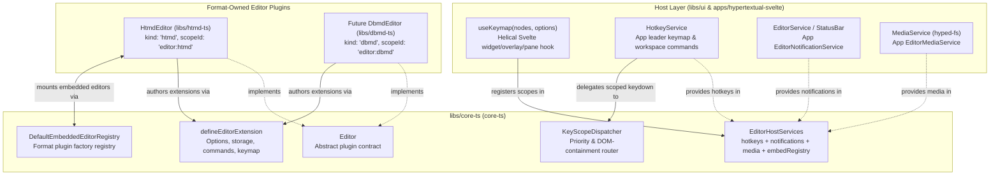
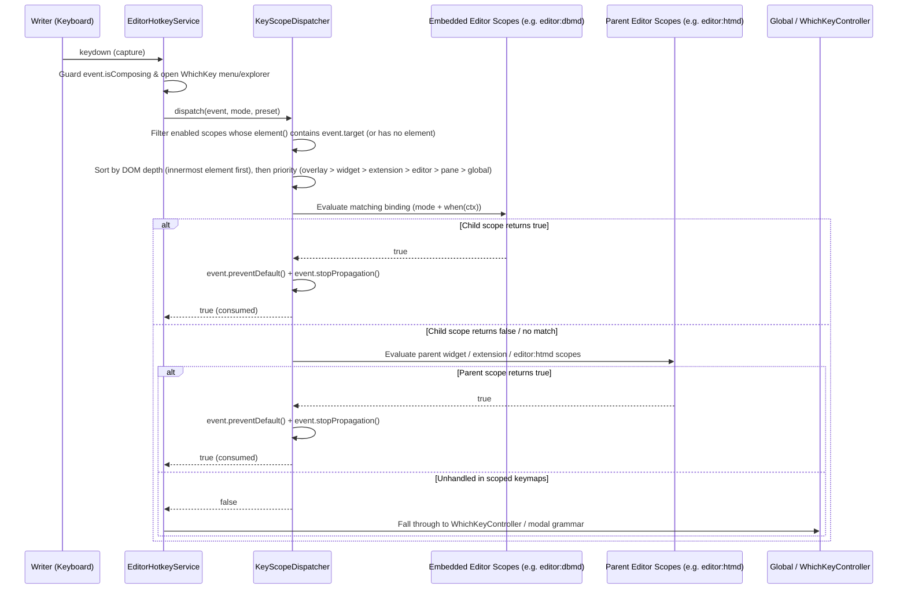

# core-ts — software architecture

## Overview

`core-ts` owns the TypeScript contracts for Hypertextual's multi-format editor plugin system. Each document or block format (`HtmdEditor` in `htmd-ts`, future `DbmdEditor`, or embedded diagram and whiteboard editors) implements the `Editor` and `EditorFormatAdapter` interfaces from `core-ts`. Format editors build extensions with `defineEditorExtension`, register shortcuts with `KeyScopeDispatcher`, and connect to the host app through `EditorHostServices`.

`core-ts` does not depend on any UI framework (`svelte`, `react`) or editor engine (`@tiptap/*`, `prosemirror-*`). Format libraries can run inside the Hypertextual desktop application or standalone in external web hosts.

## Requirement

### Functional

- Define a common editor and format-codec interface for all document and block formats.
- Define a uniform extension model for editor options, state storage, commands, and keyboard shortcuts.
- Route keyboard shortcuts across active overlays, widgets, extensions, editors, panes, and global bindings in priority order.
- Route shortcuts to the innermost focused editor first when one editor embeds another.
- Connect editors to host services for keyboard shortcuts, user notifications, media reading and writing, and embedded child editors.

### Non-Functional

- Keep `libs/core-ts` free of `@tiptap/*`, `prosemirror-*`, `svelte`, Tauri, and filesystem dependencies.
- Provide a standalone keyboard service when an editor runs without an application hotkey controller.
- Expose active shortcut metadata so help views (`<leader>?`) can list available bindings for the current mode.

## Design

### Components and Responsibilities



- `types.ts` defines the public interfaces for `Editor`, `EditorFormatAdapter`, `EditorDocument`, `EditorExtension`, `KeyBinding`, `Keymap`, `KeyScopeOptions`, `EditorHotkeyService`, `EditorNotificationService`, `EditorMediaService`, `EmbeddedEditorRegistry`, and `EditorHostServices`.
- `extension.ts` implements `defineEditorExtension`, supporting immutable `.configure(options)` and `.extend(overrides)` composition for node, mark, and behavior extensions.
- `key-scope.ts` implements `KeyScopeDispatcher`, `normalizeKeyEvent`, and `createStandaloneHotkeyService`, ordering registered key scopes by DOM containment (`outer.contains(inner)`) and priority tier (`overlay` > `widget` > `extension` > `editor` > `pane` > `global`).
- `registry.ts` implements `DefaultEmbeddedEditorRegistry`, mapping format identifiers (`'htmd'`, `'dbmd'`, etc.) to editor plugin factories so parent editors can mount child editors without importing concrete plugin packages directly.

### Data and Control Flow

#### Scoped Keystroke Resolution Across Parent and Embedded Editors

When a keystroke occurs, the root `EditorHotkeyService` (either the app's `HotkeyService` or `createStandaloneHotkeyService()`) inspects composition and overlay state, then dispatches the event through `KeyScopeDispatcher`:



1. If focus is inside an embedded child editor (such as a `DbmdEditor` inside an `HtmdEditor` block), scopes bound to the child editor DOM run before scopes bound to the outer editor. Pressing `Escape` inside the child editor triggers its `editor:dbmd` exit binding (`onExitToParent()`) and returns focus to the parent block.
2. Within the same editor container, `overlay` scopes run first, followed by `widget`, `extension`, `editor`, `pane`, and `global` scopes.
3. Each handler has the signature `(ctx: TCtx, event: KeyboardEvent) => boolean`. Returning `true` consumes the event (`preventDefault()` and `stopPropagation()`). Returning `false` passes the event to the next scope.

### Interfaces and Contracts

| Contract | Purpose |
| --- | --- |
| `Editor<TDoc, TCommandMap>` | Lifecycle (`mount`, `destroy`), document state (`getDocument`, `setDocument`, `setEditable`), serialization (`serialize`, `deserialize`), supported formats (`formats`), focus, analytics (`getCounts`), typed commands (`execCommand`), and per-editor keyscope metadata (`kind`, `scopeId`, `keymap`). |
| `EditorFormatAdapter<TDoc>` | Static plugin contract (`kind`, `formats`, `supportsFile`, `stripExtension`, `isUntitledFile`, `isUnsupportedFileError`, `deserialize`, `serialize`, `extractTitle`) for format-neutral host services. |
| `EditorDocument<TDoc>` | In-memory document model (`source`, `content`, `editable`, `title`, `issues`, `imageSources`, `displayImages`, `transformImages`, `update`, `serialize`, `copyDraft`) returned by `deserialize(source)`. |
| `EditorExtension<TOptions, TStorage, TCtx, TCommands>` | Built with `defineEditorExtension(spec)`. Supports `.configure(partialOptions)` (including option-level `keymap` overrides) and `.extend(overrides)` (passing `(ctx, parent)` to `commands` and `keymap` callbacks). |
| `KeyBinding<TCtx>` / `Keymap<TCtx>` | Declarative keybinding definition with `id`, `key`, `label`, `description`, `category`, `mode`, `when(ctx, event)`, and `run(ctx, event) => boolean`. |
| `KeyScopeOptions<TCtx>` | Scoped keymap registration with `id`, `priority` (`'overlay' \| 'widget' \| 'extension' \| 'editor' \| 'pane' \| 'global'`), `element?: () => HTMLElement \| null`, `enabled?: () => boolean`, `getContext: () => TCtx`, and `keymap`. |
| `EditorHotkeyService` | Host service for registering key scopes, commands, and modal targets, querying/setting `EditorMode` and `EditorPreset`, and inspecting active bindings. |
| `EditorNotificationService` | Host service receiving `EditorNotification` (`level`, `message`, `code`, `detail`) from editors and extensions. |
| `EditorMediaService` | Host service for reading (`get`, `batchGet`), writing/importing (`write(file)`), and restoring portable media origins (`toPortableSource`) via `hyped-fs` for local storage and future cloud sync. |
| `EmbeddedEditorRegistry` | Host registry mapping editor `kind` strings (`'htmd'`, `'dbmd'`, etc.) to `Editor` factories for recursive editor embedding. |
| `EditorHostServices` | Bundle of `{ hotkeys?, notifications?, media?, embedRegistry? }` passed to every `Editor` instance and UI wrapper. |

```ts
import {
  defineEditorExtension,
  createStandaloneHotkeyService,
  DefaultEmbeddedEditorRegistry,
  type Editor,
  type EditorHostServices,
  type Keymap,
} from 'core-ts'
```

## Implementation

### Ownership Boundaries

- `libs/core-ts/src/types.ts` owns all structural interfaces and type aliases.
- `libs/core-ts/src/extension.ts` owns `defineEditorExtension` and the immutable `.configure()` / `.extend()` builder chain.
- `libs/core-ts/src/key-scope.ts` owns key normalization (`normalizeKeyEvent`), `KeyScopeDispatcher`, and `createStandaloneHotkeyService`.
- `libs/core-ts/src/registry.ts` owns `DefaultEmbeddedEditorRegistry`.
- Format-specific schemas, ASTs, and rendering engines stay in their respective format libraries (`libs/htmd-ts`, future `libs/dbmd-ts`).

### Testing

Colocated integration and unit tests in `libs/core-ts/src/core.test.ts` verify:

- Priority ordering (`overlay` -> `widget` -> `extension` -> `editor` -> `pane` -> `global`) and fallthrough when a handler returns `false`.
- Nested DOM containment ordering when an embedded child editor (`editor:dbmd`) is mounted inside a parent editor (`editor:htmd`).
- Mode filtering (`normal`, `select`, `insert`, `jump`), `when(ctx)` predicates, and IME composition / overlay guards.
- `defineEditorExtension` option defaults, `.configure()` overrides, `.extend()` inheritance, and storage initialization.
- `DefaultEmbeddedEditorRegistry` registration, lookup, instantiation, and service propagation.

## References

- [System architecture](index.md)
- [htmd-ts format and editor plugin architecture](htmd-ts/index.md)
- [HtmdEditor Svelte component](ui/htmd-editor.md)
- [Keybindings specification](../keybindings/index.md)
