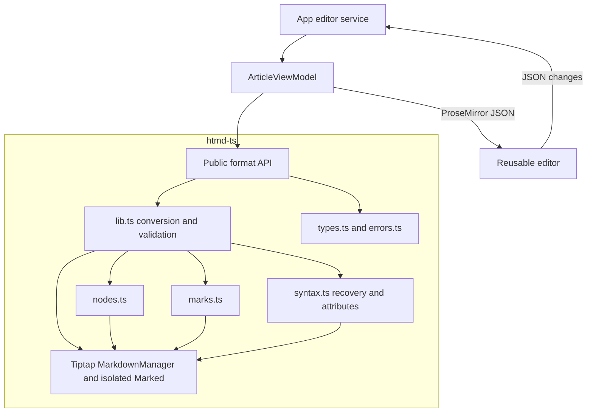
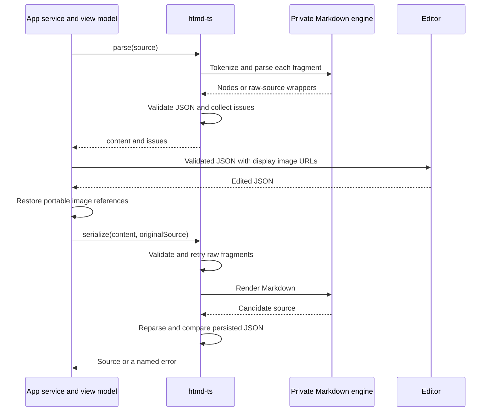

# htmd-ts — software architecture

## Overview

`htmd-ts` owns the HTMD Markdown format and synchronous conversion between UTF-8 file contents and native ProseMirror JSON. The app passes complete source strings or JSON documents to the SDK, a package with a public conversion API. The app owns filesystem access, media loading, editor instances, drafts, autosave, and recovery controls.

Tiptap Markdown and Marked are private implementation dependencies. The public boundary supports a later Rust implementation without exposing these engines. Rust conversion, source positions, an LSP, and collaborative storage remain future work.

## Requirement

### Functional

- Parse supported Markdown into native ProseMirror JSON with schema defaults.
- Write every supported node, mark, and persisted attribute without losing content when the file reopens.
- Use CommonMark and GFM for standard elements and established syntax for notices.
- Preserve custom component data for mentions, bookmarks, and YouTube embeds.
- Retain unsupported or malformed fragments as editable raw-source nodes with diagnostic metadata.
- Return recoverable issues so each client controls warning and rejection behavior.
- Preserve unchanged source bytes and retain source conventions after edits.

### Non-Functional

- Keep conversion synchronous and independent of Svelte, Tauri, filesystems, and network requests.
- Exchange complete source strings, ProseMirror JSON, and plain issue records through the public API.
- Keep parser instances, extension definitions, and engine schemas private.
- Demonstrate syntax and full save/reopen behavior through public BDD integration examples.

## Design

### Components and Responsibilities



`index.ts` exports the format API and its contracts. `lib.ts` composes a private schema and Markdown engine, validates documents, collects issues, and guards writes. `nodes.ts` and `marks.ts` reuse Tiptap definitions and specialize format behavior. `syntax.ts` supplies attribute handling, unsupported-token recovery, and internal rendering helpers.

The reusable editor has no SDK dependency. The app connects both packages and validates parsed JSON against the editor schema. The app also restores portable image references before serialization.

### Data and Control Flow



The SDK keeps its schema and engine at module scope. It retains no per-article document session. The caller supplies `originalSource` when it needs byte preservation.

If the document is unchanged, serialization returns the original source exactly. After edits, serialization retains its byte-order mark, line-ending convention, and final-newline convention. A byte-order mark is an optional marker at the start of a UTF-8 file.

### Interfaces and Contracts

| Public API | Input | Output |
| --- | --- | --- |
| `parse` | Complete source string | `ParseResult { content, issues }` |
| `validateDocument` | Native ProseMirror JSON | Validated JSON with defaults |
| `serialize` | Native ProseMirror JSON and optional `{ originalSource }` | Complete Markdown string |

```ts
import { parse, serialize, validateDocument } from 'htmd-ts'

const originalSource = '# Article\n\nSome *italic* text.\n'
const { content, issues } = parse(originalSource)
const checked = validateDocument(content)
const savedSource = serialize(checked, { originalSource })
```

`JSONContent` defines `type`, `attrs`, `content`, `marks`, and `text` as structural JSON fields. Callers do not need Tiptap imports. Each `ParseIssue` carries `code`, syntax `kind`, `message`, and the preserved `source` fragment. Its code is `unsupported-syntax` or `invalid-syntax`.

Validation rejects unknown nodes, marks, attributes, invalid values, and invalid nesting. It removes display-only image `srcset` and ordered-list presentation type. The app owns display image URLs and restores portable references before writing.

#### Markdown syntax

Headings, paragraphs, lists, task items, quotes, code, links, and images use CommonMark or GFM. Notices use GitHub blockquote markers. Underline, text color, highlight, and additional link metadata use CommonMark inline HTML.

<!-- prettier-ignore -->
```md
# Article

Some **bold**, *italic*, ~~struck~~, and `code` text.

Some <u>underlined text</u>, <mark style="background-color:var(--chart-3)">highlighted text</mark>, and <span style="color:var(--danger)">colored text</span>.

- [x] Completed task
- [ ] Pending task


> [!WARNING] Take care
> Notice body with **formatting**.

[mention id="post-1" label="An article" type="post"]

[url-mention url="https://example.com" title="Example"]

:::bookmark {url="https://example.com" title="Example" description="A saved link"} :::

:::youtube {url="https://www.youtube.com/watch?v=example&amp;t=90"} :::
```

Custom mention and card syntax retains component data. YouTube URLs retain timestamps. YouTube embeds omit titles. The parser removes legacy video titles from document data, while an unchanged source session keeps the original file. A later edit drops those titles when the article is saved. The format and editor omit text alignment. Responsive image source sets remain frontend presentation state.

Empty paragraphs use `<p></p>`. Formatted boundary whitespace uses inline HTML. Plain-text boundary whitespace and unfinished block prefixes use numeric character references. Adjacent lists use alternating standard markers so parsing preserves separate list nodes.

#### Recovery and errors

Unsupported or malformed fragments become `unparsedBlock` or `unparsedInline` nodes. Their content retains raw text. Their `kind` and `reason` attributes describe the failure. Supported siblings remain editable, and clients can style or hide wrappers without dropping their saved source.

Serialization emits raw fragments directly and retries parsing after edits. A repaired fragment can become a recognized node. Unreferenced link definitions remain raw blocks while Marked resolves references.

| Result or error | Exact purpose |
| --- | --- |
| `issues` | Recoverable unsupported or invalid source with preserved fragments. The client chooses warning or rejection behavior. |
| `InvalidDocumentError` | Supplied JSON has unknown nodes, marks, attributes, invalid values, or invalid structure. |
| `MarkdownParseError` | A fatal engine failure prevents valid JSON after local recovery. |
| `MarkdownSerializationError` | Rendering fails, raw inline source escapes its paragraph, or reopening changes persisted content or attributes. |

The app retains failed drafts and owns save recovery. A whole-source read-only preview is an app response to a fatal parsing failure.

## Implementation

### Engine adapters and extension points

Standard definitions come from Tiptap StarterKit and task-list extensions. The SDK uses native Markdown parsing and rendering hooks. Custom atomic elements use Tiptap's inline and block Markdown-spec helpers.

An isolated Marked instance prevents tokenizer changes from reaching other consumers. Numbered lists use Marked's CommonMark tokenization to retain list boundaries. Their inline tokens pass through normal paragraph parsing. Render-only attributes choose list markers and preserve whitespace without changing the public JSON schema.

`nodes.ts` groups node definitions. `marks.ts` groups mark families and the supported inline HTML subset. New format elements belong in those modules with explicit parsing, writing, and recovery examples. Svelte components render the resulting JSON separately.

### Integration examples and fixtures

Colocated `nodes.test.ts`, `marks.test.ts`, and `lib.test.ts` exercise the public API. Nested BDD groups cover elements and variants with literal source, expected JSON, and full write/reopen behavior. The complete Markdown fixture pairs with explicit expected JSON under `libs/htmd-ts/fixtures`.

App compatibility cases live in `editorService.test.ts`. The shared browser suite covers editing through rendered controls and reopening persisted files. The SDK has no separate browser runner. Test commands and setup belong in the development guide.

## References

- [Library entry point](../../libs/htmd-ts/README.md)
- [Public API exports](../../libs/htmd-ts/src/index.ts)
- [Public types](../../libs/htmd-ts/src/types.ts)
- [Conversion and validation](../../libs/htmd-ts/src/lib.ts)
- [Node definitions and examples](../../libs/htmd-ts/src/nodes.test.ts)
- [Mark examples](../../libs/htmd-ts/src/marks.test.ts)
- [Complete Markdown fixture](../../libs/htmd-ts/fixtures/editor-roundtrip.md)
- [Expected fixture JSON](../../libs/htmd-ts/fixtures/editor-roundtrip.json)
- [System architecture](index.md)
- [Workspace persistence](hyped-fs.md)
- [Editor contract](ui/document-editor.md)
- [Development commands](../development.md)
