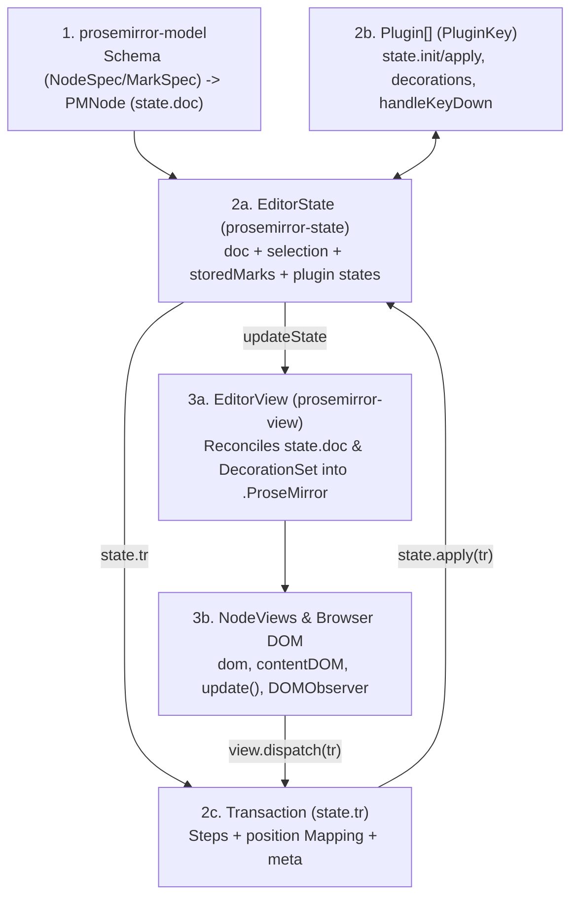
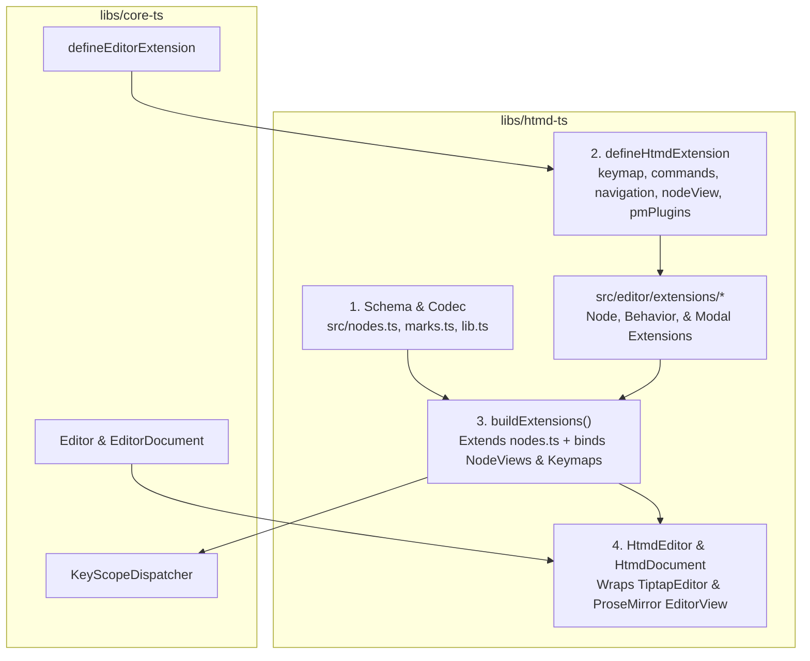
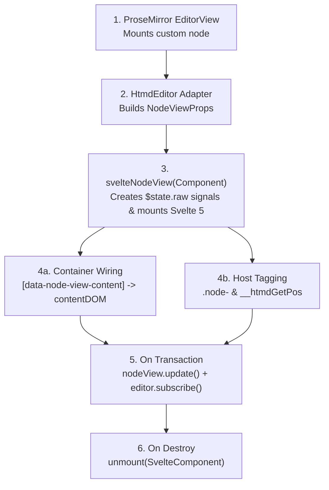
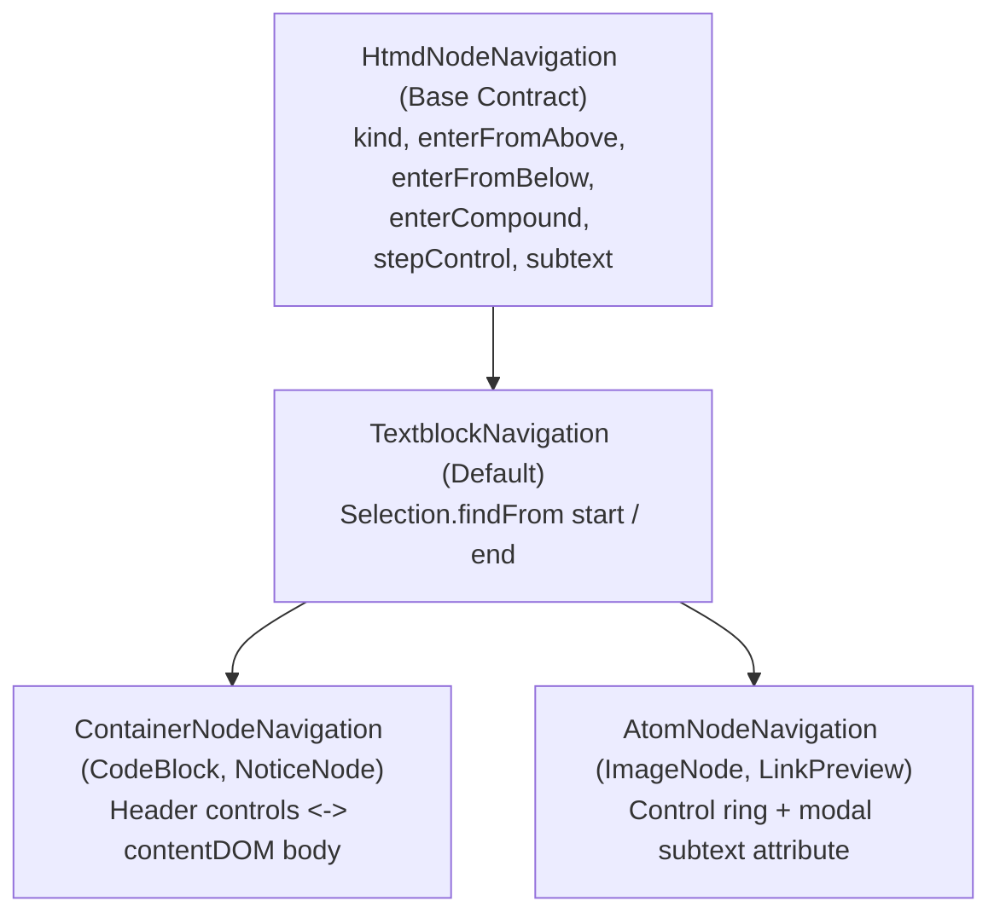
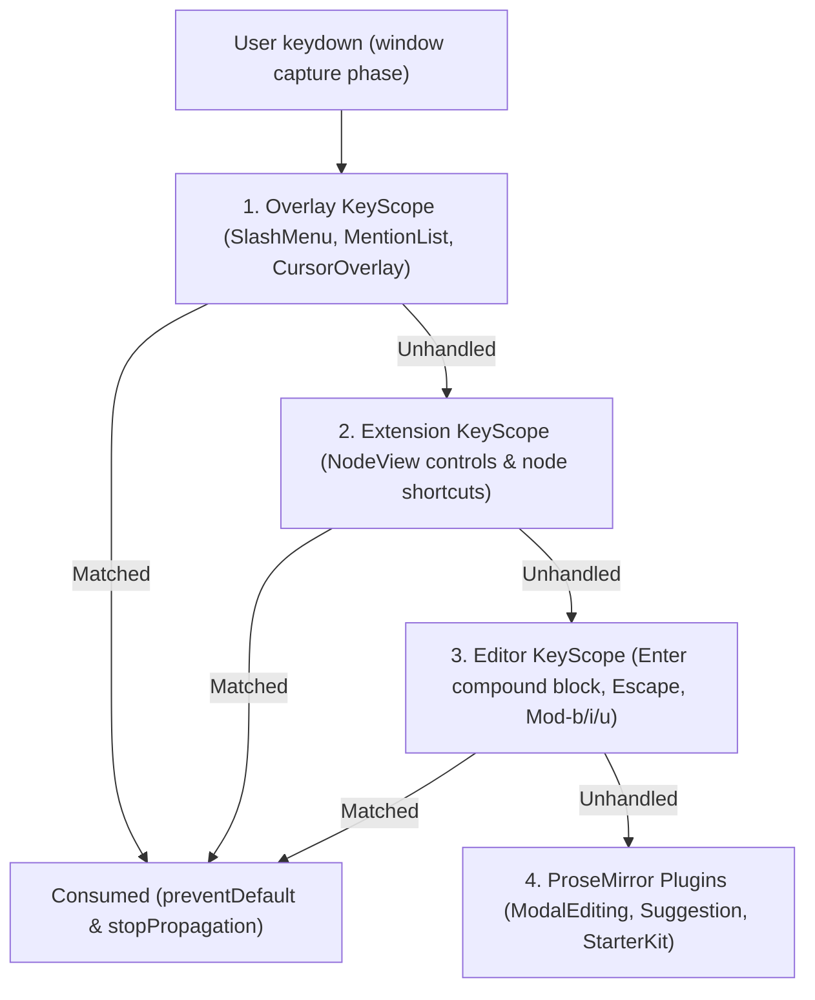
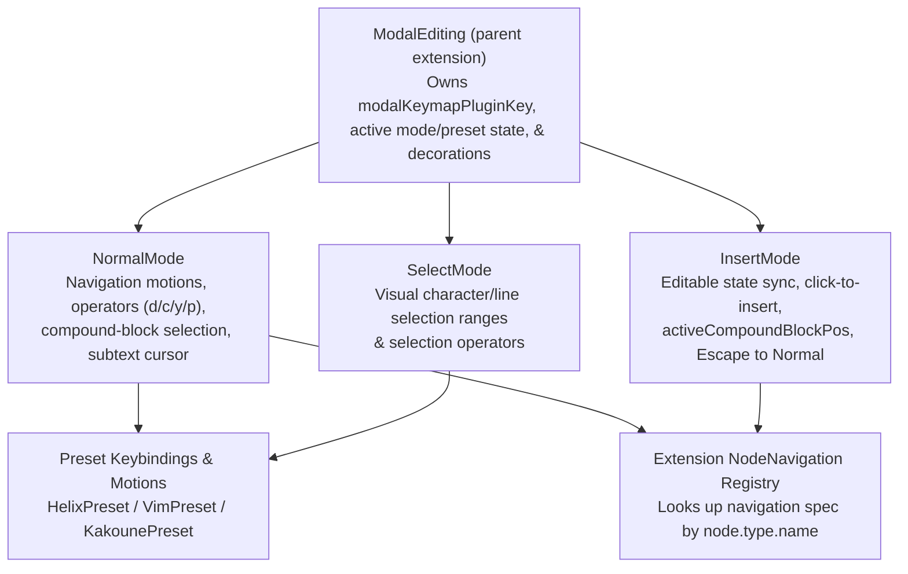

# HTMD editor, ProseMirror, Tiptap, and Svelte UI — software architecture

## Overview

`libs/htmd-ts` implements the HTMD rich-text editor (`HtmdEditor`) and Markdown codec (`HtmdDocument`, `parse`, `serialize`). Externally, `htmd-ts` exposes engine-neutral contracts from `libs/core-ts` (`Editor`, `EditorFormatAdapter`, `EditorDocument`, `EditorExtension`, `Keymap`) so `libs/ui` and `apps/hypertextual-svelte` never import `@tiptap/*` or `@tiptap/pm/*`.

Internally, `htmd-ts` runs on **ProseMirror** (`@tiptap/pm/*`) for document state, transactions, DOM rendering, and plugins, with **Tiptap** (`@tiptap/core`, `@tiptap/starter-kit`, `@tiptap/markdown`) acting as an internal schema/extension compiler and Marked.js tokenizer bridge. `libs/ui/src/editor` layers Svelte 5 UI on top of `HtmdEditor` by mounting Svelte components as ProseMirror `NodeView`s (`svelteNodeView`) and anchoring Svelte toolbars, suggestion menus, and insertion popovers to editor coordinates.

This document explains:

1. **ProseMirror's architecture** (`prosemirror-model`, `prosemirror-state`, `prosemirror-view`).
2. **Tiptap's architecture** and how Tiptap compiles extensions into ProseMirror primitives.
3. **How `htmd-ts` hooks into Tiptap and ProseMirror** (and how we isolate Tiptap so it can be removed later).
4. **How `libs/ui/src/editor` uses `HtmdEditor` and adds Svelte 5 UI** (`NodeView`s, `BubbleMenu`, `SlashMenu`, `MentionList`, `CursorOverlay`).
5. **How keybindings, selection, and navigation are inherited and overridden at the extension level**.

## Requirement

### Functional

- Expose `HtmdEditor` and `HtmdDocument` as `core-ts` plugins for `.htmd` and `.md` files.
- Share one canonical HTMD document schema (`src/nodes.ts` and `src/marks.ts`) across Markdown parsing, Markdown serialization, document validation, and interactive editing.
- Author editor extensions (`src/editor/extensions/*`) via `defineHtmdExtension` with extendible/overridable `keymap`, `commands`, `navigation`, `nodeView`, and ProseMirror plugins (`// pm ---`).
- Allow node extensions to inherit default block/inline selection and navigation behaviors (`enterFromAbove`, `enterFromBelow`, `enterCompound`, `stepControl`, `subtext`) and override only what is specific to their DOM controls or body structure.
- Mount Svelte 5 components (`CodeBlockComponent`, `NoticeNodeView`, `ImageNodeView`, `LinkPreviewCard`, `UrlMentionPill`, `UnparsedNodeView`) inside ProseMirror `NodeView`s while keeping Svelte mounting logic inside `libs/ui`.
- Recover unsupported or malformed Markdown blocks, inline spans, and inline HTML marks as editable fallback nodes (`UnparsableBlockFallback`, `UnparsableInlineFallback`) without data loss.

### Non-Functional

- Keep `@tiptap/*` and `@tiptap/pm/*` private to `libs/htmd-ts`; never leak Tiptap or ProseMirror types into `libs/core-ts`, `libs/ui`, or `apps/hypertextual-svelte`.
- Avoid duplicating node schemas in `src/editor/extensions/*` or duplicating Tiptap's `Editor` type in `define-htmd-extension.ts`.
- Keep ProseMirror plugins in `// pm ---` and transaction/state handlers in `// helpers ---` so removing Tiptap later requires changing only `build-extensions.ts` and `htmd-editor.ts`.

## Design

### Components and Responsibilities

#### 1. ProseMirror Architecture (`@tiptap/pm/*`)

ProseMirror is the actual runtime engine powering `HtmdEditor`. Unlike HTML `contenteditable` editors that treat the browser DOM as the source of truth, ProseMirror enforces a strict **unidirectional data loop** across three modules:



##### 1.1 `prosemirror-model`: Schema, Document Tree, Marks, and Integer Positions

- **`Schema` (`NodeSpec` and `MarkSpec`)**: Defines every valid block node, inline node, and inline mark in the document:
  - `NodeSpec` declares `group` (`'block'` or `'inline'`), `content` expression (e.g. `'block+'` for `notice`, `'text*'` for `codeBlock`, empty `''` for atom nodes like `imageNode` and `linkPreview`), `inline`, `atom`, `attrs`, `parseDOM`, and `toDOM`.
  - `MarkSpec` declares inline formatting annotations (`bold`, `italic`, `underline`, `textColor`, `highlight`, `link`). **Crucial constraint**: In ProseMirror, a `Mark` is a flat metadata tag attached to a text/inline `Node`—a `Mark` cannot contain child nodes (`content`), cannot be an atom, and cannot mount a `NodeView`.
- **Flat Integer Positions (`0 .. doc.content.size`)**:
  - ProseMirror addresses every location in `state.doc` with a single flat integer index (`pos`).
  - Every opening token and closing token of a non-leaf node increments the position counter by `1`, and every character in a text node increments it by `1`:

```text
Document Tree                     Flat Position Indexing
-------------                     ----------------------
doc                               0                           (inside doc, before first block)
├─ heading (level=1)              0: <heading>  1: "H" 2: "i" 3: </heading> (nodeSize = 4)
├─ notice (type="info")           4: <notice>
│  └─ paragraph                   5:   <p>      6: "A" 7: "B" 8: </p>
│                                 9: </notice>                (notice nodeSize = 6)
└─ imageNode (atom=true)          10: <imageNode/>            (leaf atom nodeSize = 1, spans 10..11)
                                  11                          (doc.content.size = 11)
```

- **`ResolvedPos` (`state.doc.resolve(pos)` -> `$pos`)**: Given an integer `pos`, `doc.resolve(pos)` returns a `$pos` object that knows its ancestor chain (`$pos.depth`, `$pos.parent`, `$pos.node(d)`, `$pos.start(d)`, `$pos.end(d)`, `$pos.before(d)`, `$pos.after(d)`).
  - For example, at `pos = 6` (`"A"` inside the notice paragraph above):
    - `depth = 2` (`d = 1` is `notice`, `d = 2` is `paragraph`).
    - `$pos.before(1) = 4` (the exact position of the `notice` node itself), and `$pos.after(1) = 10` (the position immediately after `notice`).

##### 1.2 `prosemirror-state`: `EditorState`, `Selection`, `Transaction`, and `Plugin`

- **`EditorState`**: Immutable snapshot of the editor at a point in time, holding:
  1. `state.doc`: The root `PMNode`.
  2. `state.selection`: Either a `TextSelection` (caret/range with `$anchor` and `$head`), a `NodeSelection` (selecting a whole block/inline node at `selection.from`, used for atom blocks or compound block selection), or an `AllSelection`.
  3. `state.storedMarks`: Pending marks for the next typed character.
  4. Per-plugin state slots read via `pluginKey.getState(state)`.
- **`Transaction` (`state.tr`)**:
  - To change the document, selection, or plugin state, code creates `const tr = state.tr`, applies document steps (`tr.insert`, `tr.delete`, `tr.replaceWith`, `tr.setNodeMarkup`), updates the selection (`tr.setSelection(...)`), or attaches plugin metadata (`tr.setMeta(pluginKey, payload)`), and dispatches it via `view.dispatch(tr)`.
  - Whenever document steps modify positions, `tr.mapping` maps old integer positions to new integer positions (`tr.mapping.map(oldPos)`).
- **`Plugin` and `PluginKey`**:
  - ProseMirror plugins extend editor behavior through four hooks:
    - `state: { init(config, state), apply(tr, prevPluginState, oldState, newState) }`: Maintains reactive per-plugin state updated on every transaction (used by `ModalEditing` and `EditorOverlays`).
    - `props: { decorations(state), handleKeyDown(view, event), handleClick(view, pos, event), handlePaste(view, event, slice), nodeViews }`: Intercepts view events or supplies `DecorationSet`s (`Decoration.inline`, `Decoration.widget`, `Decoration.node`).
    - `view(editorView) -> { update(view, prevState), destroy() }`: Runs side effects after the DOM updates (used by `CurrentEmptyBlock`, `EditorOverlays`, and `InsertMode`).
    - `appendTransaction(transactions, oldState, newState)`: Appends a follow-up transaction when an invariant needs enforcement (used by `TitleHeading` to guarantee the document starts with an `<h1>`).

##### 1.3 `prosemirror-view`: `EditorView`, `DecorationSet`, and `NodeView`

- **`EditorView`**: Owns the `.ProseMirror` DOM element. When `view.dispatch(tr)` produces a new `EditorState`, `EditorView` diffs `state.doc` and `DecorationSet` against its internal view tree and patches only the changed DOM nodes. Simultaneously, a `DOMObserver` watches browser text input and selection changes inside `contenteditable` and converts them into ProseMirror `Transaction`s.
- **`NodeView`**: By default, ProseMirror renders a node using its `NodeSpec.toDOM` method. When a node needs custom interactive UI (like a code block with a language dropdown, a notice with a title input, or an image card with upload/caption controls), `EditorProps.nodeViews[nodeName](node, view, getPos, decorations, innerDecorations)` returns a `NodeView` object:
  - `dom`: The outer DOM element inserted into `.ProseMirror`.
  - `contentDOM` (optional): For **container nodes** (`notice` with `content: 'block+'`, `codeBlock` with `content: 'text*'`), `contentDOM` points to a child element inside `dom` where ProseMirror renders and manages the editable child content. For **atom nodes** (`imageNode`, `linkPreview`, `urlMention` with `atom: true`), `contentDOM` is omitted (`undefined`) and the node's DOM is completely controlled by the `NodeView`.
  - `update(newNode, decorations, innerDecorations) -> boolean`: Called when the node's attributes, children, or decorations change on a transaction. Returning `true` tells ProseMirror the `NodeView` updated itself in-place without recreating the DOM.
  - `selectNode()` / `deselectNode()`: Called when ProseMirror places or removes a `NodeSelection` on this node.
  - `stopEvent(event)` / `ignoreMutation(mutation)`: Prevents ProseMirror from hijacking events or DOM mutations inside custom `[contenteditable="false"]` controls (inputs, buttons, dropdowns).

---

#### 2. Tiptap Architecture (`@tiptap/*`) and How It Connects to ProseMirror

Tiptap is **not** a separate rich-text engine. It is a configuration bundler and lifecycle wrapper that compiles `Node.create()`, `Mark.create()`, and `Extension.create()` definitions into the ProseMirror primitives described above, plus a Marked.js bridge (`@tiptap/markdown`):


Specifically, Tiptap provides five glue mechanisms on top of ProseMirror:

1. **Unified Extension Packaging (`Node`, `Mark`, `Extension`)**:
   - In raw ProseMirror, a feature's schema (`NodeSpec`), commands, keymaps, input rules, `NodeView` constructor, and plugins are registered in separate places. Tiptap bundles them into one object (`Node.create({ name, group, content, addAttributes, parseHTML, renderHTML, addCommands, addNodeView, addProseMirrorPlugins })`).
2. **Schema Compilation (`addAttributes`, `parseHTML`, `renderHTML` -> ProseMirror `Schema`)**:
   - Tiptap converts `addAttributes()` + `parseHTML()` + `renderHTML()` into ProseMirror's `NodeSpec.attrs`, `NodeSpec.parseDOM`, and `NodeSpec.toDOM`.
3. **Command Manager and Shared Transaction Chains (`addCommands()`)**:
   - Tiptap collects `addCommands()` from every extension onto `editor.commands` and `editor.chain()`.
   - When `editor.commands.someCommand()` or `editor.chain().cmdA().cmdB().run()` executes, Tiptap creates **one shared ProseMirror `Transaction`** (`const tr = editor.state.tr`) and passes `CommandProps` (`{ editor, tr, state, view, dispatch, commands, chain }`) into each command callback, dispatching `tr` once at the end.
   - _Why this matters_: Inside an `addCommands()` callback, calling `editor.commands.insertContent(...)` starts a separate nested transaction on `editor.state.tr` and causes ProseMirror to throw `RangeError: Applying a mismatched transaction` when the outer command finishes. Commands inside `addCommands()` must always call `ctx.commands.*` or mutate `ctx.tr` directly.
4. **StarterKit**:
   - `@tiptap/starter-kit` bundles standard ProseMirror schemas and plugins (`Document`, `Paragraph`, `Text`, `Heading`, `Bold`, `Italic`, `Strike`, `Code`, `BulletList`, `OrderedList`, `ListItem`, `Blockquote`, `HorizontalRule`, `HardBreak`, and `prosemirror-history` undo/redo).
5. **Markdown Tokenizer Bridge (`@tiptap/markdown` / `MarkdownManager`)**:
   - Connects Marked.js tokenization to each node/mark's `markdownTokenizer`, `parseMarkdown`, and `renderMarkdown` specs in `src/nodes.ts` and `src/marks.ts` to convert Markdown strings <-> `JSONContent`.

---

#### 3. How `htmd-ts` Connects to Tiptap and ProseMirror

`libs/htmd-ts` connects to Tiptap and ProseMirror across four internal layers:



1. **Single Source of Truth for Schema (`src/nodes.ts` and `src/marks.ts`)**:
   - Every HTMD node (`Notice`, `Image`, `LinkPreview`, `InternalMention`, `UrlMention`, `HeadingNodeWithId`, `UnparsableBlockFallback`, `UnparsableInlineFallback`) and mark (`TextColor`, `Highlight`, `Underline`, `Link`) defines its schema attributes, HTML parser/renderer (`parseHTML`, `renderHTML`), and Markdown parser/serializer (`parseMarkdown`, `renderMarkdown`) once in `src/nodes.ts` and `src/marks.ts`.
   - `define-htmd-extension.ts` does **not** re-declare node schema properties (`group`, `content`, `inline`, `atom`, `attributes`, `parseHTML`, `renderHTML`) and does **not** define a fake `HtmdInternalEditor` wrapper.
2. **Interactive Extension Definitions (`src/editor/define-htmd-extension.ts` & `src/editor/extensions/*`)**:
   - Extensions in `src/editor/extensions/*` attach interactive editor capabilities to the canonical schema nodes or define standalone editor behaviors:
     - `keymap`: Declarative `Keymap<HtmdCommandContext>` registered in `KeyScopeDispatcher` at `priority: 'extension'`.
     - `commands`: Editor commands operating on `HtmdCommandContext` (`{ editor, state, view, tr, dispatch, commands }`).
     - `navigation`: Inheritable/overridable selection and navigation hooks for block/inline elements.
     - `nodeView`: Optional `NodeViewRenderer` passed via extension options (`options.nodeView`).
     - `pmPlugins`: Pure ProseMirror `Plugin`s defined in the `// pm ---` section of the extension file.
3. **Bridge to Tiptap/ProseMirror (`src/editor/build-extensions.ts`)**:
   - Looks up the canonical node from `src/nodes.ts` by name (`SCHEMA_NODE_BY_NAME[spec.name]`) and calls `.extend({ addOptions, addStorage, addCommands, addProseMirrorPlugins, addNodeView })` (or `Extension.create(...)` for behavior-only extensions).

---

#### 4. How Svelte UI (`libs/ui/src/editor`) Uses `HtmdEditor` and Adds UI

`libs/htmd-ts` has zero Svelte dependencies, and `libs/ui` has zero Tiptap/ProseMirror dependencies. Instead:

- `htmd-ts` exposes a clean, ProseMirror-aligned **`NodeView`** contract (`{ dom, contentDOM?, update?, selectNode?, deselectNode?, destroy? }`) and **`NodeViewRenderer`** (`(props: NodeViewProps) => NodeView`), plus overlay anchoring (`attachOverlaySurface`) and state subscriptions (`editor.subscribe(listener)`).
- **Mounting Svelte 5 components is strictly the Svelte layer's responsibility** (`libs/ui/src/editor/components/svelte-node-view.svelte.ts` and `Editor.svelte`).

##### 4.1 Svelte Editor Component Hierarchy

```text
HtmdEditor.svelte (Viewport, Host Services Context, & Scroll Commands: zz / zt / zb / Ctrl-d / Ctrl-u)
└── Editor.svelte (Instantiates new HtmdEditor(...), syncs editable/mode, & mounts UI surfaces)
    ├── <div bind:this={element}> (.ProseMirror contenteditable root managed by HtmdEditor)
    │   ├── CodeBlockComponent.svelte  (mounted via svelteNodeView for `codeBlock` nodes)
    │   ├── NoticeNodeView.svelte      (mounted via svelteNodeView for `notice` nodes)
    │   ├── ImageNodeView.svelte       (mounted via svelteNodeView for `imageNode` nodes)
    │   ├── LinkPreviewCard.svelte     (mounted via svelteNodeView for `linkPreview` nodes)
    │   ├── UrlMentionPill.svelte      (mounted via svelteNodeView for `urlMention` nodes)
    │   └── UnparsedNodeView.svelte    (mounted via svelteNodeView for `unparsedBlock` / `unparsedInline`)
    │
    ├── BubbleMenu.svelte              (Floating selection toolbar anchored above text ranges)
    │   ├── FontColorPicker.svelte     (Text color & highlight swatch popover)
    │   └── LinkEditPopover.svelte     (Inline link URL editor popover)
    │
    ├── SlashMenu.svelte               (`/` command autocomplete menu, useKeyScope priority: 'overlay')
    ├── MentionList.svelte             (`@` internal mention menu, useKeyScope priority: 'overlay')
    └── CursorOverlay.svelte           (Cursor-anchored insertion popover container)
        ├── ImageInput.svelte          (Image upload / URL insertion form, useKeyScope priority: 'overlay')
        ├── BookmarkInput.svelte       (Link preview URL insertion form, useKeyScope priority: 'overlay')
        └── YouTubeInput.svelte        (YouTube embed URL insertion form, useKeyScope priority: 'overlay')
```

##### 4.2 How `svelteNodeView` Bridges ProseMirror `NodeView` to Svelte 5 Components

When ProseMirror encounters a node with a registered `nodeView` (e.g. `notice`, `codeBlock`, `imageNode`, `linkPreview`, `urlMention`), `HtmdEditor` calls the `NodeViewRenderer` supplied by `Editor.svelte`. `svelteNodeView` in `libs/ui/src/editor/components/svelte-node-view.svelte.ts` handles the entire Svelte 5 lifecycle:



There are two structural patterns for Svelte `NodeView` components:

```text
1. Container NodeView (NoticeNodeView.svelte, CodeBlockComponent.svelte)
+-----------------------------------------------------------------------+
| .node-notice (NodeView.dom, contenteditable="false" header controls)  |
| +-------------------------------------------------------------------+ |
| | [i] [ input: Notice title          ] [ Select: Info            v ]| | <- Svelte-managed controls
| +-------------------------------------------------------------------+ |
| | <div data-node-view-content> (NodeView.contentDOM)                | |
| |   <p>Editable ProseMirror child blocks live here...</p>           | | <- ProseMirror-managed body
| | </div>                                                            | |
| +-------------------------------------------------------------------+ |
+-----------------------------------------------------------------------+

2. Atom NodeView (ImageNodeView.svelte, LinkPreviewCard.svelte, UrlMentionPill.svelte)
+-----------------------------------------------------------------------+
| .node-imageNode (NodeView.dom, atom: true, contentDOM: undefined)     |
| +-------------------------------------------------------------------+ |
| |                         [ Replace ]  [ Remove ]  | | <- Svelte-managed media & actions
| | [ input.caption-input / span.caption-text (modal subtext cursor) ]| | <- Svelte-managed caption/subtext
| +-------------------------------------------------------------------+ |
+-----------------------------------------------------------------------+
```

##### 4.3 How Floating Menus and Overlays Connect to `HtmdEditor`

| UI Surface in `libs/ui/src/editor` | How `HtmdEditor` drives it | How Svelte renders & handles keys |
| --- | --- | --- |
| **`BubbleMenu.svelte`** | `BubbleMenu` subscribes to `editor.subscribe()` and checks `editor.isRangeSelectionActive()` + `editor.getSelectionFormattingState()`. Anchors via `editor.attachOverlaySurface(menuEl, { anchor: () => editor.getSelectionRange().from, placement: 'above' })`. | Renders mark toggle buttons (`Bold`, `Italic`, `Underline`, `Strike`, `Code`), `FontColorPicker`, and `LinkEditPopover`, calling `editor.toggleBold()`, `editor.setColor()`, `editor.setLink()`. |
| **`SlashMenu.svelte`** | `SlashCommands` extension (`slash-commands.ts`) runs `@tiptap/suggestion` on `/` and invokes `slashRender` callbacks (`onStart`, `onUpdate`, `onExit`) passed by `Editor.svelte`. | `Editor.svelte` mounts `SlashMenu` inside a surface anchored via `editor.attachOverlaySurface` at `slashMenuProps.range.to`. `SlashMenu` registers `useKeyScope({ priority: 'overlay' })` for `ArrowUp`, `ArrowDown`, `Enter`, and `Escape`. |
| **`MentionList.svelte`** | `InternalMention` extension (`internal-mention.ts`) runs `@tiptap/suggestion` on `@` and invokes `mentionRender` callbacks (`onStart`, `onUpdate`, `onKeyDown`, `onExit`). | `Editor.svelte` positions `MentionList` at `props.clientRect()` and forwards `onKeyDown` / `useKeyScope({ priority: 'overlay' })`. |
| **`CursorOverlay.svelte` + `ImageInput` / `BookmarkInput` / `YouTubeInput`** | Calling `editor.openOverlay('image' \| 'bookmark' \| 'youtube', pos, data)` updates `EditorOverlays` plugin state (`editor-overlays.ts`) and fires `onOverlayChange(activeOverlay)` in `Editor.svelte`. | `Editor.svelte` mounts `<CursorOverlay>` (anchored to `activeOverlay.position` via `editor.attachOverlaySurface`) wrapping the active input form, which registers `useKeyScope({ priority: 'overlay' })` for `Escape` and calls `editor.insertImage(...)` / `editor.insertLinkPreview(...)`. |

---

#### 5. Extendible Keybindings and Overridable Selection / Navigation at the Extension Level

Every editor capability—keybindings, commands, and node selection/navigation—is defined on its owning `HtmdExtension` so elements inherit sensible defaults and can override or extend any part of their behavior.

##### 5.1 Extending and Overriding Keybindings & Commands (`.extend()` and `.configure()`)

`defineEditorExtension` (`core-ts`) and `defineHtmdExtension` (`htmd-ts`) support two levels of customization:

1. **Per-instance keymap override via `.configure({ keymap })`**:
   - Every extension accepts an optional `keymap?: Keymap<HtmdCommandContext>` override in its configured options so a host or preset can remap or add bindings without defining a new extension:
     ```ts
     NoticeNode.configure({
       nodeView: svelteNodeView(NoticeNodeView),
       keymap: {
         'Mod-Shift-n': ({ commands }) => commands.insertNotice({ type: 'warning' }),
       },
     })
     ```
2. **Subclass inheritance & handler wrapping via `.extend()`**:
   - Calling `Extension.extend(overrides)` passes the parent's resolved `keymap(ctx)`, `commands(ctx)`, and `navigation(ctx)` to the child override functions so a derived extension can inherit, wrap, or replace specific bindings and behaviors:
     ```ts
     const CustomCodeBlock = CodeBlock.extend({
       keymap: (ctx, parentKeymap) => ({
         ...parentKeymap,
         'Shift-Enter': ({ state, view }) => exitCodeBlockBelow(state, view),
       }),
       navigation: (ctx, parentNav) => ({
         ...parentNav,
         enterFromAbove: (navCtx, pos, node) => {
           // Override entry from above to jump straight into code body instead of language select
           return focusCodeBodyStart(navCtx, pos)
         },
       }),
     })
     ```

##### 5.2 Inheritable Node Selection & Navigation (`navigation: HtmdNodeNavigation`)

Previously, node entry, control cycling, and modal subtext navigation were hardcoded in central `if (node.type.name === ...)` switch tables inside `define-htmd-extension.ts` (`focusBlockAtPos`) and `modal-editing.ts` (`COMPOUND_BLOCK_TYPES`, `SUBTEXT_BLOCK_TYPES`, `enterCompoundBlock`, `focusCompoundBlockControl`, `getNodeSubtextValue`).

Instead, `HtmdExtensionSpec` defines an inheritable **`navigation`** contract (`HtmdNodeNavigation`) with preset base factories (`createTextblockNavigation`, `createContainerNodeNavigation`, `createAtomNodeNavigation`) that each node extension inherits or overrides:



How the extension-level `navigation` contract works across the editor:

| Hook on `HtmdNodeNavigation` | Default Behavior (`TextblockNavigation`) | Container Override (`CodeBlock`, `NoticeNode`) | Atom Override (`ImageNode`, `LinkPreview`) |
| --- | --- | --- | --- |
| **`enterFromAbove(ctx, pos, node)`** _(Insert-mode `ArrowDown` or `Tab` from block above)_ | Places a ProseMirror `TextSelection` at the first selectable position inside the block. | Sets `activeCompoundBlockPos = pos` and focuses the first header control in `controls` (language `<Select>` on `CodeBlock`, title `<input>` on `NoticeNode`). | Sets `activeCompoundBlockPos = pos` and focuses the primary text input (`input.caption-input` on `ImageNode`, `input.url-input` on `LinkPreview`). |
| **`enterFromBelow(ctx, pos, node)`** _(Insert-mode `ArrowUp` or `Shift+Tab` from block below)_ | Places a ProseMirror `TextSelection` at the last selectable position inside the block. | Sets `activeCompoundBlockPos = pos` and places the caret on the last line of the container's editable `contentDOM` body. | Focuses the primary text input (`caption` or `url`) or last control in `controls`. |
| **`enterCompound(ctx, pos, node)`** _(Normal-mode `Enter` or `i` on a selected compound block)_ | Enters insert mode at the current cursor position. | `CodeBlock`: places caret at start of code body (`pos + 1`) and enters insert mode. `NoticeNode`: focuses `controls[0]` (title input) or body. | Focuses `controls[0]` (or subtext input at the subtext cursor offset when `i`/`a` is pressed in subtext mode). |
| **`stepControl(ctx, pos, node, target, dir)`** _(Insert-mode `Tab` / `Shift+Tab` inside node)_ | Moves focus to the next (`dir = +1`) or previous (`dir = -1`) block via `focusAfterBlock` / `focusBeforeBlock`. | Cycles through `controls[0..n-1]` <-> container `contentDOM` body <-> exits to adjacent block. | Cycles through `controls[0..n-1]` (`caption` -> `replace` -> `remove`) and exits to the adjacent block at the ends. |
| **`subtext?: { attr, textSelector, inputSelector }`** _(Normal-mode subtext motions `w`/`b`/`e`/`h`/`l`/`i`/`a`/`c`/`d`)_ | `undefined` (standard ProseMirror text motions apply). | `undefined` (normal-mode cursor moves inside the container's ProseMirror text body via `getInnerTextBounds`). | Declares `{ attr: 'caption' }` (`ImageNode`) or `{ attr: 'url' }` (`LinkPreview`) so `ModalEditing` automatically reads/writes the subtext attribute and renders `[data-pm-modal-cursor]` without hardcoding node names. |

### Data and Control Flow

#### 1. Keystroke Dispatch: `KeyScopeDispatcher` vs. ProseMirror `handleKeyDown`



#### 2. Modal Editing Architecture (`ModalEditing`)

Modal editing is decomposed into a parent `ModalEditing` extension that composes mode-specific and preset-specific extensions and queries the compiled `NodeNavigation` registry instead of hardcoding node names:



#### 3. Unparsable Fallback Nodes (`UnparsableBlockFallback` & `UnparsableInlineFallback`)

Because a ProseMirror `Mark` cannot hold editable raw source text (`content: 'text*'`) or mount a `NodeView`, `htmd-ts` recovers all unsupported or malformed Markdown—including unsupported or malformed inline HTML marks—into two fallback **Node** types:

| Fallback Extension | Node Name | Group / Inline | What recoveries map to it |
| --- | --- | --- | --- |
| `UnparsableBlockFallback` | `unparsedBlock` | `block` (`inline: false`) | Unsupported block directives (`:::unknown`), unsupported tables, raw HTML blocks, and link reference definitions (`syntax.ts`). |
| `UnparsableInlineFallback` | `unparsedInline` | `inline` (`inline: true`) | Unknown inline shortcodes (`[unknown]`), unmatched inline tokens, **and** unsupported or malformed inline HTML marks (`<font>`, unclosed `<u>`, invalid `style` attributes in `marks.ts`). |

### Interfaces and Contracts

#### Extension File Layout and Naming Conventions

Every extension file in `libs/htmd-ts/src/editor/extensions/` follows a strict 4-section layout with 80-column dividers (omitting empty sections):

````ts
// types ---------------------------------------------------------------------
export interface NoticeNodeOptions {
  nodeView?: NodeViewRenderer
  keymap?: Keymap<HtmdCommandContext>
}

// api -----------------------------------------------------------------------
/**
 * Callout notice block (`info`, `success`, `warning`, `error`) with an editable
 * header (title input + variant selector) and rich-text body.
 *
 * ```text
 * +---------------------------------------------------+
 * | [i] [ Notice title        ] [ Info            v ] |  <- header controls (Tab / ArrowUp / ArrowDown)
 * |---------------------------------------------------|
 * | Notice body paragraph...                          |  <- contentDOM (block+)
 * +---------------------------------------------------+
 * ```
 */
export const NoticeNode = defineHtmdExtension<NoticeNodeOptions>({ ... })

// pm ------------------------------------------------------------------------
// Pure ProseMirror Plugin and PluginKey definitions (when needed)

// helpers -------------------------------------------------------------------
// Named keymap and navigation handlers:
// handleTab, handleShiftTab, handleArrowUp, handleArrowDown, handleEnter, etc.
````

## Implementation

### Path to Removing Tiptap

Because Tiptap is confined to `libs/htmd-ts`:

1. **Outside `libs/htmd-ts`**: `libs/core-ts`, `libs/ui`, and `apps/hypertextual-svelte` interact exclusively with `HtmdEditor`, `HtmdDocument`, and `NodeViewRenderer`. Zero external files change when Tiptap is removed.
2. **Inside `libs/htmd-ts/src/editor/extensions/*`**:
   - Keeping ProseMirror plugins in `// pm ---`, navigation specs in `navigation`, and keymap handlers in `// helpers ---` (operating on ProseMirror `EditorState`, `Transaction`, and `EditorView`) means extension logic is already native ProseMirror code.
   - Replacing Tiptap with direct ProseMirror `Schema` + `EditorState.create({ schema, plugins })` + `new EditorView(mountEl, { state, nodeViews })` will only touch `build-extensions.ts` and `htmd-editor.ts`.

## References

- [htmd-ts software architecture](index.md)
- [core-ts editor plugin architecture](../core-ts.md)
- [HTMD editor (`HtmdEditor`)](../ui/htmd-editor.md)
- [Editor source ownership](../ui/editor-source.md)
