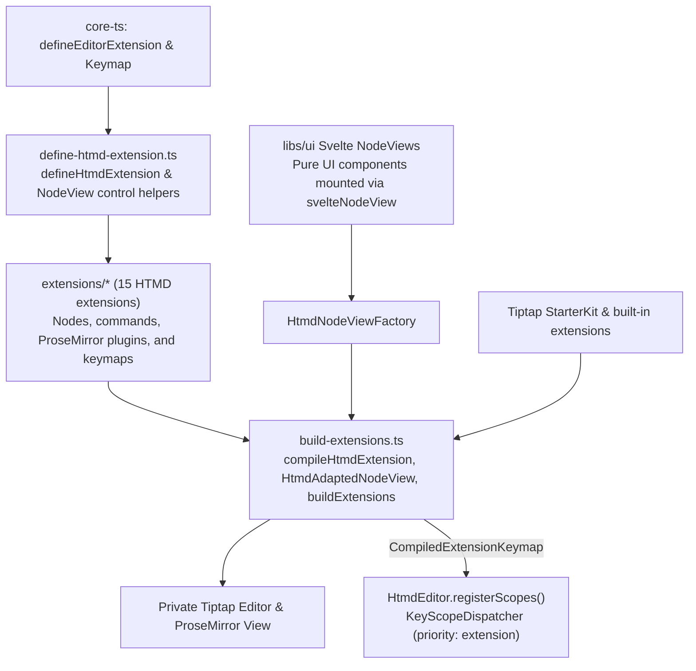
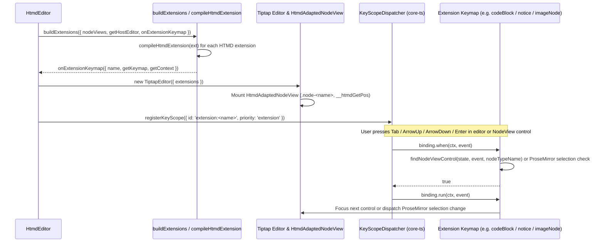

# HTMD editor extensions and compiler — software architecture

## Overview

The HTMD extension subsystem in `libs/htmd-ts/src/editor` defines the custom nodes, behaviors, commands, and keyboard shortcuts of `HtmdEditor` and compiles them into a private Tiptap and ProseMirror instance. Extension authors declare nodes and behaviors with `defineHtmdExtension` without importing `@tiptap/core`, while `build-extensions.ts` translates those specifications into Tiptap extensions, adapts framework-neutral `HtmdNodeViewFactory` instances into Tiptap `NodeView` objects, and registers extension keymaps with the host `EditorHotkeyService`.

UI rendering of custom block views (`CodeBlockComponent.svelte`, `NoticeNodeView.svelte`, `ImageNodeView.svelte`, `LinkPreviewCard.svelte`, `UrlMentionPill.svelte`) stays in `libs/ui`, while all node and control keyboard navigation lives inside the extensions in `libs/htmd-ts/src/editor/extensions`.

## Requirement

### Functional

- Define custom HTMD block and inline nodes (`codeBlock`, `notice`, `imageNode`, `linkPreview`, `urlMention`, `internalMention`, `heading`, `unparsedBlock`, `unparsedInline`) and editor behaviors (`modalKeymap`, `slashCommands`, `editorOverlays`, `pasteUrl`, `titleHeading`, `currentEmptyBlock`) using a single declarative contract.
- Support standard Tiptap capabilities (such as `#` heading input rules and `Enter` block splitting) directly through `StarterKit` without re-implementing built-in behavior.
- Mount framework-neutral custom block views (`HtmdNodeViewFactory`) and sync selection and attribute updates between ProseMirror and the mounted DOM.
- Route all node keyboard shortcuts—including `Tab`, `Shift+Tab`, `ArrowUp`, `ArrowDown`, and `Enter` inside both ProseMirror text bodies and non-editable NodeView header/caption/URL controls—through extension keymaps registered with `KeyScopeDispatcher`.

### Non-Functional

- Isolate `@tiptap/core` and `@tiptap/extension-*` imports to `build-extensions.ts` so extension modules depend only on `define-htmd-extension.ts` and ProseMirror state/view types.
- Keep Svelte NodeView components in `libs/ui` free of keymap registration so UI markup and keyboard bindings do not split across packages.
- Flush pending DOM mutations before running command contexts so cursor coordinates and text selections stay accurate during rapid keyboard input.

## Design

### Components and Responsibilities



- `define-htmd-extension.ts` wraps `defineEditorExtension` from `core-ts` with HTMD node schema fields (`group`, `content`, `inline`, `atom`, `attributes`, `parseHTML`, `renderHTML`), lifecycle hooks, `keymap`, `commands`, and `pmPlugins`. It also provides shared navigation helpers (`focusBlockAtPos`, `focusTextPosition`, `focusBeforeBlock`, `focusAfterBlock`, and `findNodeViewControl`) used by compound-block extensions.
- `extensions/*` contains the 15 HTMD extensions. Each compound-block extension (`code-block.ts`, `notice-node.ts`, `image-node.ts`, `link-preview.ts`) owns both ProseMirror body navigation and NodeView control navigation (`Tab`, `Shift+Tab`, `ArrowUp`, `ArrowDown`, `Enter`).
- `build-extensions.ts` owns three responsibilities:
  1. `HtmdAdaptedNodeView`: Bridges a framework-neutral `HtmdNodeViewFactory` to Tiptap's `NodeView` class, tags the wrapper element with `.node-<typeName>` and `__htmdGetPos`, resolves `[data-node-view-content]` for editable child blocks, and syncs `ProseMirror-selectednode` on selection changes.
  2. `compileHtmdExtension`: Maps an `HtmdExtension` specification onto `Node.create`, `Extension.create`, or a base Tiptap extension (`Heading.extend`, `CodeBlockLowlight.extend`, `Mention.extend`), wraps commands with `toCommandContext`, and extracts `CompiledExtensionKeymap` descriptors for `KeyScopeDispatcher`.
  3. `buildExtensions`: Assembles `StarterKit` (including native `Heading` input rules and `Enter` block splitting when `headingWithId` is false), third-party mark/list extensions, and the compiled HTMD extensions into a Tiptap `Extensions` array.

### Data and Control Flow

#### Extension Compilation and Keystroke Dispatch



When a node mounts with a custom view, `HtmdAdaptedNodeView.mount()` attaches `__htmdGetPos` to the `.node-<typeName>` root element. When the user presses a navigation key while focused inside a `[contenteditable="false"]` control (such as the code block language selector, notice title input, image caption input, or bookmark URL input), the event bubbles inside the editor scope root. `KeyScopeDispatcher` evaluates active `extension:<name>` scopes at `extension` priority. The owning extension calls `findNodeViewControl(state, event, nodeTypeName)` to resolve the control element, wrapper element, document position, and ProseMirror `Node`, and moves focus either to the next control or back into the ProseMirror document.

### Interfaces and Contracts

#### Extension Inventory

| Extension | File | Kind / Base | Responsibility |
| --- | --- | --- | --- |
| `CodeBlock` | `extensions/code-block.ts` | `node` (`codeBlockLowlight`) | Syntax-highlighted code block with `Tab`/`Shift+Tab` indentation and keyboard navigation between the code body, language selector, and copy button. |
| `NoticeNode` | `extensions/notice-node.ts` | `node` | Callout block (`info`, `success`, `warning`, `error`) with `insertNotice` command and keyboard navigation between the title input, variant selector, and body. |
| `ImageNode` | `extensions/image-node.ts` | `node` | Block image with `insertImage` command, two-step `Backspace` deletion, and keyboard navigation across the caption input, replace button, and remove button. |
| `LinkPreview` | `extensions/link-preview.ts` | `node` | Bookmark card and YouTube embed node with `insertLinkPreview` command and keyboard navigation between the URL input and remove button. |
| `UrlMention` | `extensions/url-mention.ts` | `node` | Inline URL pill with `insertUrlMention` command. |
| `InternalMention` | `extensions/internal-mention.ts` | `node` (`mention`) | `@` mention node and suggestion trigger. |
| `HeadingWithId` | `extensions/heading-with-id.ts` | `node` (`heading`) | Optional heading extension that assigns deterministic slug IDs when `headingWithId` is enabled. |
| `UnparsedBlock` | `extensions/unparsed-block.ts` | `node` | Editable raw-source block wrapper for unsupported Markdown blocks. |
| `UnparsedInline` | `extensions/unparsed-inline.ts` | `node` | Editable raw-source inline wrapper for unsupported Markdown spans. |
| `ModalKeymap` | `extensions/modal-keymap.ts` | `behavior` | Helix/Vim modal state machine, normal/select motions, compound-block selection, and subtext cursors. |
| `SlashCommands` | `extensions/slash-commands.ts` | `behavior` | `/` command palette suggestion plugin and default block insertion items. |
| `EditorOverlays` | `extensions/editor-overlays.ts` | `behavior` | Anchored popover state and `openOverlay` / `closeOverlay` commands for image, bookmark, YouTube, and link popovers. |
| `PasteUrl` | `extensions/paste-url.ts` | `behavior` | Converts pasted URLs into links, inline URL mentions, bookmarks, or YouTube embeds. |
| `TitleHeading` | `extensions/title-heading.ts` | `behavior` | Enforces a leading H1 title block when `enforceTitle` is enabled. |
| `CurrentEmptyBlock` | `extensions/current-empty-block.ts` | `behavior` | Marks the active empty paragraph with `.is-current-empty` for placeholder styling. |

#### NodeView Control Resolution Contract

```ts
export interface NodeViewControlTarget {
  target: HTMLElement
  wrapper: HTMLElement
  pos: number
  node: Node
}

export function findNodeViewControl(
  state: EditorState,
  event: KeyboardEvent,
  nodeTypeName: string,
): NodeViewControlTarget | null
```

`findNodeViewControl` verifies that `event.target` is inside a `[contenteditable="false"]` region within `.node-${nodeTypeName}`, reads the node position from `__htmdGetPos()` on the NodeView root element, and confirms that `state.doc.nodeAt(pos)` matches `nodeTypeName`.

## Implementation

### Dependency Direction

- `libs/core-ts` defines `defineEditorExtension` and `Keymap`.
- `libs/htmd-ts/src/editor/define-htmd-extension.ts` extends `defineEditorExtension` with ProseMirror state/view types and exports `findNodeViewControl`, `focusBlockAtPos`, `focusTextPosition`, `focusBeforeBlock`, and `focusAfterBlock`.
- `libs/htmd-ts/src/editor/extensions/*` imports only from `../define-htmd-extension.js`, `../types.js`, and `@tiptap/pm/*`.
- `libs/htmd-ts/src/editor/build-extensions.ts` is the sole module that imports `@tiptap/core`, `@tiptap/starter-kit`, and `@tiptap/extension-*`.
- `libs/ui/src/editor/components/*` renders Svelte 5 NodeView components and delegates all node keyboard shortcuts to `libs/htmd-ts/src/editor/extensions/*`.

## References

- [htmd-ts software architecture](../htmd-ts.md)
- [core-ts editor plugin architecture](../core-ts.md)
- [Extension contract and control helpers](../../../libs/htmd-ts/src/editor/define-htmd-extension.ts)
- [Tiptap compiler and NodeView adapter](../../../libs/htmd-ts/src/editor/build-extensions.ts)
- [Compound-block extensions](../../../libs/htmd-ts/src/editor/extensions/code-block.ts)
