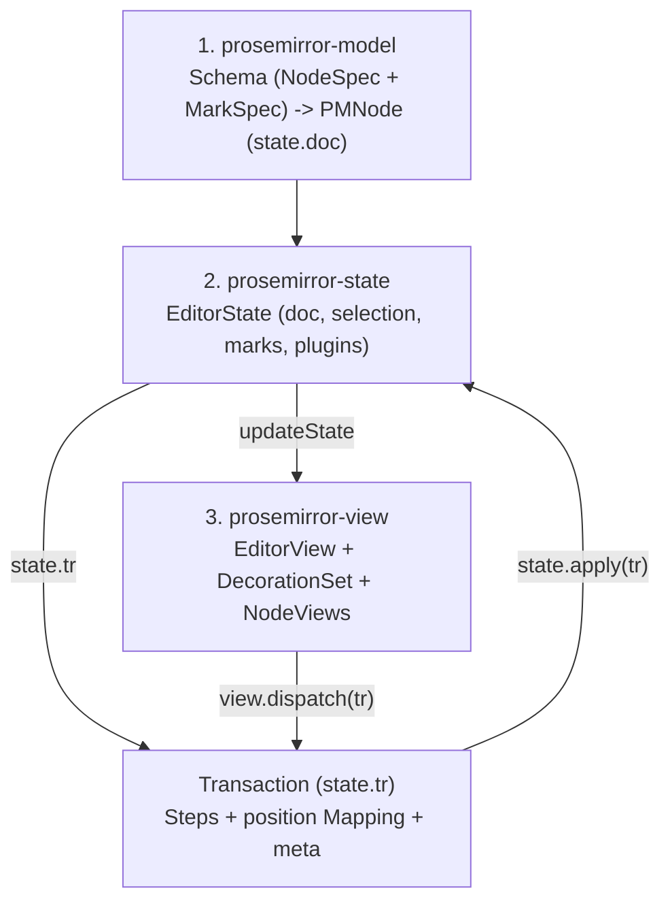
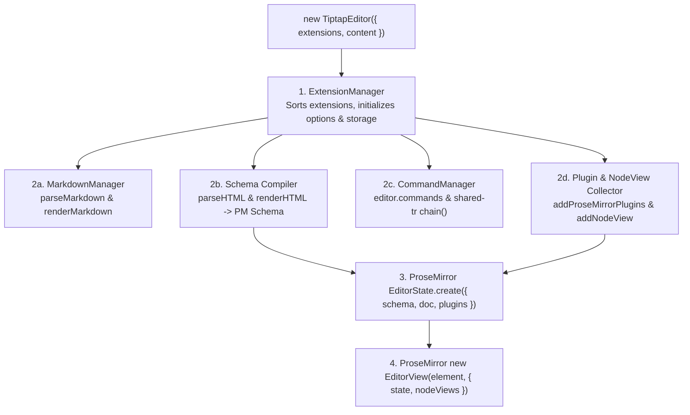
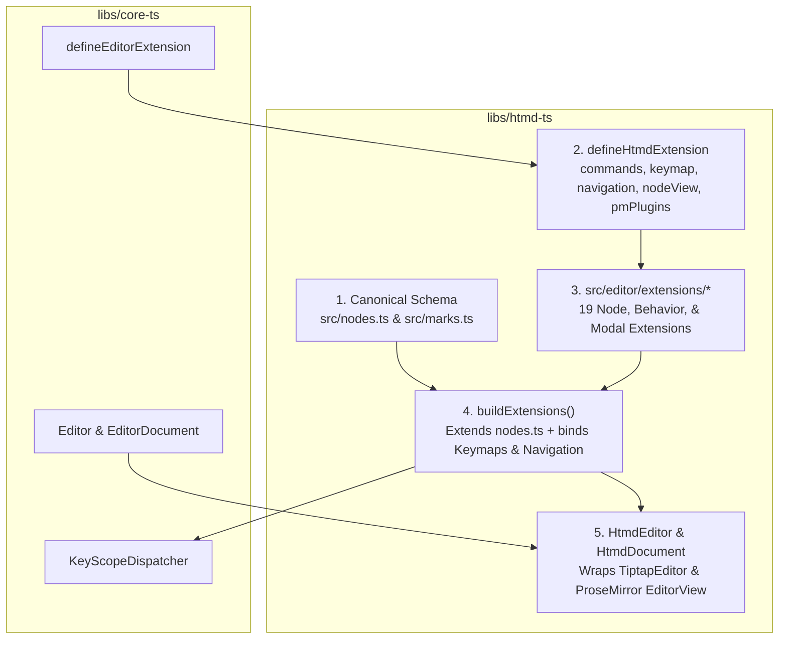
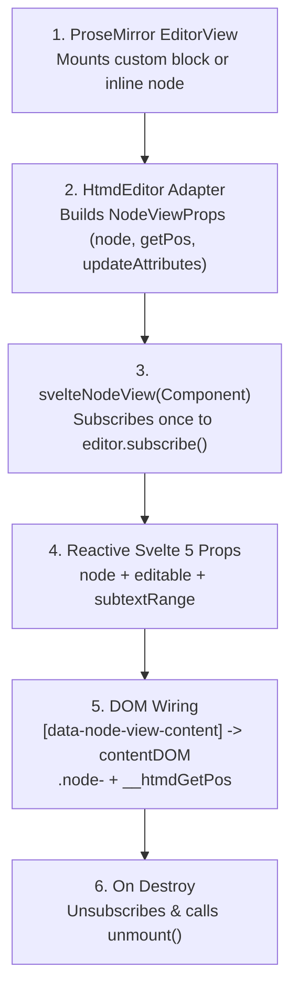
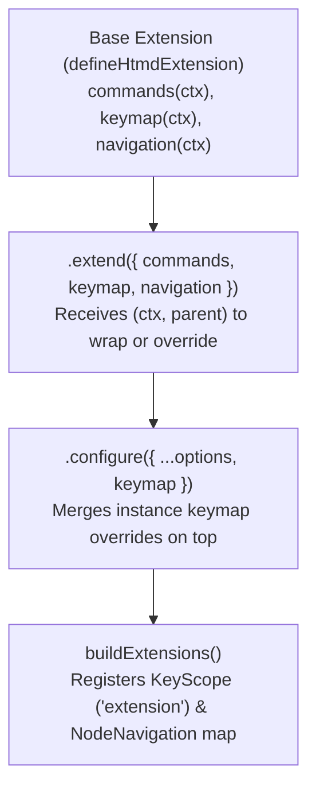
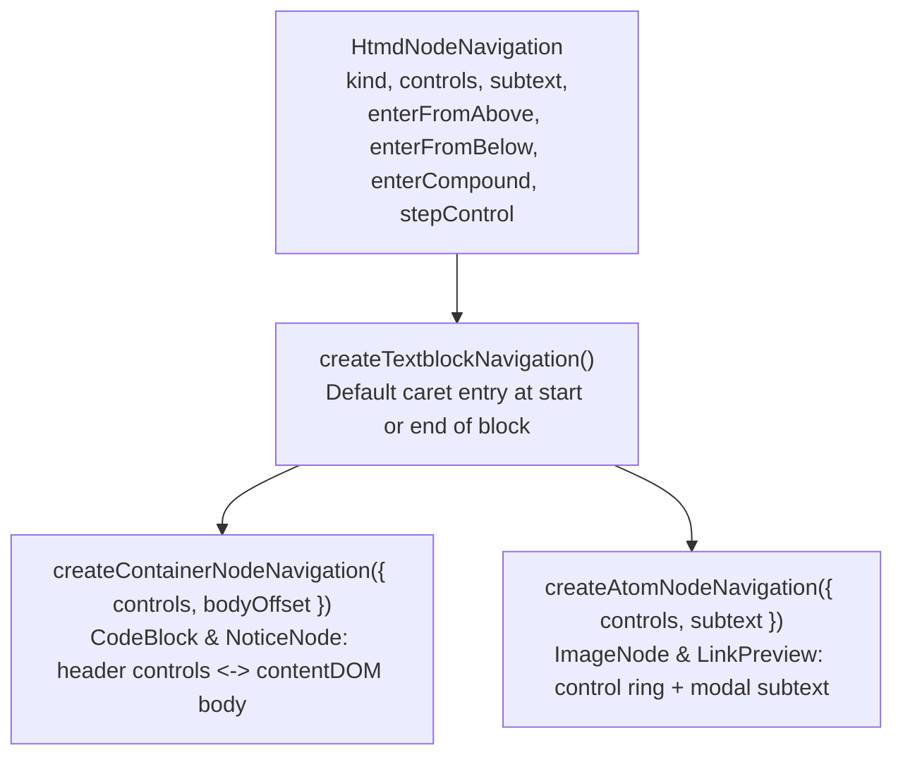
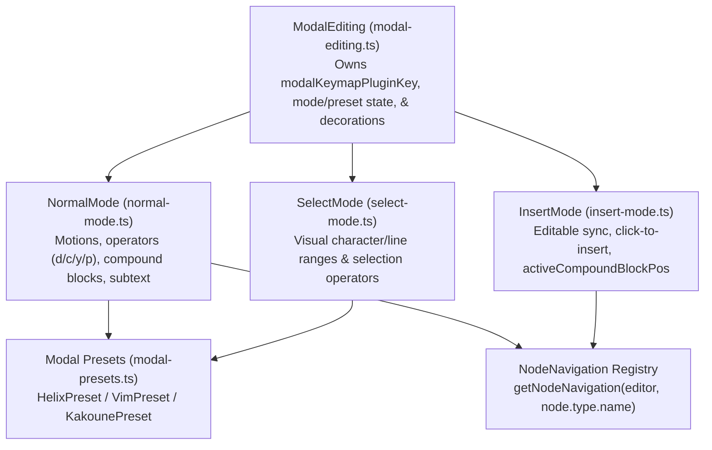

# HTMD editor, ProseMirror, Tiptap, and Svelte UI — software architecture

## Overview

`libs/htmd-ts` runs the HTMD rich-text editor (`HtmdEditor`) and the Markdown codec (`HtmdDocument`). It exposes engine-free interfaces from `libs/core-ts` (`Editor`, `EditorDocument`, `EditorExtension`, `Keymap`). Neither `libs/ui` nor `apps/hypertextual-svelte` imports `@tiptap/*` or `@tiptap/pm/*`.

Internally, **ProseMirror** (`@tiptap/pm/*`) manages document state, transactions, DOM rendering, and plugins. **Tiptap** (`@tiptap/core`, `@tiptap/starter-kit`, `@tiptap/markdown`) compiles extensions into ProseMirror primitives and bridges Marked.js tokenization. `libs/ui/src/editor` mounts Svelte 5 `NodeView` components (`svelteNodeView`) and floating overlays on top of `HtmdEditor`.

## Requirement

### Functional

- Expose `HtmdEditor` and `HtmdDocument` as `core-ts` plugins for `.htmd` and `.md` files.
- Keep one canonical HTMD node and mark schema in `src/nodes.ts` and `src/marks.ts`.
- Define interactive extensions in `src/editor/extensions/*` with `defineHtmdExtension` (`commands`, `keymap`, `navigation`, `nodeView`, and `pmPlugins`).
- Let extensions inherit and override `commands`, `keymap`, and `navigation` via `.extend()` and `.configure()`.
- Mount Svelte 5 `NodeView` components (`svelteNodeView`) with reactive `editable` and `subtextRange` props.
- Recover unsupported or malformed Markdown blocks, inline spans, and inline HTML marks as editable fallback nodes (`UnparsableBlockFallback`, `UnparsableInlineFallback`).

### Non-Functional

- Keep `@tiptap/*` and `@tiptap/pm/*` private inside `libs/htmd-ts`.
- Do not duplicate node schemas in `src/editor/extensions/*` or Tiptap editor types in `define-htmd-extension.ts`.
- Isolate ProseMirror plugins in `// pm ---` and helpers in `// helpers ---` so removing Tiptap only changes `build-extensions.ts` and `htmd-editor.ts`.

## Design

### Components and Responsibilities

#### 1. ProseMirror Runtime (`@tiptap/pm/*`)

ProseMirror enforces a one-way data loop across three packages:



| ProseMirror Module | Key Types | Role in `HtmdEditor` |
| --- | --- | --- |
| `prosemirror-model` | `Schema`, `NodeSpec`, `MarkSpec`, `PMNode`, `ResolvedPos` | Defines valid blocks, inline nodes, and flat marks. Addresses every token in `state.doc` by a flat integer position (`pos`). |
| `prosemirror-state` | `EditorState`, `Transaction`, `TextSelection`, `NodeSelection`, `Plugin`, `PluginKey` | Holds the immutable document snapshot, selection, and per-plugin state (`ModalEditing`, `EditorOverlays`). |
| `prosemirror-view` | `EditorView`, `DecorationSet`, `NodeView` | Patches the `.ProseMirror` DOM from `EditorState` and delegates custom blocks to `NodeView` instances (`dom`, `contentDOM`, `update`, `destroy`). |

##### Flat Integer Positions (`0 .. doc.content.size`)

Every opening token, closing token, and text character advances `pos` by `1`. Leaf atom nodes (`atom: true`) have `nodeSize = 1`:

```text
Document Tree                     Flat Position Indexing
-------------                     ----------------------
doc                               0                           (before first block)
├─ heading (level=1)              0: <heading>  1: "H" 2: "i" 3: </heading> (nodeSize = 4)
├─ notice (type="info")           4: <notice>
│  └─ paragraph                   5:   <p>      6: "A" 7: "B" 8: </p>
│                                 9: </notice>                (notice nodeSize = 6)
└─ imageNode (atom=true)          10: <imageNode/>            (leaf atom nodeSize = 1, spans 10..11)
                                  11                          (doc.content.size = 11)
```

---

#### 2. Tiptap Compiler (`@tiptap/*`)

Tiptap is a build-time compiler and command runner on top of ProseMirror:



| Tiptap Layer | Input | Compiled ProseMirror Output |
| --- | --- | --- |
| Schema compiler | `addAttributes`, `parseHTML`, `renderHTML` | ProseMirror `NodeSpec` and `MarkSpec` (`attrs`, `parseDOM`, `toDOM`). |
| Command manager | `addCommands()` | `editor.commands` and `editor.chain()` sharing one `Transaction` (`ctx.tr`). |
| Plugin collector | `addProseMirrorPlugins()`, `addNodeView()` | `EditorState.plugins` and `EditorProps.nodeViews`. |
| Markdown manager | `markdownTokenizer`, `parseMarkdown`, `renderMarkdown` | Marked.js tokenizer <-> ProseMirror `JSONContent` codec. |

> [!IMPORTANT]
> Inside `addCommands()`, always call `ctx.commands.*` or mutate `ctx.tr`. Calling `editor.commands.*` starts a separate transaction and throws `RangeError: Applying a mismatched transaction`.

---

#### 3. How `htmd-ts` Connects to Tiptap and ProseMirror



| Module | Responsibility |
| --- | --- |
| `src/nodes.ts` & `src/marks.ts` | Single source of truth for HTML (`parseHTML`, `renderHTML`) and Markdown (`parseMarkdown`, `renderMarkdown`) schemas. |
| `src/editor/define-htmd-extension.ts` | Defines `HtmdExtensionSpec` (`commands`, `keymap`, `navigation`, `nodeView`, `pmPlugins`) and navigation preset factories (`createTextblockNavigation`, `createContainerNodeNavigation`, `createAtomNodeNavigation`). |
| `src/editor/build-extensions.ts` | Extends canonical nodes from `src/nodes.ts`, merges `.configure({ keymap })` overrides, and registers `HtmdNodeNavigation` specs. |
| `src/editor/htmd-editor.ts` | Implements `HtmdEditor` (`Editor<JSONContent, HtmdCommandMap>`), mounts `EditorView`, and bridges `EditorHostServices`. |

---

#### 4. How Svelte UI (`libs/ui/src/editor`) Mounts `NodeView`s and Overlays

`libs/ui/src/editor` owns all Svelte 5 mounting and reactive UI state:



##### Container vs. Atom `NodeView` Layout

```text
1. Container / Inplace NodeView (NoticeNodeView.svelte, CodeBlockComponent.svelte, MermaidEditor.svelte)
+-----------------------------------------------------------------------+
| .node-notice (NodeView.dom, contenteditable="false" header controls)  |
| +-------------------------------------------------------------------+ |
| | [i] [ input: Notice title          ] [ Select: Info            v ]| | <- Svelte header controls
| +-------------------------------------------------------------------+ |
| | <div data-node-view-content> (NodeView.contentDOM)                | |
| |   <p>Editable ProseMirror child blocks live here...</p>           | | <- ProseMirror body
| | </div>                                                            | |
| +-------------------------------------------------------------------+ |
+-----------------------------------------------------------------------+

2. Atom NodeView (ImageNodeView.svelte, LinkPreviewCard.svelte, UrlMentionPill.svelte)
+-----------------------------------------------------------------------+
| .node-imageNode (NodeView.dom, atom: true, contentDOM: undefined)     |
| +-------------------------------------------------------------------+ |
| |                         [ Replace ]  [ Remove ]  | | <- Svelte media & actions
| | [ input.caption-input / span.caption-text (subtextRange cursor)  ]| | <- Svelte subtext
| +-------------------------------------------------------------------+ |
+-----------------------------------------------------------------------+
```

##### Floating Menus and Overlays

| Svelte Component | Trigger in `HtmdEditor` | Key Scope Priority |
| --- | --- | --- |
| `BubbleMenu.svelte` (`FontColorPicker`, `LinkEditPopover`) | `editor.isRangeSelectionActive()` via `editor.subscribe()` | `overlay` (when popover open) |
| `SlashMenu.svelte` | `SlashCommands` (`/` suggestion callback) | `overlay` |
| `MentionList.svelte` | `InternalMention` (`@` suggestion callback) | `overlay` |
| `CursorOverlay.svelte` (`ImageInput`, `BookmarkInput`, `YouTubeInput`) | `editor.openOverlay(type, pos, data)` (`EditorOverlays` plugin) | `overlay` |

---

#### 5. Extension Inheritance: Keymaps, Commands, and `HtmdNodeNavigation`

##### `.configure()` and `.extend()` Inheritance Flow



```ts
// 1. Instance-level keymap override via .configure()
NoticeNode.configure({
  nodeView: svelteNodeView(NoticeNodeView),
  keymap: {
    'Mod-Shift-n': ({ commands }) => commands.insertNotice({ type: 'warning' }),
  },
})

// 2. Subclass inheritance via .extend()
const CustomCodeBlock = CodeBlock.extend({
  keymap: (ctx, parentKeymap) => ({
    ...parentKeymap,
    'Shift-Enter': ({ state, view }) => exitCodeBlockBelow(state, view),
  }),
  navigation: (ctx, parentNav) => ({
    ...parentNav,
    enterFromAbove: (editor, pos, node) => parentNav.enterFromBelow(editor, pos, node),
  }),
})
```

##### `HtmdNodeNavigation` Hierarchy



| Navigation Hook | `createTextblockNavigation` | `createContainerNodeNavigation` (`CodeBlock`, `NoticeNode`) & `createInplaceWindowNodeNavigation` (`MermaidEditor`) | `createAtomNodeNavigation` (`ImageNode`, `LinkPreview`) |
| --- | --- | --- | --- |
| `enterFromAbove` (`ArrowDown` / `Tab`) | Caret at start of block | `CodeBlock` & `NoticeNode`: focuses `controls[0]`; `MermaidEditor`: caret at start of code | Focuses `controls[0]` (`caption` or `url` input) |
| `enterFromBelow` (`ArrowUp` / `Shift+Tab`) | Caret at end of block | Caret on last line of `contentDOM` body | Focuses `controls[0]` or last control |
| `enterCompound` (Normal `Enter` / `i`) | Enters insert mode at caret | `CodeBlock` & `MermaidEditor`: body start; `NoticeNode`: `controls[0]` | Focuses `controls[0]` or subtext offset |
| `stepControl` (`Tab` / `Shift+Tab`) | Moves to adjacent block | Cycles `controls` <-> body <-> adjacent block | Cycles `controls` <-> adjacent block |
| `subtext` | `undefined` | `undefined` (`NoticeNode` uses `noticeTitle` on header) | `{ kind, attr, textSelector, inputSelector }` |

### Data and Control Flow

#### 1. Keystroke Dispatch Order


#### 2. Modal Editing Decomposition (`ModalEditing`)



#### 3. Unparsable Fallback Nodes (`UnparsableBlockFallback` & `UnparsableInlineFallback`)

In ProseMirror, a `Mark` is a flat metadata tag on a text node. A `Mark` cannot hold raw source text or mount a `NodeView`. Therefore, `htmd-ts` recovers all unsupported or malformed fragments into two fallback **Node** types:

| Fallback Extension | Node Name | Scope | Recovered Inputs |
| --- | --- | --- | --- |
| `UnparsableBlockFallback` | `unparsedBlock` | `block` | Unknown directives (`:::unknown`), unsupported tables, raw HTML blocks, link definitions. |
| `UnparsableInlineFallback` | `unparsedInline` | `inline` | Unknown shortcodes (`[unknown]`), unmatched inline tokens, and unsupported or malformed inline HTML marks (`<font>`, unclosed `<u>`, invalid `style`). |

### Interfaces and Contracts

#### Extension File Layout (4 Sections)

Every file in `libs/htmd-ts/src/editor/extensions/` uses 80-column dividers and omits empty sections:

````ts
// types ---------------------------------------------------------------------
export interface NoticeNodeOptions {
  nodeView?: NodeViewRenderer
  keymap?: Keymap<HtmdCommandContext>
}

// api -----------------------------------------------------------------------
/**
 * Callout notice block (`info`, `success`, `warning`, `error`) with an editable
 * header and rich-text body.
 *
 * ```text
 * +---------------------------------------------------+
 * | [i] [ Notice title        ] [ Info            v ] |  <- header controls
 * |---------------------------------------------------|
 * | Notice body paragraph...                          |  <- contentDOM (block+)
 * +---------------------------------------------------+
 * ```
 */
export const NoticeNode = defineHtmdExtension<NoticeNodeOptions>({ ... })

// pm ------------------------------------------------------------------------
// ProseMirror Plugin and PluginKey definitions

// helpers -------------------------------------------------------------------
// Named keymap and navigation handlers:
// handleTab, handleShiftTab, handleArrowUp, handleArrowDown, handleEnter
````

## Implementation

### Path to Removing Tiptap

| Layer | Impact of Removing Tiptap |
| --- | --- |
| `libs/core-ts`, `libs/ui`, `apps/hypertextual-svelte` | Zero changes. External packages only use `HtmdEditor`, `HtmdDocument`, and `NodeViewRenderer`. |
| `libs/htmd-ts/src/editor/extensions/*` | Zero changes to `// pm ---`, `navigation`, and `// helpers ---`, which already use native ProseMirror `EditorState`, `Transaction`, and `EditorView`. |
| `libs/htmd-ts/src/editor/{build-extensions,htmd-editor}.ts` | Replace `TiptapEditor` with direct ProseMirror `Schema`, `EditorState.create()`, and `new EditorView()`. |

## References

- [htmd-ts software architecture](index.md)
- [core-ts editor plugin architecture](../core-ts.md)
- [HTMD editor (`HtmdEditor`)](../ui/htmd-editor/index.md)
- [Editor source ownership](../ui/editor-source.md)
