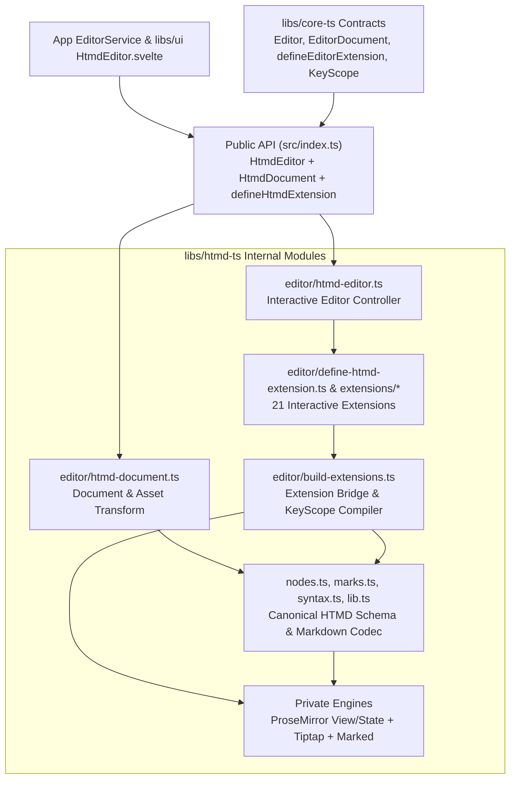
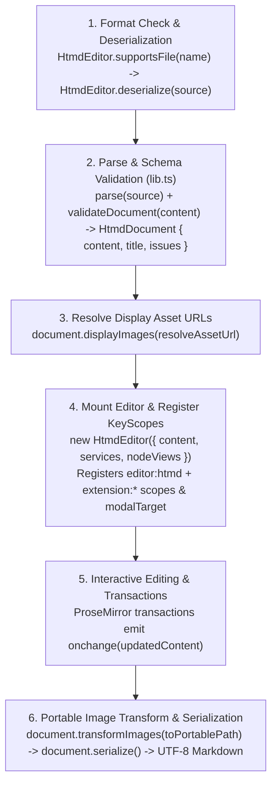

# htmd-ts — software architecture

## Overview

`htmd-ts` owns the HTMD document editor (`HtmdEditor`), the in-memory HTMD document model (`HtmdDocument`), and the Markdown codec (`htmdCodec`). It converts between `.htmd` or `.md` text and validated document JSON, and it mounts the rich-text editor in the browser. All Tiptap, ProseMirror, Marked, and syntax-highlighting engines stay private inside the library.

The host application owns filesystem access, media storage, autosave scheduling, and recovery dialogs. The host passes keyboard, notification, media, and embedded-editor services to `HtmdEditor`. Rust conversion, source positions, a language server, and collaborative storage remain future work in `htmd-rs`.

## Requirement

### Functional

- Read and write `.htmd` and `.md` files without losing supported blocks, marks, or persisted attributes when a file reopens.
- Convert between Markdown text and validated document JSON so local files and remote JSON services use the same document model.
- Keep unsupported or malformed Markdown fragments editable as raw-source blocks or inline spans with diagnostic messages.
- Preserve unchanged source bytes, byte-order marks (BOM, a Unicode file header), line endings, and final newlines after edits.
- Extract the document title and map image references between portable storage paths and runtime display URLs.
- Edit HTMD documents with modal keyboard navigation, formatting commands, slash and mention menus, media overlays, and custom block views.
- Route editor and extension shortcuts, user notifications, media writes, and embedded child editors through host services.

### Non-Functional

- Run format conversion synchronously without UI frameworks, Tauri, filesystem access, or network calls.
- Keep Tiptap, ProseMirror, Marked, and `lowlight` types private inside the package.
- Run in standard web browsers both inside the Hypertextual desktop app and as a standalone library.

## Design

### Components and Responsibilities



- `index.ts` exports `HtmdEditor`, `HtmdDocument`, `htmdCodec`, `defineHtmdExtension`, `createHtmdEditorKeymap`, editor types, and error classes.
- `editor/htmd-document.ts` implements `HtmdDocument` (`EditorDocument<JSONContent>` from `core-ts`). It parses and serializes Markdown, extracts the first level-1 heading as the title, and maps `imageNode` URLs between portable paths and display URLs.
- `lib.ts`, `nodes.ts`, `marks.ts`, and `syntax.ts` compose the private Markdown engine, own the canonical HTMD node and mark schemas (`group`, `content`, `inline`, `atom`, `addAttributes`, `parseHTML`, `renderHTML`, `parseMarkdown`, `renderMarkdown`), validate documents against the HTMD schema, collect recoverable issues, and guard serialization.
- `editor/htmd-editor.ts` implements `HtmdEditor` (`Editor<JSONContent, HtmdCommandMap>` and `EditorFormatAdapter<JSONContent>` for `htmd` and `md`). It manages the private Tiptap and ProseMirror instance, registers the `editor:htmd` and extension key scopes, forwards notifications and media writes to host services, and exposes engine-free methods to UI wrappers.
- `editor/define-htmd-extension.ts` specializes `defineEditorExtension` from `core-ts` for interactive HTMD editor behavior (`keymap`, `commands`, `nodeView`, and `pmPlugins`) without duplicating node schema fields.
- `editor/build-extensions.ts` adapts `HtmdExtension` definitions by extending the canonical node schemas from `nodes.ts` and attaching `HtmdNodeViews`, commands, keymaps, and ProseMirror plugins.

### Data and Control Flow

#### Format Deserialization, Editing, and Serialization Lifecycle



### Interfaces and Contracts

#### 1. `HtmdEditor` Format Codec and `HtmdDocument` API

| Public API | Input | Output |
| --- | --- | --- |
| `HtmdEditor.formats` | None | `readonly ['htmd', 'md']` |
| `HtmdEditor.supportsFile` | `filename: string` | `boolean` (`.htmd` or `.md`) |
| `HtmdEditor.deserialize` | `source: string` | `HtmdDocument` (`EditorDocument<JSONContent>`) |
| `HtmdEditor.serialize` | `JSONContent` and optional `{ originalSource }` | Complete Markdown string |
| `HtmdEditor.extractTitle` | `source: string` | Extracted H1 title string |

```ts
import { HtmdEditor } from 'htmd-ts'

const originalSource = '# Article\n\nSome *italic* text.\n'
const document = HtmdEditor.deserialize(originalSource)
const title = document.title // 'Article'
const savedSource = document.serialize()
```

#### 2. `HtmdEditor` Plugin and `defineHtmdExtension` API

```ts
import {
  HtmdEditor,
  defineHtmdExtension,
  type HtmdEditorOptions,
  type HtmdNodeViewFactory,
} from 'htmd-ts'

const editor = new HtmdEditor({
  content: checked,
  editable: false,
  enforceTitle: false,
  services: { hotkeys, notifications, media, embedRegistry },
  nodeViews: {
    notice: noticeNodeViewFactory,
    codeBlock: codeBlockNodeViewFactory,
    image: imageNodeViewFactory,
    linkPreview: linkPreviewNodeViewFactory,
    urlMention: urlMentionNodeViewFactory,
  },
  onchange: (doc) => onDocumentChange(doc),
})

editor.mount(containerElement)
```

- `HtmdEditor` registers its `editor:htmd` keymap (`createHtmdEditorKeymap`) at `editor` priority. In normal mode, `Enter` enters a compound block such as a notice, code block, image, or link preview. In insert mode, `Escape` returns to normal mode when no inner overlay or widget consumes the key.
- Extensions built with `defineHtmdExtension` declare shortcuts using `Keymap<HtmdCommandContext>` at `extension` priority.
- Custom block views use `HtmdNodeViewFactory`. Each factory receives `HtmdNodeViewContext` (`editor`, `node`, `getPos`, `updateAttributes`, `deleteNode`, `subscribe`) and returns `{ dom, contentDOM?, update?, destroy? }`.
- Modal yank actions and editor errors send messages to `services.notifications`. Image uploads and replacements write files through `services.media`.

#### 3. Markdown Syntax and Recovery

Headings, paragraphs, lists, task items, quotes, code, links, and images use CommonMark or GitHub Flavored Markdown (GFM). Notices use GitHub blockquote markers (`> [!NOTE] Title`). Underline, text color, highlight, and link metadata use CommonMark inline HTML. Mentions, bookmarks, and YouTube embeds use directive or shortcode syntax (`[mention ...]`, `[url-mention ...]`, `:::bookmark {...} :::`, `:::youtube {...} :::`).

Unsupported or malformed fragments become `unparsedBlock` or `unparsedInline` nodes with `kind` and `reason` attributes. Serialization writes raw fragments directly and parses them again after edits so fixed fragments become standard nodes.

| Result or error | Exact purpose |
| --- | --- |
| `issues` | Recoverable unsupported or invalid source with preserved fragments. |
| `InvalidDocumentError` | Supplied JSON has unknown nodes, marks, attributes, invalid values, or invalid structure. |
| `MarkdownParseError` | A fatal engine failure prevents valid JSON after local recovery. |
| `MarkdownSerializationError` | Rendering fails, raw inline source escapes its paragraph, or reopening changes persisted content or attributes. |

## Implementation

### Engine Adapters and Extension System

- `src/nodes.ts`, `src/marks.ts`, `src/syntax.ts`, and `src/lib.ts` own the canonical HTMD node/mark schemas, Markdown parsing, serialization, and schema validation.
- `src/editor/define-htmd-extension.ts` provides `defineHtmdExtension` on top of `defineEditorExtension` from `core-ts` for interactive editor behavior (`keymap`, `commands`, `nodeView`, and `pmPlugins`).
- `src/editor/extensions/*` contains the 21 HTMD editor extensions (9 node extensions including `UnparsableBlockFallback` and `UnparsableInlineFallback`, 5 document behavior extensions, and 7 modal editing extensions: `ModalEditing`, `NormalMode`, `SelectMode`, `InsertMode`, `HelixPreset`, `VimPreset`, `KakounePreset`).
- `src/editor/build-extensions.ts` extends the canonical node schemas from `src/nodes.ts` and attaches interactive extension behavior. See [HTMD editor extensions and compiler](editor-extensions.md).
- `src/editor/htmd-editor.ts` owns `HtmdEditor` and wraps the private Tiptap `Editor` and ProseMirror `EditorView`.

### Testing

- `src/nodes.test.ts`, `src/marks.test.ts`, and `src/lib.test.ts` test every block, inline node, mark, whitespace rule, and recovery path against `fixtures/editor-roundtrip.md` and `fixtures/editor-roundtrip.json`.
- `src/editor/htmd-editor.test.ts` tests `HtmdEditor` lifecycle, `HtmdDocument`, `defineHtmdExtension` compilation, modal block operations, and host services.
- `e2e/htmd-ts/` runs Playwright in Chromium and WebKit against a standalone `HtmdEditor` browser fixture without the desktop app. It tests DOM rendering, key scope priority, notifications, media writes, embedded child editor focus handoff, and Markdown round-trips.

## References

- [core-ts editor plugin architecture](../core-ts.md)
- [HTMD editor extensions and compiler](editor-extensions.md)
- [Library entry point](../../../libs/htmd-ts/README.md)
- [Public API exports](../../../libs/htmd-ts/src/index.ts)
- [Public types](../../../libs/htmd-ts/src/types.ts)
- [Conversion and validation](../../../libs/htmd-ts/src/lib.ts)
- [Node definitions and examples](../../../libs/htmd-ts/src/nodes.test.ts)
- [Mark examples](../../../libs/htmd-ts/src/marks.test.ts)
- [Complete Markdown fixture](../../../libs/htmd-ts/fixtures/editor-roundtrip.md)
- [Expected fixture JSON](../../../libs/htmd-ts/fixtures/editor-roundtrip.json)
- [System architecture](../index.md)
- [HtmdEditor Svelte component](../ui/htmd-editor.md)
- [Editor source ownership](ui/editor-source.md)
- [Development commands](../development.md)
