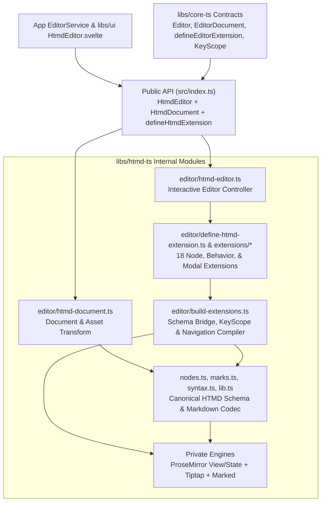
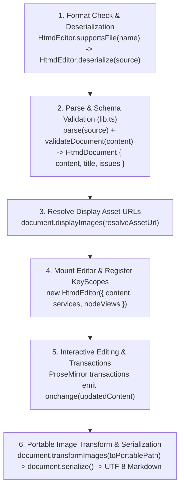

# htmd-ts — software architecture

## Overview

`htmd-ts` owns the HTMD rich-text editor (`HtmdEditor`), the in-memory document model (`HtmdDocument`), and the Markdown codec (`htmdCodec`). It converts between `.htmd` or `.md` text and validated document JSON, and it mounts the editor in the browser. All Tiptap, ProseMirror, Marked, and syntax-highlighting engines stay private inside the library.

The host application owns filesystem access, media storage, autosave, and recovery dialogs. The host passes keyboard, notification, media, and embedded-editor services to `HtmdEditor`.

## Requirement

### Functional

- Read and write `.htmd` and `.md` files without losing supported blocks, marks, or persisted attributes.
- Convert between Markdown text and validated document JSON.
- Keep unsupported or malformed Markdown fragments editable as fallback nodes (`UnparsableBlockFallback`, `UnparsableInlineFallback`) with diagnostic messages.
- Preserve unchanged source bytes, byte-order marks (BOM), line endings, and final newlines after edits.
- Extract the document title and map image references between portable storage paths and runtime display URLs.
- Edit HTMD documents with modal keyboard navigation, formatting commands, slash and mention menus, media overlays, and custom block views.
- Route editor and extension shortcuts, notifications, media writes, and embedded child editors through host services.

### Non-Functional

- Run format conversion synchronously without UI frameworks, Tauri, filesystem access, or network calls.
- Keep Tiptap, ProseMirror, Marked, and `lowlight` types private inside the package.
- Run in standard web browsers both inside the Hypertextual desktop app and as a standalone library.

## Design

### Components and Responsibilities



| Module | Responsibility |
| --- | --- |
| `src/index.ts` | Exports `HtmdEditor`, `HtmdDocument`, `htmdCodec`, `defineHtmdExtension`, navigation presets, `NodeView` types, and error classes. |
| `src/nodes.ts`, `marks.ts`, `syntax.ts`, `lib.ts` | Own the canonical HTMD node and mark schemas, Markdown parsing/serialization, document validation, and issue recovery. |
| `src/editor/htmd-document.ts` | Implements `HtmdDocument` (`EditorDocument<JSONContent>`). Extracts the H1 title and maps image URLs between portable paths and display URLs. |
| `src/editor/define-htmd-extension.ts` | Defines `defineHtmdExtension` (`commands`, `keymap`, `navigation`, `nodeView`, `pmPlugins`) and navigation presets (`createTextblockNavigation`, `createContainerNodeNavigation`, `createAtomNodeNavigation`). |
| `src/editor/build-extensions.ts` | Extends canonical nodes from `nodes.ts`, merges `.configure({ keymap })` overrides, and registers `HtmdNodeNavigation` specs. |
| `src/editor/htmd-editor.ts` | Implements `HtmdEditor` (`Editor<JSONContent, HtmdCommandMap>`), mounts ProseMirror `EditorView`, and connects `EditorHostServices`. |

### Data and Control Flow

#### Format Deserialization, Editing, and Serialization Lifecycle



### Interfaces and Contracts

#### 1. `HtmdEditor` Format Codec and `HtmdDocument` API

| Public API | Input | Output |
| --- | --- | --- |
| `HtmdEditor.formats` | None | `readonly ['htmd', 'md']` |
| `HtmdEditor.supportsFile` | `filename: string` | `boolean` (`.htmd` or `.md`) |
| `HtmdEditor.deserialize` | `source: string` | `HtmdDocument` (`EditorDocument<JSONContent>`) |
| `HtmdEditor.serialize` | `JSONContent` and optional `{ originalSource }` | Complete Markdown string |
| `HtmdEditor.extractTitle` | `source: string` | Extracted H1 title string |

```ts
import { HtmdEditor } from 'htmd-ts'

const originalSource = '# Article\n\nSome *italic* text.\n'
const document = HtmdEditor.deserialize(originalSource)
const title = document.title // 'Article'
const savedSource = document.serialize()
```

#### 2. `HtmdEditor` Plugin and `defineHtmdExtension` API

```ts
import {
  HtmdEditor,
  defineHtmdExtension,
  type HtmdEditorOptions,
  type NodeViewRenderer,
} from 'htmd-ts'

const editor = new HtmdEditor({
  content: checked,
  editable: false,
  enforceTitle: false,
  services: { hotkeys, notifications, media, embedRegistry },
  nodeViews: {
    notice: noticeNodeView,
    codeBlock: codeBlockNodeView,
    image: imageNodeView,
    linkPreview: linkPreviewNodeView,
    urlMention: urlMentionNodeView,
  },
  onchange: (doc) => onDocumentChange(doc),
})

editor.mount(containerElement)
```

| Feature | Contract |
| --- | --- |
| Editor keyscope | `editor:htmd` (`editor` priority): `Enter` enters a compound block in normal mode; `Escape` returns to normal mode in insert mode. |
| Extension keyscope | `extension:<name>` (`extension` priority): declarative `Keymap<HtmdCommandContext>`, overridable via `.configure({ keymap })` and `.extend({ keymap })`. |
| Node navigation | `HtmdNodeNavigation` (`enterFromAbove`, `enterFromBelow`, `enterCompound`, `stepControl`, `subtext`) inherited from `createTextblockNavigation`, `createContainerNodeNavigation`, or `createAtomNodeNavigation`. |
| Custom block views | `NodeViewRenderer` (`HtmdNodeViewFactory`) receives `NodeViewProps` (`editor`, `node`, `getPos`, `updateAttributes`, `deleteNode`) and returns `{ dom, contentDOM?, update?, destroy? }`. |

#### 3. Markdown Syntax and Recovery

| Syntax Kind | Markdown Representation | Schema Node / Mark |
| --- | --- | --- |
| Standard blocks & inline marks | CommonMark & GFM | `heading`, `paragraph`, `codeBlock`, `bulletList`, `orderedList`, `taskList`, `blockquote`, `bold`, `italic`, `strike`, `code`, `link` |
| Callout notices | `> [!NOTE] Title` | `notice` (`NoticeNode`) |
| Inline HTML marks | `<u>`, `<span style="color:...">`, `<mark>` | `underline`, `textColor`, `highlight` |
| Mentions & embeds | `[mention ...]`, `[url-mention ...]`, `:::bookmark`, `:::youtube` | `internalMention`, `urlMention`, `linkPreview` |
| Unsupported / malformed | Preserved verbatim with `kind` and `reason` | `unparsedBlock` (`UnparsableBlockFallback`), `unparsedInline` (`UnparsableInlineFallback`) |

| Result or error | Exact purpose |
| --- | --- |
| `issues` | Recoverable unsupported or invalid source with preserved fragments. |
| `InvalidDocumentError` | Supplied JSON has unknown nodes, marks, attributes, invalid values, or invalid structure. |
| `MarkdownParseError` | A fatal engine failure prevents valid JSON after local recovery. |
| `MarkdownSerializationError` | Rendering fails, raw inline source escapes its paragraph, or reopening changes persisted content or attributes. |

## Implementation

### Engine Adapters and Extension System

- `src/nodes.ts`, `src/marks.ts`, `src/syntax.ts`, and `src/lib.ts` own the canonical HTMD node and mark schemas, Markdown parsing, serialization, and schema validation.
- `src/editor/define-htmd-extension.ts` provides `defineHtmdExtension` and the `HtmdNodeNavigation` presets (`createTextblockNavigation`, `createContainerNodeNavigation`, `createAtomNodeNavigation`).
- `src/editor/extensions/*` contains the 18 HTMD editor extension modules (9 node extensions, 5 document behavior extensions, and 4 modal editing modules: `modal-editing.ts`, `normal-mode.ts`, `select-mode.ts`, `insert-mode.ts`, plus `modal-presets.ts`).
- `src/editor/build-extensions.ts` extends the canonical node schemas from `src/nodes.ts` and attaches interactive extension behavior. See [HTMD editor, ProseMirror, Tiptap, and Svelte UI architecture](editor-extensions.md).

### Testing

- `src/nodes.test.ts`, `src/marks.test.ts`, and `src/lib.test.ts` test every block, inline node, mark, whitespace rule, and recovery path against `fixtures/editor-roundtrip.md` and `fixtures/editor-roundtrip.json`.
- `src/editor/htmd-editor.test.ts` tests `HtmdEditor` lifecycle, `HtmdDocument`, `defineHtmdExtension` keymap and navigation inheritance, modal block operations, and host services.
- `e2e/htmd-ts/` runs Playwright in Chromium and WebKit against a standalone `HtmdEditor` browser fixture.

## References

- [HTMD editor, ProseMirror, Tiptap, and Svelte UI architecture](editor-extensions.md)
- [core-ts editor plugin architecture](../core-ts.md)
- [HtmdEditor Svelte component](../ui/htmd-editor.md)
- [Editor source ownership](../ui/editor-source.md)
- [System architecture](../index.md)
- [Development commands](../../development.md)
