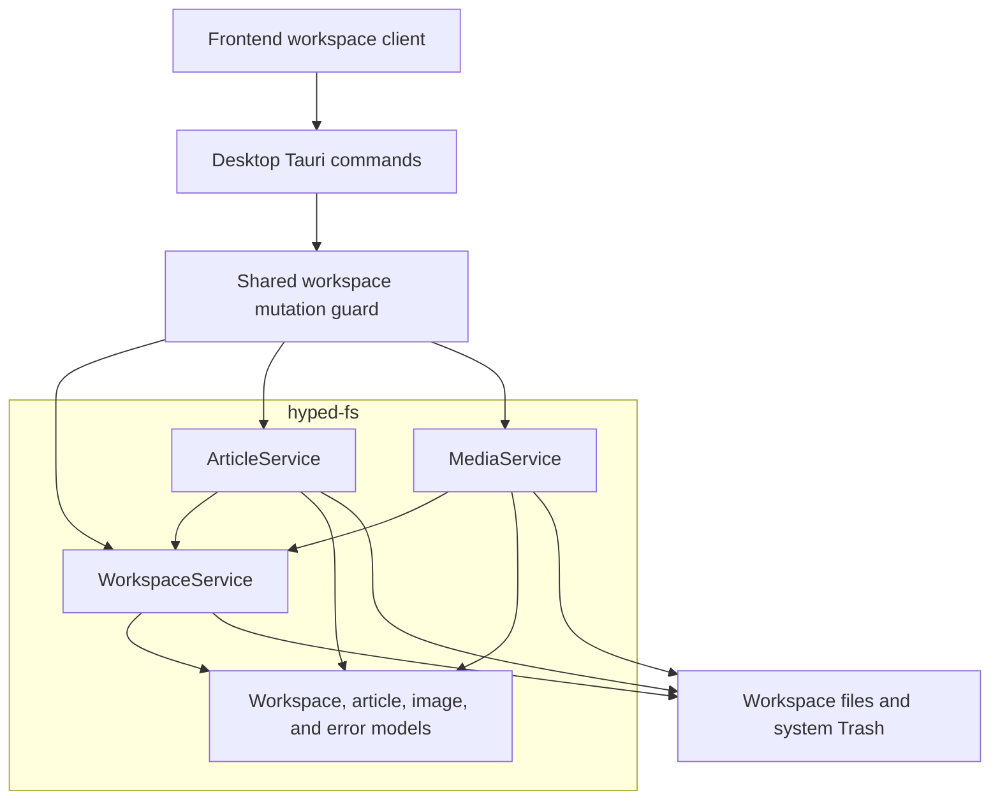
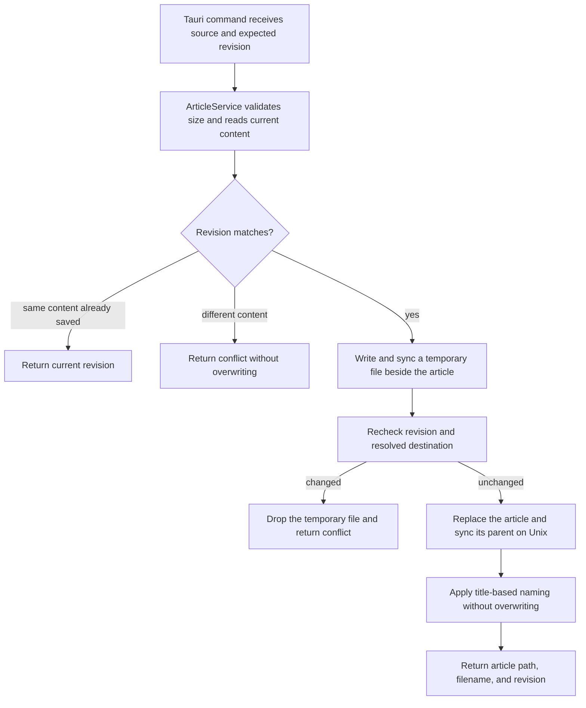

# hyped-fs — software architecture

## Overview

Private `hyped-fs` owns the Hypertextual workspace models and native persistence services. The desktop application supplies a home directory and adapts Tauri commands to these services. The crate preserves the existing workspace, article, and media behavior without a Tauri dependency. It implements Hypertextual workspace policy. Remote file synchronization remains future work.

## Requirement

### Functional

- Open the default workspace under `.hypertextual/workspace` and list visible entries.
- Confine paths and resolved links to that workspace.
- Create, rename, and delete articles and folders without overwriting occupied entries.
- Validate article formats and image headers, enforce size limits, and derive filenames.
- Save complete article bytes with revision checks, permission preservation, and temporary-file cleanup.
- Store images beside their articles and return portable references and display URLs.

### Non-Functional

- Keep the crate private with `publish = false` and a local Cargo path dependency.
- Keep Tauri, frontend autosave scheduling, and editor JSON conversion outside the crate.
- Preserve platform-specific rename, directory synchronization, and system Trash behavior.
- Test public Hypertextual operations against isolated temporary homes.

## Design

### Components and Responsibilities

The crate owns workspace location rules, sorting and hidden entries, name validation, article extensions, image types and names, and revision acceptance. It also owns the corresponding serialized models and error codes. The desktop owns Tauri state, command dispatch, blocking-task execution, and close/quit events. Frontend services own selection, drafts, autosave scheduling, and recovery presentation.

### Data and Control Flow

The existing article service performs this sequence inside `hyped-fs`. The desktop delegates revision policy to the article service. Tauri commands retain the shared mutation guard across workspace, article, and media operations. The app receives the same source text, revisions, image assets, and error payloads as before.

### Interfaces and Contracts

`WorkspaceService::from_home(home)` selects the default Hypertextual workspace. Operation paths remain relative to that workspace, and serialized entry paths use forward slashes. The desktop supplies the operating-system home directory through Tauri.

| Public service     | Responsibilities                                                        |
| ------------------ | ----------------------------------------------------------------------- |
| `WorkspaceService` | `from_home`, `open`, `list`, `create_folder_in`, `rename`, and `delete` |
| `ArticleService`   | `new`, `create`, `create_file`, `read`, `write`, and `save`             |
| `MediaService`     | `new`, `import`, and `read`                                             |

`Workspace`, `WorkspaceListing`, `WorkspaceNode`, `ArticleContent`, `ArticleMetadata`, and `ImageAsset` live in the crate. `WorkspaceError` and `Result` preserve the existing transport payloads without depending on Tauri. Model methods remain limited to factories, validation, mapping, and derived values. Services perform filesystem access.

Article reads return `ArticleContent { content, revision }`. The revision is a SHA-256 hash of the file bytes. Writes require the expected revision. Saves also receive an app-derived title and return `ArticleMetadata { path, name, revision }` after filename selection.

Image operations return `ImageAsset { source, url }`. The source is a portable relative reference. The URL is a data URL for display. The app media service can replace it with a Blob URL, an object URL for image bytes held in memory. Remote HTTP image loading belongs to that app service.

Articles use `.md` or `.htmd`, contain UTF-8 text, and exclude null bytes. Articles and images each have a 16 MiB limit. Images use PNG, JPEG, GIF, or WebP headers. Imported files use content hashes under the article's adjacent `.images` directory. `WorkspaceError { code, message }` describes containment, validation, revision, permission, and I/O failures.

## Implementation

### Package ownership

Premise generated `libs/hyped-fs` as a private isolated crate. The root Cargo workspace excludes it, and the desktop uses `hyped-fs = { path = "../../libs/hyped-fs" }`. The existing native model and service modules moved into the crate together. The crate exposes the application services directly.

`src/models` contains workspace, article, and image models. `src/services` contains the corresponding native services. `src/error.rs` owns their existing error contract. The desktop's `src/workspace.rs` is the Tauri adapter, and `src/lib.rs` handles application setup and lifecycle.

### Behavior evidence and limits

`tests/workspace.rs` exercises the public workspace API and includes article and media behavior modules. The 36 lifted service cases retain their Given, When, and Then contexts and isolated temporary homes. They cover containment, occupied names, permissions, revision conflicts, retry behavior, titles, and media references.

The browser suite uses a filesystem-backed Tauri substitute and does not execute this Rust crate. Native windows and system Trash behavior require native checks. Remote file synchronization remains future work.

## References

- [Library entry point](../../libs/hyped-fs/README.md)
- [System architecture](index.md)
- [Public library API](../../libs/hyped-fs/src/lib.rs)
- [Workspace models](../../libs/hyped-fs/src/models/workspace.rs)
- [Workspace service](../../libs/hyped-fs/src/services/workspace.rs)
- [Article service](../../libs/hyped-fs/src/services/article.rs)
- [Media service](../../libs/hyped-fs/src/services/media.rs)
- [Desktop commands](../../apps/hypertextual-desktop/src/workspace.rs)
- [Development commands](../development.md)
