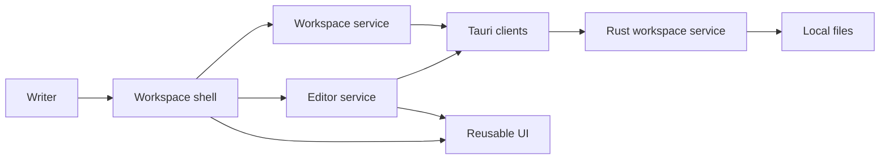

# Hypertextual software architecture

## Overview

Hypertextual is a desktop workspace for local articles. Writers browse files, edit articles, and save changes without a separate save action. The current scope is one local workspace. Tabs, cloud synchronization, and multiple workspaces remain future work.

## Requirement

### Functional

- Browse, create, rename, and delete articles and folders.
- Edit supported articles and retain drafts when saving fails.
- Store article images beside their articles and preserve portable references.

### Non-Functional

- Support macOS, Linux, and Windows.
- Keep filesystem access within the selected workspace.
- Keep reusable UI independent of storage and application policy.
- Preserve existing content when the editor cannot represent it.

## Design

### Components and Responsibilities

- The shell composes navigation, the article pane, and recovery controls.
- Application services own workspace operations, article selection, and autosave policy.
- The private UI library supplies portable editor, tree, and menu interfaces using published Helical packages and Ark UI.
- Tauri clients connect application services to Rust. Rust owns filesystem access and workspace safety.
- The HTMD libraries remain reserved for format SDK design. The CLI is a separate Rust consumer.

### Data and Control Flow

Opening a workspace supplies the tree with its entries. Selecting an article opens an editor document through the editor service. The reusable editor emits serialized content and title changes. Autosave writes those changes through the Tauri client, and the workspace service reflects the saved filename.

A failed save retains the draft. Switching articles or closing the window requires pending writes to finish. Application state belongs to one window and resets on startup.

### Interfaces and Contracts

Workspace clients expose file operations and revision-aware writes. A revision identifies the content version that the caller expects to replace. Media clients supply article-scoped asset adapters. The reusable editor accepts those adapters without knowing workspace paths or storage conventions.

## Implementation

### Ownership boundaries

Application-specific components and services live in the Svelte app. Generic components and editor conversion live in the private UI library. The desktop backend retains native filesystem and window integration.

### Extension points

Storage and asset adapters allow the editor to serve other applications. The planned Helical editor service and shared Rust filesystem library can replace these boundaries without moving workspace policy into UI components.

## References

- [UI library components](ui/index.md)
- [Svelte web app components](svelte-web-app/index.md)
- [Development commands](../development.md)
- [Product requirements](../../prd/0001-hypertextual-app/README.md)
- [Helical editor service follow-up](https://linear.app/cloudvoyant/issue/CLO-197/provide-a-self-contained-editor-service-for-document-loading-and)
- [Shared Rust filesystem follow-up](https://linear.app/cloudvoyant/issue/DIFF-244/extract-shared-rust-hyped-fs-library-for-desktop-and-cli-file)
