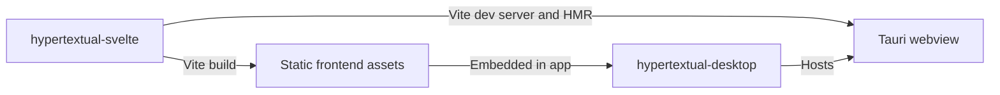

# Architecture

Hypertextual currently contains five starter projects. The desktop app embeds the Svelte frontend, while the CLI and HTMD libraries remain separate starters.

| Path                        | Role                                                            |
| --------------------------- | --------------------------------------------------------------- |
| `apps/hypertextual-desktop` | Tauri shell and Rust backend for the desktop app                |
| `apps/hypertextual-svelte`  | Private Svelte frontend built with Vite                         |
| `apps/hypertextual-cli`     | Rust CLI package `hypertextual`, with executable `hyped`        |
| `libs/htmd-rs`              | Internal Rust library reserved for shared HTMD behavior         |
| `libs/htmd-ts`              | Internal TypeScript library reserved for frontend HTMD behavior |

## Desktop composition

In development, the desktop app loads the frontend from the local Vite server. Production builds embed the compiled frontend into the desktop executable. The Vite server serves frontend assets and does not provide a Hypertextual backend API.

Tauri commands let the frontend call Rust functions and receive their results. Events and channels let Rust send updates to the frontend. The Svelte project includes the Tauri API package, but no document commands are implemented yet. See the [Tauri communication guide](https://v2.tauri.app/develop/calling-rust/) for the available mechanisms.

## Shared behavior and storage

The Rust library will hold document behavior shared by desktop and CLI. The TypeScript library will hold frontend HTMD behavior. Neither library is integrated into an app yet, and no backend server, sync engine, or managed datastore is implemented.

The CLI currently prints a starter greeting. Future CLI and MCP operations can use the shared Rust core for local documents without requiring a server. Coordination between desktop and CLI storage remains a future design decision.

## Workspace boundaries

The root Cargo workspace contains the CLI only. The desktop app and Rust library use independent Cargo manifests. Bun manages the Svelte app and TypeScript library through the root package workspace.

The `premise.yaml` manifest declares each project's path and its remote template registry. It also contains scaffolding questionnaire answers, whose removal is tracked in [CLO-185](https://linear.app/cloudvoyant/issue/CLO-185/do-not-persist-scaffolding-questionnaire-answers-in-premiseyaml). The package and manifest names differ from the CLI's executable name: project commands use `hypertextual`, while the installed binary is `hyped`.
