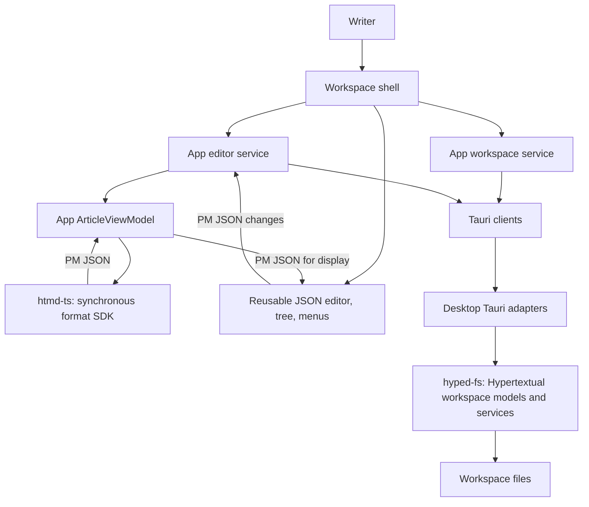

# Hypertextual software architecture

## Overview

Hypertextual is a desktop workspace for local articles. Writers browse files, edit articles, and save changes without a separate save action. The current scope is one local workspace. Tabs, cloud synchronization, and multiple workspaces remain future work.

## Requirement

### Functional

- Browse, create, rename, and delete articles and folders.
- Edit supported articles and retain drafts when saving fails.
- Store article images beside their articles and preserve portable references.

### Non-Functional

- Support macOS, Linux, and Windows.
- Keep filesystem access within the selected workspace.
- Keep reusable UI independent of storage and application policy.
- Preserve existing content when the editor cannot represent it.

## Design

### Components and Responsibilities

- The shell composes navigation, the article pane, and recovery controls.
- App services own selection, autosave, source previews, drafts, and portable image references.
- `htmd-ts` owns Markdown syntax, validation, and synchronous conversion to and from ProseMirror JSON.
- The private UI library supplies the local editor, tree, and menus through published Helical and Ark controls.
- Tauri clients exchange raw source and revisions through thin desktop command adapters.
- Private `hyped-fs` owns the Hypertextual workspace models and services, including article, image, naming, revision, and file policy.

### Data and Control Flow

Opening the workspace supplies entries for the tree. Selecting an article reads raw Markdown and its revision through the Tauri client. `EditorService` calls `htmd-ts` synchronously and asks its workspace-aware `MediaService` to resolve local and remote images for an `ArticleViewModel`. `ContentPane` supplies the resulting JSON to the editor. Unsupported nodes become editable raw-source wrappers alongside recognized content. Only an unrecoverable parser failure shows the whole source in an app-owned read-only preview.

Editor changes return native JSON. The app retains the draft, restores portable image references, and calls the synchronous writer. Autosave sends raw source to the native article service. The article service in `hyped-fs` checks the revision, stages replacement bytes, rechecks the revision and destination, and commits the replacement. The app reflects any title-based filename change.

A failed conversion or save retains the draft for recovery. Switching articles or closing the window requires pending writes to finish. Application state belongs to one window and resets on startup.

### Interfaces and Contracts

The format SDK exposes `parse`, `serialize`, and `validateDocument` with SDK-owned ProseMirror JSON types. Parsing returns JSON plus plain issues and preserves failed nodes as raw-source wrappers. Tiptap Markdown, Marked, extension objects, and the engine schema stay private. Invalid editor JSON and unsafe writes return purpose-specific errors. App integration tests validate actual parsed JSON in the mounted editor schema.

`DocumentEditor` receives document JSON and emits JSON changes. It has no format SDK or filesystem dependency. The app supplies image uploads. Source text, revisions, asset mappings, and recovery belong to app services.

The workspace client retains its raw source-text read/write API. A revision identifies the content version that the caller expects to replace. `hyped-fs` exposes Hypertextual workspace, article, and media services with the existing models and error codes. Tauri adapts these APIs without duplicating their policy.

## Implementation

### Ownership boundaries

`libs/htmd-ts` owns the current format implementation. It uses Tiptap Markdown and Marked with CommonMark and GFM. Custom syntax is limited to component data those formats cannot represent. Consolidated `nodes.ts` and `marks.ts` reuse upstream extension machinery and define custom parsing/rendering hooks. Public BDD parsing examples document the syntax and complete save/reopen contract. Svelte renders parsed nodes without defining the saved format.

`libs/ui` owns reusable UI and the local editor core. App compositions, `ArticleViewModel`, and autosave live under `apps/hypertextual-svelte/src`. Native models and services live under `libs/hyped-fs/src/models` and `src/services`. Models validate and map data without filesystem access.

`libs/hyped-fs` owns the existing Hypertextual file operations and policy together: confinement, article validation, limits, image types and names, revisions, title-derived filenames, replacement, and Trash. The desktop owns Tauri command and lifecycle adapters and serializes service mutations.

### Extension points

`htmd-rs` remains a private placeholder under its original name. Rust conversion, source-position APIs, and an LSP remain future work. Charts will use format-owned structured data and separate Svelte rendering. `hyped-fs` provides the boundary for future remote file sync, but no remote provider exists now.

Package integration suites exercise the format and filesystem APIs. App integration tests cover document sessions and schema agreement. The existing Chromium/WebKit suite covers editor and workspace behavior through a filesystem-backed Tauri substitute. Lifted package integration tests cover native workspace policy.

## References

- [hyped-fs workspace persistence](hyped-fs.md)
- [htmd-ts format SDK](htmd-ts.md)
- [UI library components](ui/index.md)
- [Svelte web app components](svelte-web-app/index.md)
- [Development commands](../development.md)
- [Product requirements](../../prd/0001-hypertextual-app/README.md)
- [Helical editor service follow-up](https://linear.app/cloudvoyant/issue/CLO-197/provide-a-self-contained-editor-service-for-document-loading-and)
- [Shared Rust filesystem follow-up](https://linear.app/cloudvoyant/issue/DIFF-244/extract-shared-rust-hyped-fs-library-for-desktop-and-cli-file)
