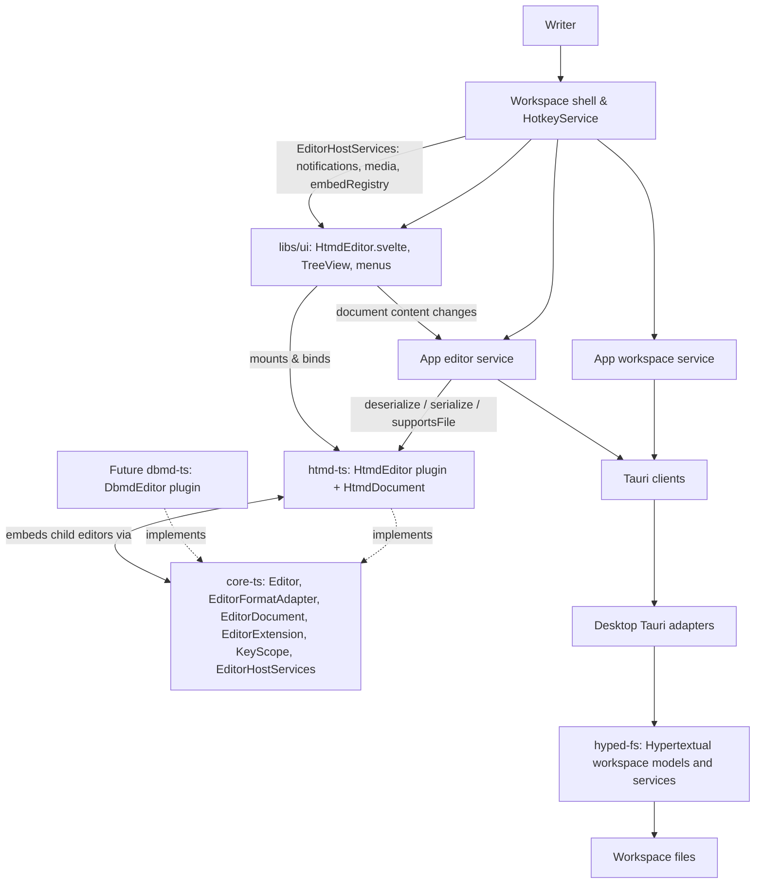

# Hypertextual software architecture

## Overview

Hypertextual is a desktop workspace for local documents across multiple rich-text and structured formats. It starts with `.htmd` and `.md` through `HtmdEditor` and expands to `.dbmd`, diagram, code, and media editors. Writers browse files, edit documents with keyboard-first modal editing, and save changes automatically. The current scope is one local workspace. Tabs, cloud synchronization, and multiple workspaces remain future work.

## Requirement

### Functional

- Browse, create, rename, and delete articles and folders.
- Edit supported document formats through format-owned editor plugins that can also embed one another.
- Route keyboard shortcuts, user notifications, and media reads and writes uniformly through host services.
- Retain drafts when saving or format serialization fails, and store article images beside their articles with portable references.

### Non-Functional

- Support macOS, Linux, and Windows.
- Keep filesystem access within the selected workspace.
- Keep editor engines private inside their format packages so each editor can run inside Hypertextual or standalone in a web browser.
- Preserve existing content as editable raw-source blocks or spans when a format editor cannot represent a fragment.

## Design

### Components and Responsibilities

- `core-ts` defines the engine- and framework-neutral contracts for editor plugins (`Editor<TDoc, TCommandMap>`, `EditorFormatAdapter<TDoc>`, `EditorDocument<TDoc>`), extensions (`defineEditorExtension`), hierarchical key scopes (`KeyScopeOptions`), notifications (`EditorNotificationService`), media reading/writing (`EditorMediaService`), and recursive editor embedding (`EmbeddedEditorRegistry`).
- Format packages (such as `htmd-ts` for `.htmd`/`.md` and a future `dbmd-ts` for `.dbmd`) own their supported format declarations (`formats: ['htmd', 'md']`), their concrete editor plugin (`HtmdEditor`, `DbmdEditor`), their `EditorDocument` implementation (`HtmdDocument`), and their internal format codec (`lib.ts`). Each format package encapsulates its internal editing and conversion engines (e.g. Tiptap/ProseMirror and Marked in `htmd-ts`) and registers its own editor keyscope (`editor:htmd`, `editor:dbmd`) and extension keymaps.
- `libs/ui` (`@hypertextual/ui`) supplies reusable Svelte components (`HtmdEditor.svelte`, `TreeView`, `Breadcrumb`, `ContextMenu`, `FontSelector`, `ThemeToggle`) and Svelte NodeViews/overlays mounted into `HtmdEditor` through published Helical (`useKeymap`) and Ark controls without importing `@tiptap/*`.
- App services (`WorkspaceService`, `EditorService`, `HotkeyService`, `SettingsService`, `MediaService`) own workspace selection, `EditorHostServices` injection (`notifications`, `media`, `embedRegistry`), autosave, source previews, and portable media asset storage (`hyped-fs`) without hardcoding file-format regexes or conversion logic.
- Tauri clients exchange raw source and revisions through thin desktop command adapters.
- Private `hyped-fs` owns the Hypertextual workspace models and services, including article, image, naming, revision, and file policy.

### Data and Control Flow

Opening the workspace supplies entries for the tree. Selecting an article reads raw source and its revision through the Tauri client. `EditorService` checks format support via the editor plugin (`HtmdEditor.supportsFile`), deserializes the source (`HtmdEditor.deserialize(source) -> HtmdDocument`), and asks its workspace-aware `MediaService` to resolve local and remote images (`document.displayImages`). `ContentPane` supplies the document content and `workspace.editorServices` (`EditorHostServices`) to `HtmdEditor.svelte`, which mounts the concrete `HtmdEditor` controller from `htmd-ts`. Unsupported nodes become editable raw-source wrappers alongside recognized content. Only an unrecoverable parser failure shows the whole source in an app-owned read-only preview.

Keystrokes flow through Helical's `WhichKeyController`, which resolves hierarchical keymap layers (`overlay` -> `widget` -> `extension` -> `editor` -> `pane` -> `global`, with innermost DOM containment winning when an embedded child editor is focused). Editor and extension notifications (such as modal yank confirmations or errors) emit through `EditorNotificationService`.

Editor changes return updated document content. `EditorService` restores portable image references via `document.transformImages` and updates the `EditorDocument` (`document.update(portable)`), which validates and serializes the draft inside `htmd-ts` while extracting the current title. Autosave sends raw source to the native article service. The article service in `hyped-fs` checks the revision, stages replacement bytes, rechecks the revision and destination, and commits the replacement. The app reflects any title-based filename change.

A failed conversion or save retains the draft for recovery. Switching articles or closing the window requires pending writes to finish. Application state belongs to one window and resets on startup.

### Interfaces and Contracts

- Each file-type or embeddable block editor implements `Editor<TDoc, TCommandMap>` and `EditorFormatAdapter<TDoc>` from `core-ts` and accepts `EditorHostServices` (`hotkeys`, `notifications`, `media`, `embedRegistry`). Extensions use `defineEditorExtension` and declare shortcuts with `Keymap<TCtx>`.
- `htmd-ts` exposes `HtmdEditor` (`formats: ['htmd', 'md']`), `HtmdDocument` (`EditorDocument`), `defineHtmdExtension`, `createHtmdEditorKeymap`, and engine-free node-view, overlay, and suggestion contracts. Tiptap, ProseMirror, Marked, `lowlight`, and internal conversion helpers (`lib.ts`) stay private inside `htmd-ts`.
- `HtmdEditor.svelte` in `@hypertextual/ui` receives document content, `editable`, `services?: EditorHostServices`, and `onchange` or `onUpload` callbacks. It mounts `HtmdEditor` from `htmd-ts` and Svelte 5 node views without engine dependencies. Components and overlays register scoped keymaps with Helical's `useKeymap`.
- The workspace client retains its raw source-text read and write API. A revision identifies the content version that the caller expects to replace. `hyped-fs` exposes Hypertextual workspace, article, and media services with existing models and error codes.

## Implementation

### Ownership Boundaries

- `libs/core-ts` owns the abstract `Editor`, `EditorFormatAdapter`, `EditorDocument`, `EditorExtension` (`defineEditorExtension`), `KeyScopeOptions`, `EmbeddedEditorRegistry`, and `EditorHostServices` contracts.
- `libs/htmd-ts` owns `HtmdEditor`, `HtmdDocument`, the internal HTMD Markdown codec (`src/lib.ts`, `src/nodes.ts`, `src/marks.ts`, `src/syntax.ts`), and the HTMD editor extensions (`src/editor/htmd-editor.ts`, `src/editor/htmd-document.ts`, `src/editor/define-htmd-extension.ts`, `src/editor/build-extensions.ts`, and `src/editor/extensions/*`).
- `libs/ui` owns reusable Svelte UI primitives, `HtmdEditor.svelte`, and Svelte NodeViews/overlays (`src/editor/components/*`).
- `apps/hypertextual-svelte` owns app services (`HotkeyService`, `EditorService`, `WorkspaceService`, `MediaService`, `SettingsService`), `Autosave`, and shell composition without format-specific AST or conversion code.
- `libs/hyped-fs` owns native workspace confinement, article validation, limits, image types and names, revisions, title-derived filenames, replacement, and Trash.

### Extension Points and Testing

New document or block formats (such as `DbmdEditor`, Mermaid, Draw.io, or Manim) implement `Editor<TDoc, TCommandMap>` from `core-ts`, define their own `scopeId` (`editor:dbmd`, etc.) and extensions via `defineEditorExtension`, and register with `EmbeddedEditorRegistry` so they can run both as top-level pane editors and as embedded block editors inside `HtmdEditor` (or vice versa).

- `libs/core-ts/src/core.test.ts` tests `KeyScopeDispatcher` priority and nested DOM containment, `defineEditorExtension`, and `EmbeddedEditorRegistry`.
- `libs/htmd-ts` owns unit and integration tests (`nodes.test.ts`, `marks.test.ts`, `lib.test.ts`, `editor/htmd-editor.test.ts`) that verify the Markdown codec, `HtmdEditor` commands and modal editing, key scopes, host services, and embedded editor handoff.
- `e2e/hypertextual-desktop/` exercises the integrated desktop workspace, `HtmdEditor.svelte`, modal editing, and `HotkeyService` through a filesystem-backed Tauri substitute.
- `libs/hyped-fs/tests` covers native Rust workspace and filesystem policy.

## References

- [core-ts editor plugin architecture](core-ts.md)
- [htmd-ts format and editor plugin architecture](htmd-ts/index.md)
- [hyped-fs workspace persistence](hyped-fs.md)
- [Keybindings](../keybindings/index.md)
- [UI library components](ui/index.md)
- [Svelte web app components](svelte-web-app/index.md)
- [Development commands](../development.md)
- [Product requirements](../../prd/0001-hypertextual-app/README.md)
- [HYPE-169: Unify EditorExtension system and Svelte component keybindings](https://linear.app/cloudvoyant/issue/HYPE-169/refactorui-unify-editorextension-system-and-svelte-component)
