# Architecture

## Overview

Hypertextual combines a Tauri desktop application, a Svelte frontend, a Rust CLI, and shared HTMD libraries. The desktop application hosts the frontend and its Rust backend in one installed application.

The project uses Tauri 2, Svelte 5, TypeScript, Vite 8, Rust 2024, and Clap 4. [Premise](https://github.com/cloudvoyant/premise) manages project tasks, with Mise providing tools and Bun and Cargo managing dependencies.

## Requirements

### Functional requirements

- Run the Svelte interface inside the desktop application and in a browser.
- Expose Rust operations to the desktop frontend through Tauri commands, events, and channels.
- Provide a CLI package named `hypertextual` with the executable name `hyped`.

### Non-functional requirements

- Support macOS, Linux, and Windows desktop platforms.
- Embed frontend assets so installed applications run without Bun, Node, or a development server.
- Keep document behavior reusable through shared Rust and TypeScript libraries.
- Support frontend hot module replacement and automatic Rust rebuilds during development.
- Keep the HTMD libraries and Svelte package private.

## Design

### Project structure

```text
hypertextual/
├── apps/
│   ├── hypertextual-desktop/  Tauri shell and Rust backend
│   ├── hypertextual-svelte/   Svelte frontend
│   └── hypertextual-cli/      Rust CLI, executable hyped
└── libs/
    ├── htmd-rs/               Shared Rust document library
    ├── htmd-ts/               Reserved TypeScript HTMD format SDK starter
    └── ui/                    Private Svelte wrappers around Ark UI primitives
```

### Component boundaries



- `hypertextual-svelte` renders the interface inside Tauri's webview and can run independently in a browser.
- `hypertextual-desktop` owns the native application window and Rust backend, with Tauri providing the communication boundary.
- Commands carry frontend requests to Rust and return results, while events and channels carry updates from Rust to the frontend.
- `hypertextual-cli` provides the `hyped` executable through the Cargo package named `hypertextual`.
- The HTMD libraries are format SDK starters; they do not own editor schemas, UI state, or Markdown editor adapters.
- The frontend uses the published Helical editor and its shared TypeScript node factories. Its local Markdown adapter bridges editor JSON and files until Helical exposes a persistence API.

### Development flow


- The desktop development task starts Vite at `http://127.0.0.1:1420` and loads that URL inside the Tauri window.
- Vite applies frontend changes without restarting Rust, while Rust changes rebuild and restart the desktop process.
- Bun manages the Svelte app and TypeScript library through the root package workspace, with one shared dependency-install task.

### Packaging flow


- The desktop build runs the frontend build first, then embeds `apps/hypertextual-svelte/dist` into the application.
- Installed desktop applications load their embedded assets and do not connect to a frontend development server.
- The root Cargo workspace contains the CLI, while the desktop app and Rust library use independent Cargo manifests.

### Workspace and save flow

Tauri owns access to `~/.hypertextual/workspace`. Its commands list folders, read articles, and write edits. Each command rejects paths outside the workspace. The frontend never receives unrestricted access to the filesystem.

The Svelte interface uses the helical editor and layout components from npm. The editor represents content as Tiptap JSON, a structured document format. The app-local Markdown adapter converts supported Markdown to this format and converts edits back to source, reusing Helical notice/image factories and upstream Tiptap extensions and types. Unsupported source stays read-only.

Each selected article owns an autosave queue. The queue waits briefly after typing and sends one write at a time. Each write includes the revision from the last successful read or write. A revision is a hash of the file contents. The backend checks that revision before it replaces the file.

The backend writes through a temporary file in the same directory. It retains file permissions and rejects external changes. The frontend drains pending writes before an article switch, window close, or app quit. Failed writes keep the draft open for retry or copying. The app keeps no selected article or folder state across launches.

## Implementation

Supported desktop platforms:

- macOS.
- Linux.
- Windows.

## References

- [Development guide](../development.md).
- [Product requirements](../../prd/0001-hypertextual-app/README.md).
- [Design prototype](../../designs/prototypes/hypertextual-v0/README.md).
- [Premise](https://github.com/cloudvoyant/premise).
- [Tauri frontend and Rust communication](https://v2.tauri.app/develop/calling-rust/).
- [Tauri and Vite integration](https://v2.tauri.app/start/frontend/vite/).

The workspace sidebar uses the published Helical Sidebar components. The private `@hypertextual/ui` library supplies a Helical-style wrapper around [Ark UI Tree View](https://ark-ui.com/docs/components/tree-view). Ark owns tree navigation and accessibility; the app owns workspace reads, article selection, and file and folder creation.
