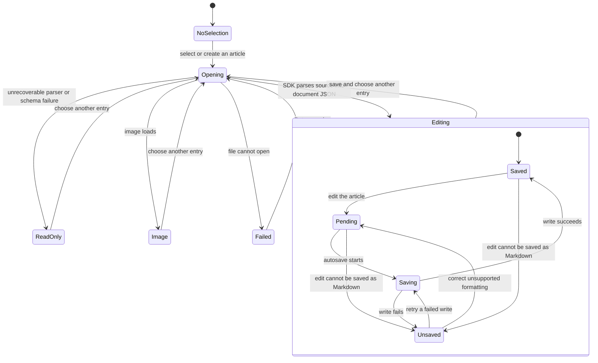

# Content pane

## Overview

The content pane presents the selected document, image, or empty workspace preview. Its footer shows the article breadcrumb, current mode, and save status.

## Design

### Public API

`ContentPaneProps` is declared inside the component and contains a `WorkspaceService`. DocumentEditor receives native document JSON and emits JSON changes. The app editor service passes those changes through `ArticleViewModel` and `htmd-ts`. Unsupported nodes stay editable in the document as raw-source wrappers. This pane renders source read-only only after an unrecoverable parser failure.

```svelte
<ContentPane {workspace} />
```

### Layout

No selection:

```text
+------------------------------------------------------------------------+
|                                                                        |
|                                                                        |
|                                                                        |
|                                                                        |
|                                                                        |
|                 [document]                                             |
|                                                                        |
|                 Your workspace, ready to write.                        |
|                                                                        |
|          Select an article, or create a new one.                       |
|                                                                        |
|                                                                        |
|                                                                        |
|                                                                        |
|                                                                        |
+------------------------------------------------------------------------+
|  No article selected                                      Local files  |
+------------------------------------------------------------------------+
```

Article selected:

```text
+------------------------------------------------------------------------+
|                                                                        |
|                                                                        |
|       A saved article                                                  |
|                                                                        |
|                                                                        |
|       Start writing your article here.                                 |
|                                                                        |
|                                                                        |
|                                                                        |
|                                                                        |
|                                                                        |
|                                                                        |
|                                                                        |
|                                                                        |
|                                                                        |
+------------------------------------------------------------------------+
|  Local workspace > Drafts > A saved article               View  Saved  |
+------------------------------------------------------------------------+
```

Unsupported source, rendered by this app pane:

```text
+------------------------------------------------------------------------+
|                                                                        |
|  This article contains syntax the editor cannot preserve.              |
|  The original source is shown read-only.                               |
|                                                                        |
|  :::chart                                                              |
|  {"series": [1, 2, 3]}                                                 |
|  :::                                                                   |
|                                                                        |
+------------------------------------------------------------------------+
|  Local workspace > Imported article                         Read-only  |
+------------------------------------------------------------------------+
```

The article has no heading bar. Only the document body scrolls. The footer uses the Ark-based Breadcrumb component. Its final item shows the article title, and its tooltip shows the saved path. The pane focuses the scroll region after opening an article or leaving edit mode. Arrow keys then use native browser scrolling. Its reading area is centered, with a maximum width of 820 px and 48 px horizontal padding. Padding reduces to 24 px below a 700 px viewport width.

### State and Data Flow



- The heading and footer show the current article title. Hover either title to see its path.

## Implementation

- Key the editor by `editor.version`, not the selected path. Saving a new title can rename the file without replacing the editing session.
- Wait for `tick()` before forwarding a focus request to a newly mounted editor.
- Keep original-source previews here. The reusable editor receives document JSON and upload callbacks, without source sessions or format errors.
- `EditorService` asks its workspace-aware `MediaService` to batch-get local and remote images, then uses a method-local map to substitute portable references with blob URLs in the displayed `ArticleViewModel`. Save transformations restore portable origins, including newly uploaded assets. The media service retains origin records for the workspace window and revokes its blob URLs and clears the records when disposed; failed local or remote reads retain the original reference.
