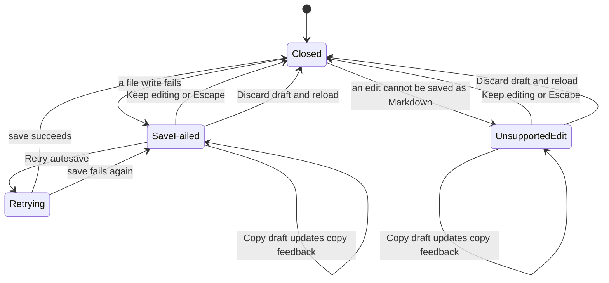

# Draft recovery dialog

## Overview

The recovery dialog presents choices after document conversion or saving fails. It is an application-specific composition of published Helical controls.

## Design

### Public API

`DraftRecoveryDialogProps` declares `open`, `message`, `copyStatus`, `busy`, and callbacks for close, copy, discard, and optional retry.

```svelte
<DraftRecoveryDialog {open} {message} onclose={keepEditing} oncopy={copyDraft} ondiscard={reload} />
```

### Layout

Save failure:

```text
+----------------------------------------------------------------------------+
|                                                                            |
|  Changes need attention                                                    |
|                                                                            |
|  Disk unavailable.                                                         |
|  Your draft is retained.                                                   |
|  Discard replaces it with the last saved version.                          |
|                                                                            |
| Keep editing   Copy draft   Retry autosave   Discard draft and reload      |
|                                                                            |
+----------------------------------------------------------------------------+
```

Unsupported formatting:

```text
+----------------------------------------------------------------------------+
|                                                                            |
|  Changes need attention                                                    |
|                                                                            |
|  This formatting cannot be saved as Markdown.                              |
|  Your draft is retained.                                                   |
|  Discard replaces it with the last saved version.                          |
|                                                                            |
| Keep editing   Copy draft   Discard draft and reload                       |
|                                                                            |
+----------------------------------------------------------------------------+
```

The modal is centered above the workspace. Retry appears only for a save failure. Busy operations disable Retry and Discard while the draft remains visible behind the modal.

### State and Data Flow



- Focus stays inside the open dialog. While the host is busy, Retry and Discard are disabled.

## Implementation

- Keep `EditorService.reload()` waiting for active writes before reopening the file. A late write can otherwise replace the reloaded content.
- Strip duplicate recovery instructions before adding the shared draft-retention explanation.
