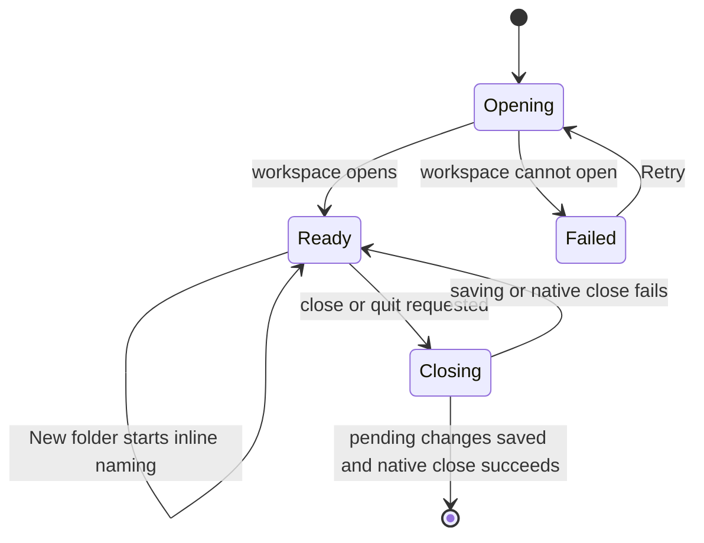
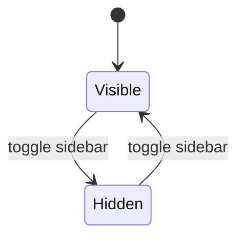

# Shell

## Overview

The shell is the desktop workspace frame. It composes navigation, file actions, the workspace explorer, the content pane, and draft recovery.

## Design

### Public API

`Shell` accepts a `WorkspaceClient`. `App` supplies the production Tauri client. Tests supply isolated Tauri behavior at the transport boundary.

```svelte
<Shell client={workspaceClient} />
```

### Layout

Sidebar expanded:

```text
+----------------------------------------------------------------------------------------------+
| [=]  hypertextual    [Local workspace v]                                                     |
+--------------------+-------------------------------------------------------------------------+
| Workspace [+] [+d] |  A saved article                                                    MD  |
|                    +-------------------------------------------------------------------------+
| Drafts/            |                                                                         |
| | First article    |                                                                         |
| | Research/        |       A saved article                                                   |
| Archive/           |                                                                         |
|                    |                                                                         |
|                    |       Start writing your article here.                                  |
|                    |                                                                         |
|                    |                                                                         |
|                    |                                                                         |
|                    |                                                                         |
|                    |                                                                         |
|                    |                                                                         |
|                    |                                                                         |
|                    |                                                                         |
|                    |                                                                         |
|                    |                                                                         |
|                    |                                                                         |
|                    |                                                                         |
|                    +-------------------------------------------------------------------------+
|                    |  A saved article                                                 Saved  |
+--------------------+-------------------------------------------------------------------------+
```

Sidebar collapsed:

```text
+----------------------------------------------------------------------------------------------+
| [=]  hypertextual    [Local workspace v]                                                     |
+----------------------------------------------------------------------------------------------+
|  A saved article                                                                         MD  |
+----------------------------------------------------------------------------------------------+
|                                                                                              |
|                                                                                              |
|                 A saved article                                                              |
|                                                                                              |
|                                                                                              |
|                 Start writing your article here.                                             |
|                                                                                              |
|                                                                                              |
|                                                                                              |
|                                                                                              |
|                                                                                              |
|                                                                                              |
|                                                                                              |
|                                                                                              |
|                                                                                              |
|                                                                                              |
|                                                                                              |
|                                                                                              |
+----------------------------------------------------------------------------------------------+
|  A saved article                                                                      Saved  |
+----------------------------------------------------------------------------------------------+
```

The sidebar occupies 236 px of the window, below the 36 px title bar. Its footer is empty. The content pane fills the remaining width, with its status bar at the bottom.

### State and Data Flow



Sidebar visibility changes independently of the selected document:



## Implementation

- Notify Rust that the frontend is ready only after both close and quit listeners are registered.
- Release listeners that finish registering after unmount. Otherwise, a closed shell can leave handlers active.
