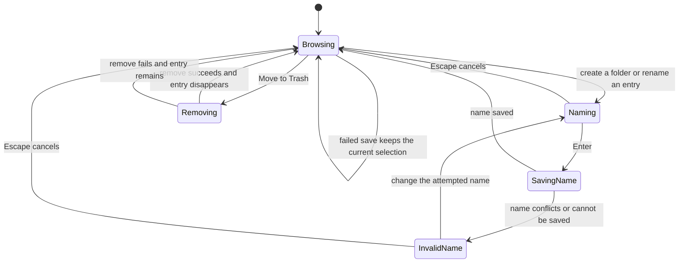

# Workspace explorer

## Overview

The workspace explorer presents workspace entries inside the shell sidebar. It connects workspace actions to the reusable TreeView.

## Design

### Public API

`WorkspaceExplorerProps` is declared inside the component and contains one `WorkspaceService`. The component forwards the service view model to TreeView and supplies workspace icons.

```svelte
<WorkspaceExplorer {workspace} />
```

### Layout

Folders collapsed:

```text
Drafts/
Archive/
Welcome
```

Drafts expanded:

```text
Drafts/
|-- First article
`-- Research/
Archive/
Welcome
```

Creating a folder inside Drafts:

```text
Drafts/
|-- [ New folder             ]
|-- First article
`-- Research/
Archive/
Welcome
```

The tree fills the sidebar width below the Workspace actions. Folder icons occupy a fixed box and change with expansion. Article labels use their headings, while pending folders show an inline input.

### State and Data Flow



- Right-click a folder to create articles or folders inside it. Folder expansion and keyboard navigation follow the [TreeView states](../ui/tree-view.md#state-and-data-flow).

## Implementation

- Use article headings for display labels. Keep tree values tied to entry paths.
- Let rename failures reject the promise returned to TreeView. Resolving that promise ends the inline edit.
