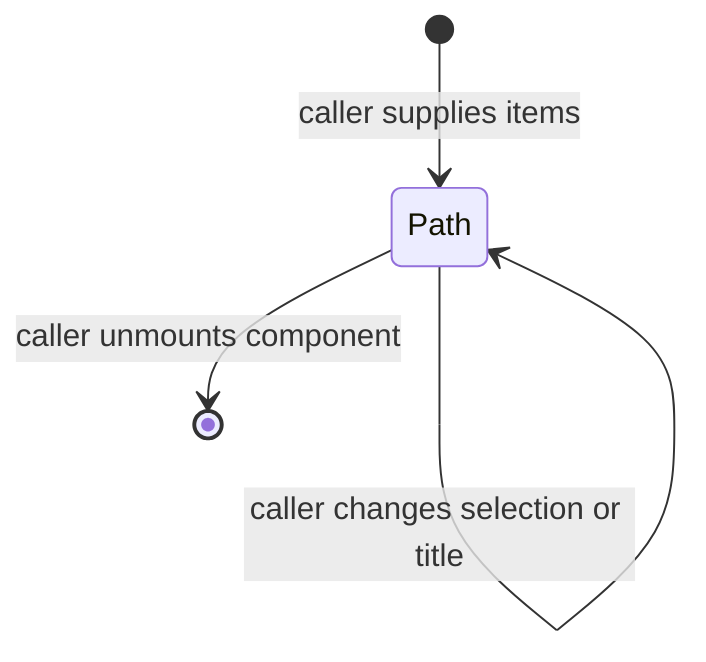

# Breadcrumb

## Overview

Breadcrumb shows the path to the current item. ContentPane uses it in the article footer.

## Design

### Public API

`BreadcrumbProps` accepts `items: string[]`, an optional accessible `label`, a path `title`, and a caller `class`.

```svelte
<Breadcrumb items={['Local workspace', 'Drafts', 'Article']} label="Article path" />
```

### Layout

```text
Local workspace > Drafts > Article
```

The list stays on one line. Labels truncate when space is limited.

### State and Data Flow



The final item has `aria-current="page"`. The component uses a labeled navigation element and an ordered list.

## Implementation

- Compose Ark factory elements with semantic theme tokens and Lucide separators.
- Keep filesystem paths and selection state in the caller.
