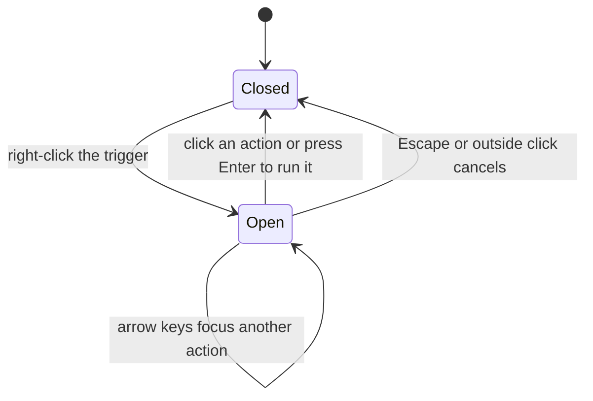

# Context menu

## Overview

ContextMenu is a generic action menu built on Ark UI Menu. Workspace branches and articles supply its actions.

## Design

### Public API

`ContextMenuProps` declares `items`, `onaction`, a trigger snippet, size, and caller classes. `ContextMenuItem` contains a value, label, optional shortcut, and destructive flag.

```svelte
<ContextMenu items={actions} onaction={runAction}>
  {#snippet children(_props)}<span>Open actions here</span>{/snippet}
</ContextMenu>
```

### Layout

Open menu over the sidebar and adjacent article area:

```text
+--------------------------------------------------------------------------+
| Workspace       [+] [+d]   |  A saved article                            |
|                            |                                             |
| Drafts/  x                 |                                             |
|          +-------------------+                                           |
| | First a| New article       |    A saved article                        |
|          | New folder        |                                           |
| | Researc| Rename         F2 |                                           |
|          | Move to Trash     |    Start writing here.                    |
| Archive/ +-------------------+                                           |
|                            |                                             |
|                            |                                             |
|                            |                                             |
|                            |                                             |
|                            |                                             |
|                            |                                             |
+--------------------------------------------------------------------------+
```

`x` marks the right-click position on the Drafts row. The menu opens below that point and overlays both the tree and the adjacent pane. It has a minimum width of 164 px, with 25 px compact rows. Shortcut labels align at the right edge.

### State and Data Flow



## Implementation

- Keep the portal outside sidebar clipping, with the positioner above the sidebar layer.
- Reposition after `tick()` and the next animation frame. The menu needs its mounted dimensions to align with the cursor.
- Upstream component work is tracked in [CLO-198](https://linear.app/cloudvoyant/issue/CLO-198/add-a-generic-ark-ui-context-menu-using-the-hypertextual).
