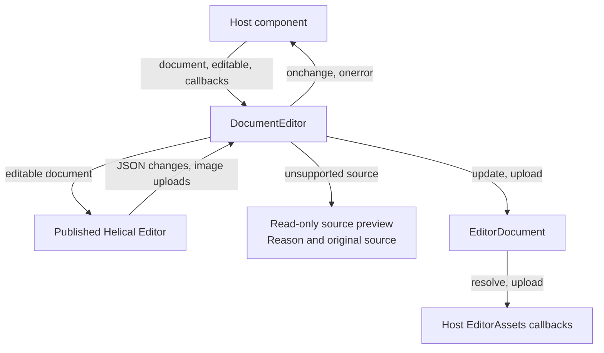
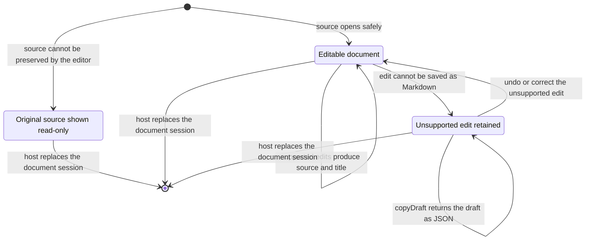

# Document editor

## Overview

DocumentEditor wraps the published Helical editor with a portable document API. Hosts exchange source text and title metadata without traversing editor JSON.

## Design

### Public API

`EditorDocument.open(source, assets?)` prepares a document. The session exposes title, editability, source, serialization, and draft-copy operations. `DocumentEditorProps` accepts the session, editability, and change/error callbacks. The component handle exposes `focus()`.

`EditorAssets` supplies `resolve(source)` and `upload(file)`. Upload results include a persisted source reference and a display URL. The host decides how storage works.

```svelte
<DocumentEditor document={session} onchange={saveChange} onerror={showRecovery} />
```

### Component Diagram



DocumentEditor renders either the Helical editor or the source preview. The host supplies the document session and asset callbacks. The wrapper forwards `focus()` to the mounted Helical editor.

### Layout

Editable document, including an inserted notice:

```text
+------------------------------------------------------------------+
|                                                                  |
|  A saved article                                                 |
|                                                                  |
|                                                                  |
|  Start writing your article here.                                |
|                                                                  |
|  +------------------------------------------------------------+  |
|  | [i] Note                                                   |  |
|  |     Add the notice body here.                              |  |
|  +------------------------------------------------------------+  |
|                                                                  |
|                                                                  |
+------------------------------------------------------------------+
```

Unsupported source:

```text
+------------------------------------------------------------------+
|                                                                  |
|  This article contains syntax the editor cannot preserve.        |
|  The original source is shown read-only.                         |
|                                                                  |
|  :::chart                                                        |
|  {"series": [1, 2, 3]}                                           |
|  :::                                                             |
|                                                                  |
|                                                                  |
|                                                                  |
|                                                                  |
+------------------------------------------------------------------+
```

The wrapper occupies the host content area without a toolbar or footer of its own. Helical renders the editable blocks. The source fallback places its reason above the original text.

### State and Data Flow



- In an editable document, `/` opens the block menu. Arrow keys choose an item, Enter inserts it, and Escape closes the menu.

## Implementation

- Restore saved image paths before serialization. Display URLs must never enter saved Markdown.
- Return unchanged source exactly, including its line endings. Reject conversions that lose content and retain the latest draft.
- Cover document sessions in `document.test.ts` and Markdown preservation in `markdown.test.ts`.
- Editor ownership work is tracked in [HYPE-160](https://linear.app/cloudvoyant/issue/HYPE-160/vendor-the-helical-editor-for-development-inside-hypertextual) and [CLO-197](https://linear.app/cloudvoyant/issue/CLO-197/provide-a-self-contained-editor-service-for-document-loading-and).
