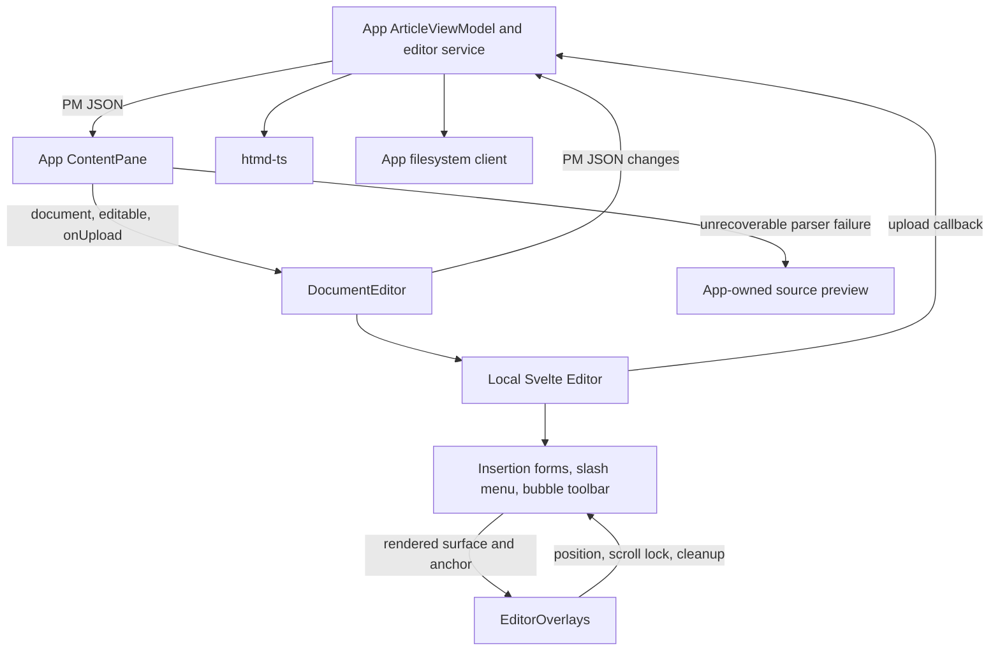
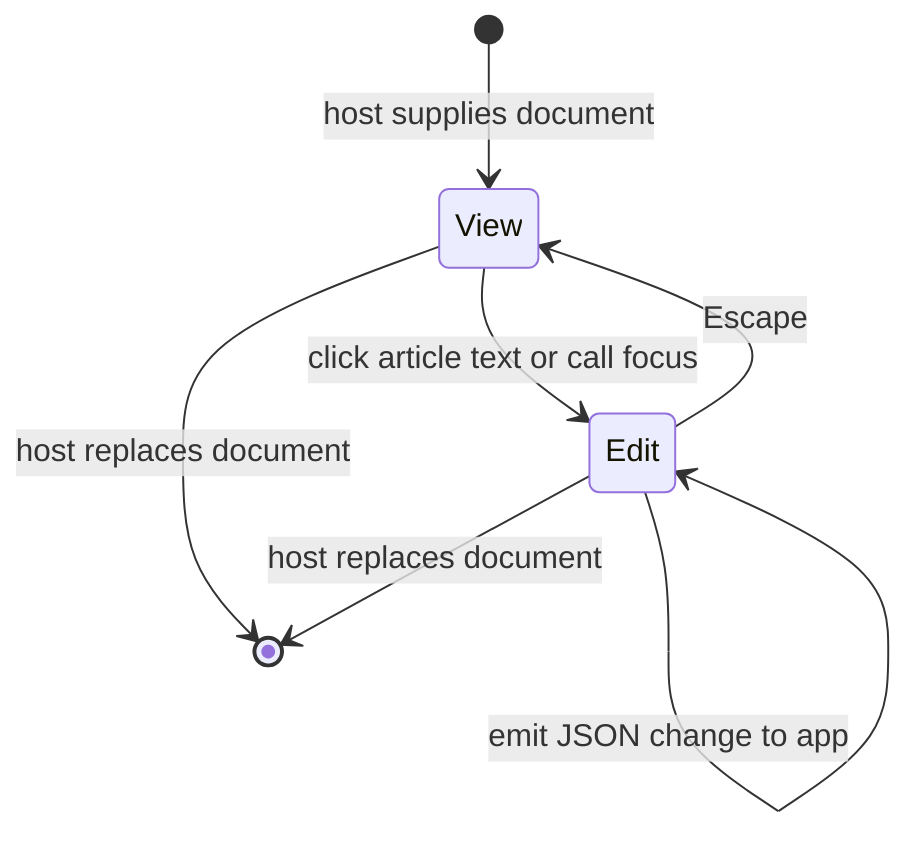
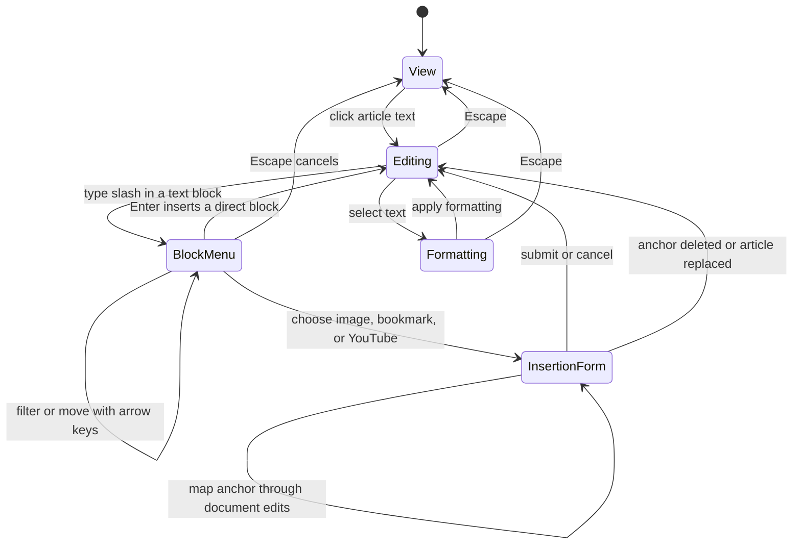

# Document editor

## Overview

DocumentEditor hosts the local Svelte editor with a native ProseMirror JSON API. The app supplies parsed content and receives document changes. Every supported node, mark, and attribute must survive the app's full save/reopen workflow, including formatting on whitespace.

## Design

### Public API

`DocumentEditorProps` accepts `document: JSONContent`, optional `editable`, and `onchange(document: JSONContent)`. The optional `onUpload(file)` callback returns an image display `src` and optional `srcset`. The optional `oneditablechange(editable)` callback requests an editability change and returns the accepted boolean. The app owns that boolean. The component handle exposes `focus()`, which requests editing before focusing the document. `class` styles the scroll region, and `contentClass` styles the inner document.

```svelte
<DocumentEditor
  document={article.content}
  editable={!workspace.blocked}
  onchange={(document) => editor.change(document)}
  onUpload={uploadImage}
/>
```

The app's `ArticleViewModel` owns source, draft, display JSON, title extraction, and pure document transformations. `EditorService` coordinates format validation, files, media, and autosave. The workspace-aware `MediaService` fetches and uploads local and remote assets. Unsupported nodes remain editable as raw-source wrappers; `ContentPane` shows the whole source only after an unrecoverable parser failure. These services and views are outside the reusable component.

### Component Diagram



DocumentEditor uses the supplied `editable` flag and forwards its focus handle. EditorService owns that flag. There is no separate `editing` state or modal state context. It does not import the format SDK, parse Markdown, or perform filesystem operations.

### Layout

Editable document, including an inserted notice:

```text
+------------------------------------------------------------------+
|                                                                  |
|  A saved article                                                 |
|                                                                  |
|                                                                  |
|  Start writing your article here.                                |
|                                                                  |
|  +------------------------------------------------------------+  |
|  | [i] Note                                                   |  |
|  |     Add the notice body here.                              |  |
|  +------------------------------------------------------------+  |
|                                                                  |
|                                                                  |
+------------------------------------------------------------------+
```

The wrapper fills the host content area without a toolbar or footer of its own. View mode hides editing controls and the formatting toolbar. Video playback and code copying remain available. DocumentEditor owns the focusable scroll region. It focuses that region while editing is disabled so arrow keys scroll the article. The local editor renders blocks with Helical and Ark controls. The app owns loading, save status, source previews, and recovery dialogs.

### State and Data Flow



The editor keeps selection, transactions, and node views. EditorService owns the current `editable` flag and resets it when the selected article changes. If the host disables editing, the component hides edit controls and preserves the chosen mode. The app processes emitted JSON synchronously through `htmd-ts` before scheduling a save. Format or storage errors retain the app draft and open app recovery. Replacing the article destroys the previous editor and overlay bindings.

### Behavior



The component disables forced-title enforcement. The app extracts the first H1 from document JSON for display titles and saved filenames. `EditorOverlays` owns insertion requests, surface positioning, and scroll locks. Forms follow mapped document anchors, slash suggestions follow their range, and the toolbar follows selection. Svelte and Ark own the controls and keyboard interaction. Text formatting includes highlight and font color; text alignment is unavailable for both headings and paragraphs.

## Implementation

- Let node views read Tiptap editability through update subscriptions. Forward document updates only when the transaction changes document content.

- Compose published Helical prose variants for editor typography. Keep app CSS to layout so heading sizes and spacing have one owner. Avoid Tailwind Typography inside the editor; its generated quote characters and code margins are for rendered prose.
- Render editable code without whitespace around its node-view content. Place the language selector at the left of the shared code-block header.

- Keep component props and change events as native JSON, without encoded JSON strings or source sessions.
- Supply framework node views through configured Tiptap extensions. Keep format and filesystem dependencies outside the UI package.
- Use `@hypertextual/ui/editor-schema` for app schema agreement tests. Cover format syntax in SDK BDD integration examples.
- Cover editability and scrolling in `e2e/hypertextual-desktop/modal-editing.spec.ts`. Cover document interaction and overlays in `editor.spec.ts`. Do not add tests inside UI extensions.
- See [editor source ownership](editor-source.md) for provenance, dependencies, coverage, and the upstream transplant procedure.
