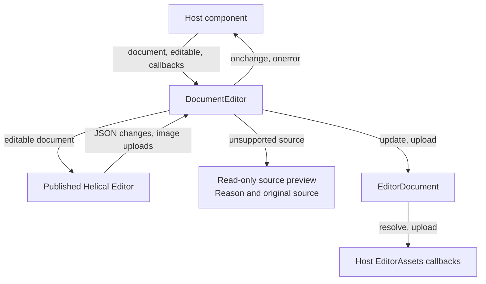
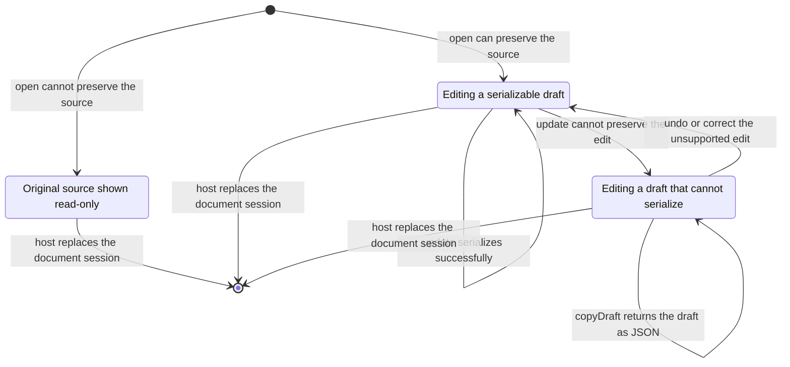
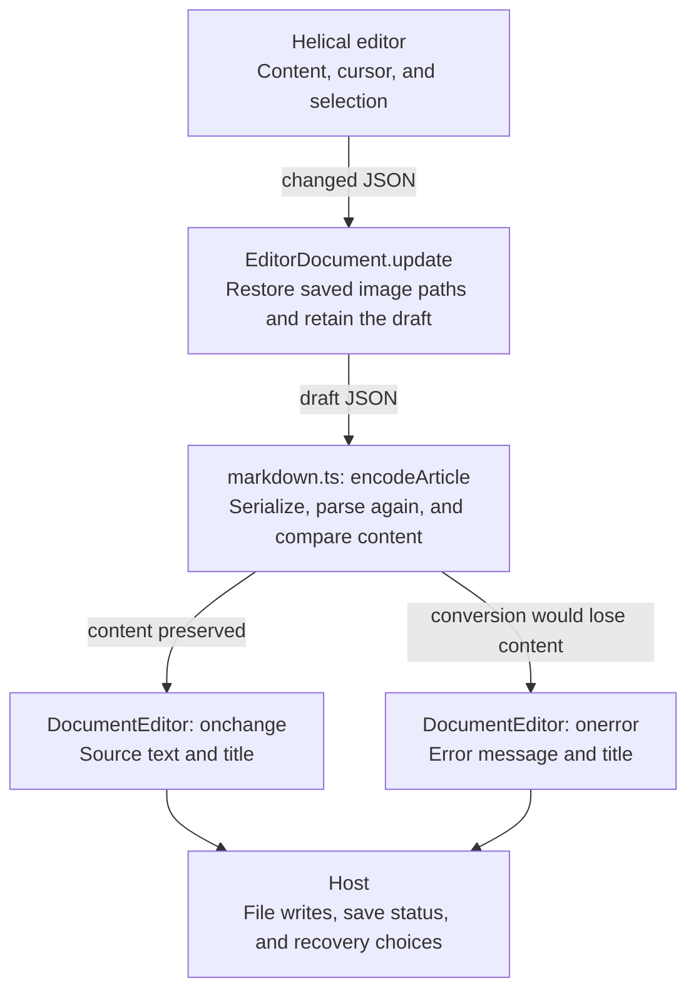

# Document editor

## Overview

DocumentEditor wraps the published Helical editor with a portable document API. Hosts exchange source text and title metadata without traversing editor JSON.

## Design

### Public API

`EditorDocument.open(source, assets?)` prepares a document. The session exposes title, editability, source, serialization, and draft-copy operations. `DocumentEditorProps` accepts the session, editability, and change/error callbacks. The component handle exposes `focus()`.

`EditorAssets` supplies `resolve(source)` and `upload(file)`. Upload results include a persisted source reference and a display URL. The host decides how storage works.

```svelte
<DocumentEditor document={session} onchange={saveChange} onerror={showRecovery} />
```

### Component Diagram



DocumentEditor renders either the Helical editor or the source preview. The host supplies the document session and asset callbacks. The wrapper forwards `focus()` to the mounted Helical editor.

### Layout

Editable document, including an inserted notice:

```text
+------------------------------------------------------------------+
|                                                                  |
|  A saved article                                                 |
|                                                                  |
|                                                                  |
|  Start writing your article here.                                |
|                                                                  |
|  +------------------------------------------------------------+  |
|  | [i] Note                                                   |  |
|  |     Add the notice body here.                              |  |
|  +------------------------------------------------------------+  |
|                                                                  |
|                                                                  |
+------------------------------------------------------------------+
```

Unsupported source:

```text
+------------------------------------------------------------------+
|                                                                  |
|  This article contains syntax the editor cannot preserve.        |
|  The original source is shown read-only.                         |
|                                                                  |
|  :::chart                                                        |
|  {"series": [1, 2, 3]}                                           |
|  :::                                                             |
|                                                                  |
|                                                                  |
|                                                                  |
|                                                                  |
+------------------------------------------------------------------+
```

The wrapper occupies the host content area without a toolbar or footer of its own. Helical renders the editable blocks. The source fallback places its reason above the original text.

### Behavior

- Open supported source as an editable document with headings, text, lists, notices, code blocks, and images.
- Type `/` to find and insert a block. Edit notice titles, types, and bodies directly in the document.
- Display inserted images inline and retain their captions when reopening the document.
- Show unsupported source as read-only text with a reason instead of replacing or losing its content.
- Keep the current draft available when a change cannot be represented in the document format.
- Support keyboard selection in the slash menu, with Enter to insert and Escape to dismiss.

## Implementation

### State and Data Flow

Document states:



An unsupported edit stays in the document. The user can continue editing or copy the draft while the host presents recovery choices.

Edit data flow:



### Maintainer Notes

- Before saving, replace image display URLs with the source references returned by the host, such as `.images/photo.png`.
- If the document content is unchanged, return the original source exactly. This preserves its formatting and line endings.
- If conversion loses content, report an error and retain the latest draft. `copyDraft()` returns JSON when Markdown conversion fails.
- Test document sessions and image references in `document.test.ts`. Test Markdown conversion and supported blocks in `markdown.test.ts`.

[CLO-197](https://linear.app/cloudvoyant/issue/CLO-197/provide-a-self-contained-editor-service-for-document-loading-and) tracks moving document loading, conversion, and draft handling into Helical. Until then, keep these operations behind `EditorDocument`.
