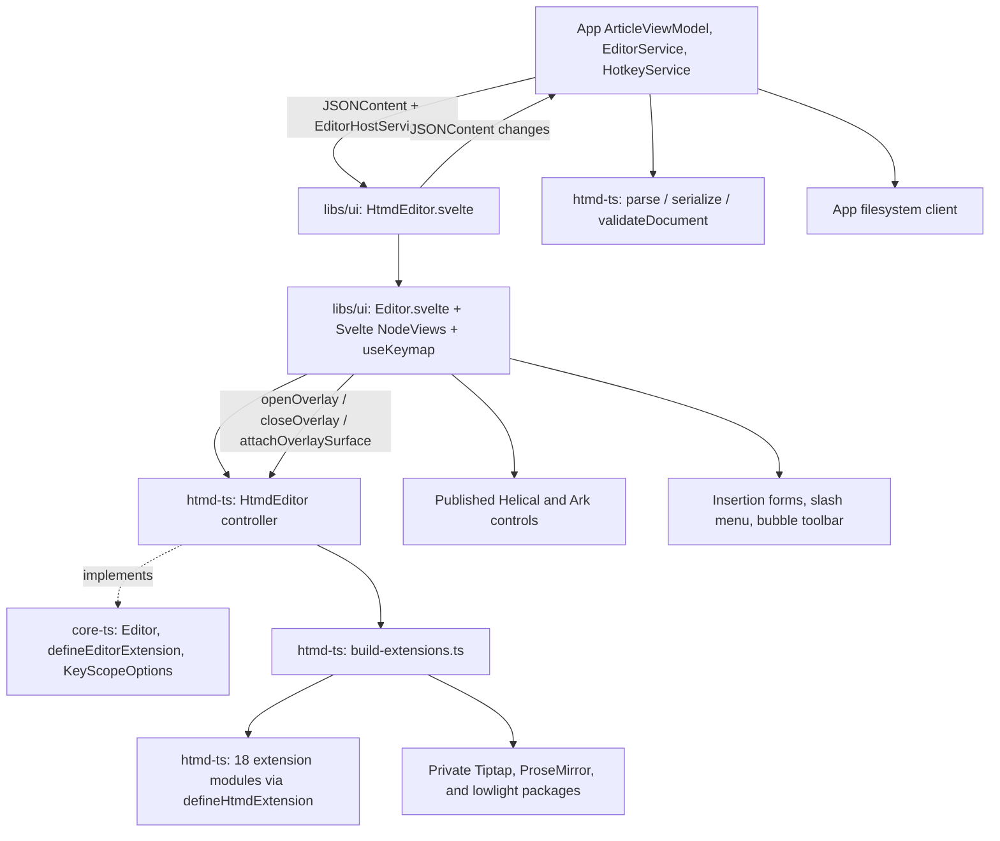
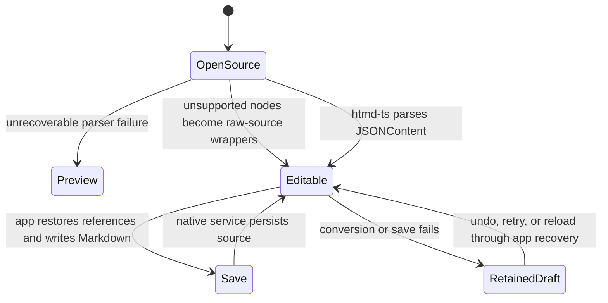

# Editor source — software architecture

## Overview

Hypertextual splits its vendored Helical editor baseline across three workspace packages:

1. `libs/core-ts` (`core-ts`): Abstract `Editor<TDoc, TCommandMap>`, `defineEditorExtension`, `KeyScopeDispatcher`, `EmbeddedEditorRegistry`, and `EditorHostServices`.
2. `libs/htmd-ts` (`htmd-ts`): Concrete `HtmdEditor` plugin (`kind: 'htmd'`, `scopeId: 'editor:htmd'`), `defineHtmdExtension`, `HtmdNodeNavigation`, `build-extensions.ts`, all 18 HTMD extension modules, and the synchronous Markdown codec.
3. `libs/ui` (`@hypertextual/ui`): Svelte `HtmdEditor.svelte` wrapper, `Editor.svelte`, and Svelte 5 `NodeView`s and overlays mounted via `svelte-node-view.svelte.ts` (`svelteNodeView`).

Published Helical packages (`@cloudvoyant/helical-ui` and `@cloudvoyant/helical-svelte`) still supply generic controls, `WhichKeyController`, `useKeymap`, theme tokens, and shared styles. React, the standalone Reader, documentation demos, and upstream build tools are excluded.

## Requirement

### Functional

- Run the HTMD editor through the Tiptap-free `HtmdEditor` controller (`htmd-ts`) and `HtmdEditor.svelte` (`@hypertextual/ui`) APIs.
- Author all custom extensions via `defineHtmdExtension` (`defineEditorExtension`) and compile them to Tiptap/ProseMirror solely inside `libs/htmd-ts/src/editor/build-extensions.ts`.
- Route all extension, editor (`editor:htmd`), widget, overlay, and pane keybindings through `WhichKeyController` (`registerKeymap` + `useKeymap`).
- Save and reopen every node, mark, and attribute in the HTMD schema, including combinations and boundary whitespace.
- Preserve article-local image references, per-node raw-source recovery, and retained-draft recovery for invalid data or persistence failures.

### Non-Functional

- Keep `libs/core-ts` and `libs/htmd-ts` free of Svelte, React, Tauri, and app imports.
- Keep `libs/ui` and `apps/hypertextual-svelte` free of `@tiptap/*`, `lowlight`, and `svelte-tiptap` dependencies.
- Resolve third-party dependencies through npm packages. Do not link the Helical checkout.
- Keep changes traceable to the recorded upstream baseline and test observable behavior through `libs/htmd-ts/src/editor/htmd-editor.test.ts` and the integrated `e2e/hypertextual-desktop/` browser suite.

## Design

### Components and Responsibilities



`libs/ui/src/editor/` owns Svelte rendering, `useKeymap` overlay registrations, and `svelte-node-view.svelte.ts`. `libs/htmd-ts/src/editor/` owns `HtmdEditor`, `defineHtmdExtension`, `build-extensions.ts`, node/mark/behavior extensions, suggestions, paste handling, modal editing, and overlay placement. App services compose `HtmdEditor.svelte` with `htmd-ts` codec methods, `HotkeyService`, and filesystem clients.

### Data and Control Flow



The editor exchanges native `JSONContent` with the app. `EditorService` restores portable image references through its workspace-aware `MediaService` and `ArticleViewModel` before synchronous serialization through `htmd-ts`. The app owns disk writes, title-based filenames, autosave, and close/quit flushing.

### Interfaces and Contracts

The public component contract is documented in [HTMD editor](htmd-editor/index.md), the plugin and extension contract in [htmd-ts](../htmd-ts/index.md), and the abstract editor/key-scope contract in [core-ts](../core-ts.md).

#### Extension authoring and compilation (`defineHtmdExtension` -> `build-extensions.ts`)

Extension modules in `libs/htmd-ts/src/editor/extensions/` export `HtmdExtension` definitions created with `defineHtmdExtension` (never importing `@tiptap/core` directly). Configure per-editor options with `.configure()`:

```ts
ImageNode.configure({ nodeView: nodeViews.image })
NoticeNode.configure({ nodeView: nodeViews.notice })
CodeBlock.configure({ lowlight, nodeView: nodeViews.codeBlock })
InternalMention.configure({ hrefBuilder, suggestion: { items, render } })
```

`NodeViewRenderer` (`HtmdNodeViewFactory`) is a framework-neutral renderer callback supplied by `libs/ui/src/editor/components/svelte-node-view.svelte.ts` (`svelteNodeView`). `buildExtensions` in `libs/htmd-ts/src/editor/build-extensions.ts` compiles configured `HtmdExtension` objects into Tiptap extensions, registers their `HtmdNodeNavigation` specs, and registers their `keymap` definitions at `priority: 'extension'` in `EditorHotkeyService`.

#### Registered overlays and rendered surfaces

`EditorOverlays` (`libs/htmd-ts/src/editor/extensions/editor-overlays.ts`) owns one active insertion request per `HtmdEditor` and provides surface attachment for insertion forms, slash suggestions, and the formatting toolbar through `HtmdEditor` methods:

```ts
editor.openOverlay('image', { position: 12, data: { source: 'upload' } })
editor.closeOverlay('image')

const binding = editor.attachOverlaySurface(surface, {
  anchor: () => 'selection',
  width: 480,
  height: 40,
  placement: 'top',
  align: 'center',
  gap: 8,
  viewportGap: 8,
  lockScroll: () => linkInputOpen,
})
binding.update()
binding.destroy()
```

| Surface | Anchor and placement | Article scroll lock |
| --- | --- | --- |
| Insertion form | Mapped document position; start-aligned, below by default | While the form is mounted, unless configured otherwise |
| Slash menu | Current suggestion range end; start-aligned, below by default | While the menu is mounted |
| Bubble toolbar | Native text selection with document-coordinate fallback; centered, above by default | While its link editor is open |

## Implementation

### Source Baseline and Package Mapping

- Source repository: `cloudvoyant/helical-ui`, local reference `~/Projects/helical-ui`.
- Source revision: `5085f0d`.
- Source package manifests: `@cloudvoyant/helical-svelte` and `@cloudvoyant/helical-ui`, both version `0.21.1-rc.202611031218.5085f0d` with `license: MIT`.

| Upstream source | Local owner |
| --- | --- |
| Abstract editor, extension, and key-scope contracts | `libs/core-ts/src/{types,extension,key-scope,registry}.ts` |
| `libs/helical-ui/src/editor/types.ts` | `libs/htmd-ts/src/editor/types.ts` |
| `libs/helical-ui/src/editor/build-extensions.ts` | `libs/htmd-ts/src/editor/build-extensions.ts` |
| `libs/helical-ui/src/editor/overlay-position.ts` | `libs/htmd-ts/src/editor/extensions/editor-overlays.ts` |
| `libs/helical-ui/src/editor/index.ts` | `libs/htmd-ts/src/editor/index.ts` |
| `libs/helical-ui/src/editor/paste-url.ts` | `libs/htmd-ts/src/editor/extensions/paste-url.ts` |
| `libs/helical-ui/src/editor/extensions/` | `libs/htmd-ts/src/editor/extensions/` (ported to `defineHtmdExtension`) |
| Concrete `HtmdEditor` controller | `libs/htmd-ts/src/editor/htmd-editor.ts` |
| `libs/helical-svelte/src/editor/Editor.svelte` | `libs/ui/src/editor/components/Editor.svelte` + `libs/ui/src/editor/HtmdEditor.svelte` |
| Svelte editor menus, overlays, inputs, and node views | `libs/ui/src/editor/components/` (mounted via `svelte-node-view.svelte.ts` + `useKeymap`) |
| `libs/helical-svelte/src/editor/Reader.svelte` | Excluded: unused standalone rendering API |
| `libs/helical-react/` and `apps/docs/` | Excluded: other framework and documentation app |

### Dependency Ownership

| Package group | Owner package | Pinned version |
| --- | --- | --- |
| `@tiptap/*`, `@tiptap/pm`, `lowlight`, `marked`, `@xmldom/xmldom` | `libs/htmd-ts` | `3.31.4` / `3.3.0` / `17.0.6` / `0.9.12` |
| `@cloudvoyant/helical-ui` | `libs/htmd-ts`, `libs/ui`, `apps/hypertextual-svelte` | `0.21.1-rc.202611031218.5085f0d` |
| `@cloudvoyant/helical-svelte`, `@ark-ui/svelte`, `lucide-svelte` | `libs/ui`, `apps/hypertextual-svelte` | `0.21.1-rc.202611031218.5085f0d` / `5.24.3` / `0.577.0` |

`libs/ui` and `apps/hypertextual-svelte` do not depend on `@tiptap/*`, `lowlight`, or `svelte-tiptap`.

### Behavior Coverage

- `libs/htmd-ts/src/editor/htmd-editor.test.ts` verifies `HtmdDocument` round-tripping, `HtmdEditor` commands and overlays, `editor:htmd` and extension key scopes, `EditorHostServices` callbacks, embedded child editor focus handoff, and modal editing across `insert`, `normal`, and `select` modes.
- `e2e/hypertextual-desktop/{editor,modal-editing,workspace-file-tree}.spec.ts` covers the integrated desktop workspace, `HtmdEditor.svelte`, `TreeView.svelte`, `WhichKey`, and `HotkeyService`.

### Moving Changes Back to Helical

1. Compare `libs/core-ts/src/`, `libs/htmd-ts/src/editor/`, and `libs/ui/src/editor/` against the recorded source revision using the path map above.
2. Separate import, formatting, and repository-style adaptations from behavior changes. Keep `htmd-ts` Markdown conversion and Hypertextual's app storage policy here.
3. Apply framework-neutral fixes to Helical's shared editor core and view changes to its Svelte editor.
4. Run Helical's own checks and record the new baseline only after upstream changes are verified.

## References

- [core-ts architecture](../core-ts.md)
- [htmd-ts architecture](../htmd-ts/index.md)
- [HTMD editor (`HtmdEditor`)](htmd-editor/index.md)
- [Development commands](../../development.md)
- [HYPE-160](https://linear.app/cloudvoyant/issue/HYPE-160/vendor-the-helical-editor-for-development-inside-hypertextual)
- [HYPE-169](https://linear.app/cloudvoyant/issue/HYPE-169/refactorui-unify-editorextension-system-and-svelte-component)
