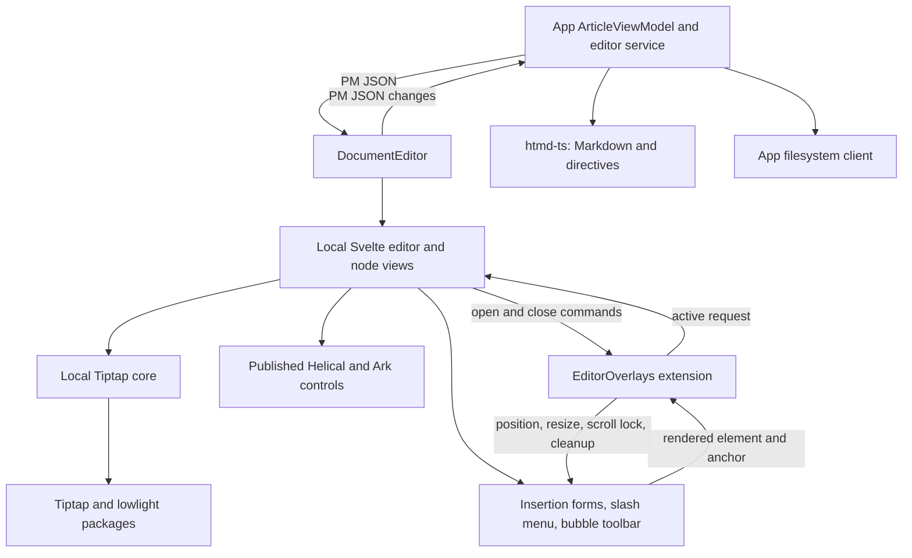
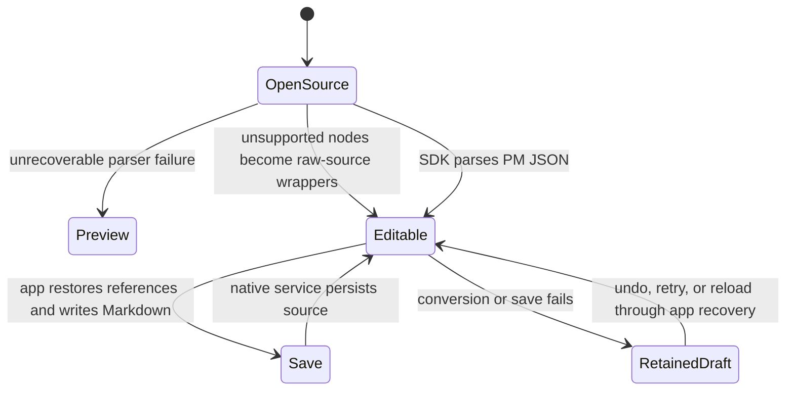
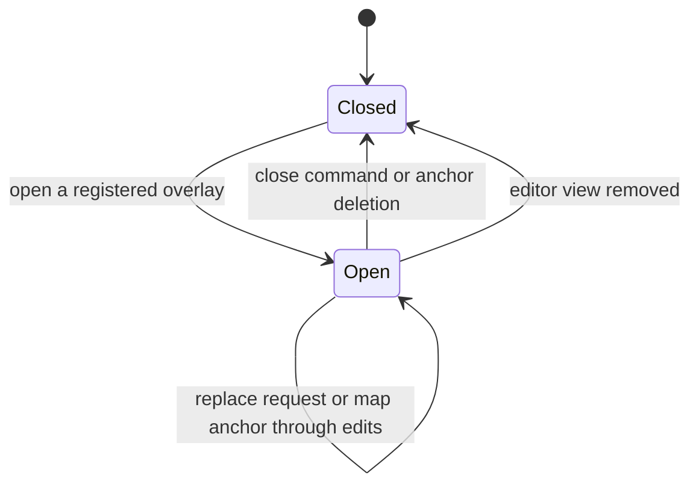
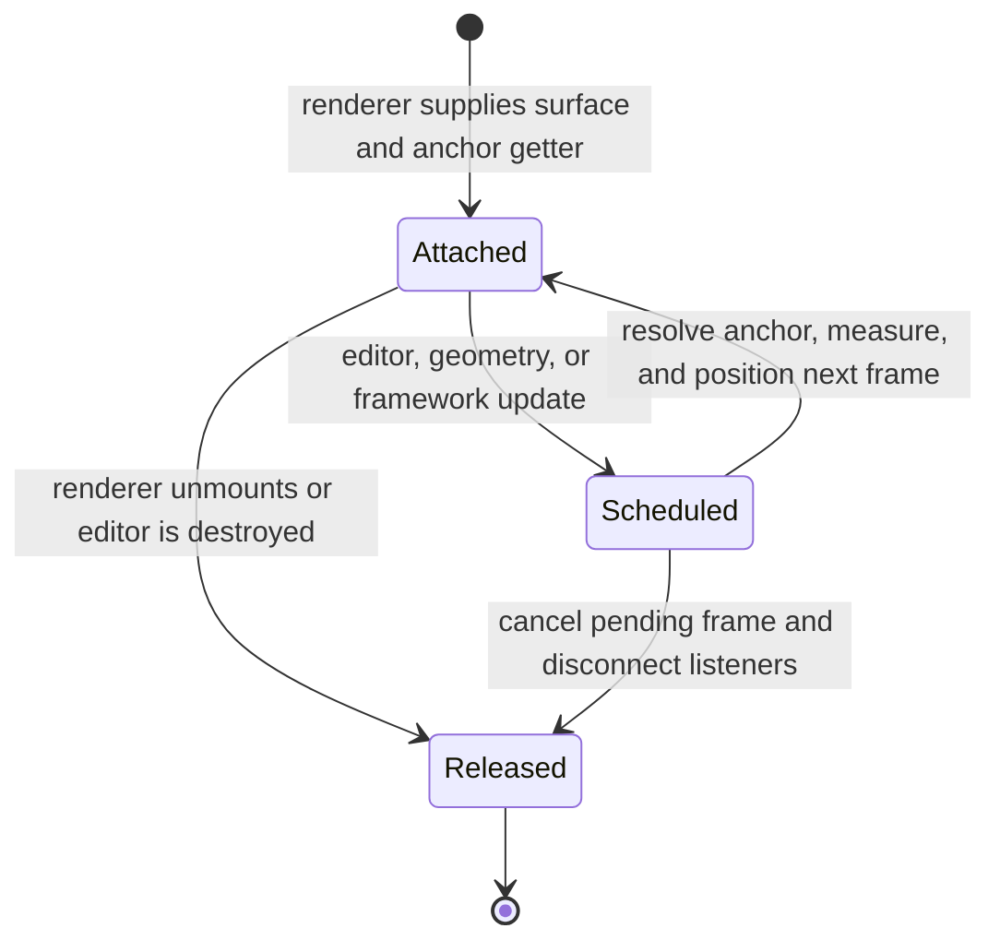

# Editor source — software architecture

## Overview

Hypertextual owns a temporary copy of Helical's Svelte editor and its framework-neutral Tiptap core inside private `libs/ui`. This lets the editor change without a Helical release. Published Helical still supplies generic controls, theme tokens, and shared styles. React, the standalone Reader, documentation demos, and upstream build tools are excluded.

## Requirement

### Functional

- Run the local editor through the JSON-only `DocumentEditor` API.
- Keep the SDK schema compatible with the mounted editor schema through app integration tests.
- Save and reopen every node, mark, and attribute in the mounted editor schema, including combinations and boundary whitespace.
- Preserve article-local image references, per-node raw-source recovery, and retained-draft recovery for invalid data or persistence failures.
- Keep format conversion in `htmd-ts` and source, storage, and autosave policy in app services.

### Non-Functional

- Keep the core free of Svelte, React, Tauri, and app imports.
- Resolve third-party dependencies through npm packages. Do not link the Helical checkout.
- Keep changes traceable to a fixed upstream baseline and test observable behavior through the existing desktop browser suite.

## Design

### Components and Responsibilities



`components/` owns rendering and framework lifecycle. `core/` owns extension assembly, node definitions, suggestions, paste handling, and overlay behavior. The reusable editor has no source session, Markdown codec, or format SDK dependency. App services compose it with `htmd-ts` and filesystem clients.

### Data and Control Flow



The editor exchanges native `JSONContent` with the app. `EditorService` restores portable image references through its workspace-aware `MediaService` and `ArticleViewModel` before synchronous serialization through `htmd-ts`. The app owns disk writes, title-based filenames, autosave, and close/quit flushing. The UI receives raw fragments inside wrapper JSON, but does not parse the Markdown document or decide save recovery policy.

### Interfaces and Contracts

The public contract is documented in [Document editor](document-editor.md). The internal editor preserves `buildExtensions`, `NodeViewFactory`, node names and attributes, and upload/mention/preview callbacks from the copied baseline. Optional mention search and metadata fetching remain host seams, without new application integrations.

#### Format boundary and lossless persistence

`htmd-ts` owns Markdown syntax and synchronous conversion between opaque file contents and native ProseMirror JSON. Its public `parse` result contains `content` and plain `issues`; `serialize` accepts document JSON, and `validateDocument` checks the persisted JSON contract. SDK-owned structural types keep Tiptap classes, extension objects, tokens, and the engine schema out of the public API. App service integration tests pass the complete fixture through editor validation without losing data.

The SDK uses Tiptap's standalone `MarkdownManager` and an isolated Marked instance. `nodes.ts` and `marks.ts` reuse standard extensions, with focused hooks for custom component data. Tiptap's Markdown-spec helpers supply shortcode and atomic-block syntax for mentions, bookmarks, and YouTube. CommonMark inline HTML handles underline, colors, highlight, and link metadata. A render-only adapter preserves formatted whitespace; plain-text boundary whitespace and unfinished block prefixes use numeric references. Empty paragraphs use `<p></p>`. No text alignment or basic-node persistence envelope is supported.

Unchanged source remains byte-for-byte intact. Edited source retains its BOM and newline convention. The app restores display URLs to portable image references before writing. Unsupported HTML, unknown directives, invalid source attributes, and future chart syntax become editable `unparsedBlock` or `unparsedInline` nodes. These carry raw text, a syntax kind, and a diagnostic reason; supported siblings still parse normally. The writer emits their source directly. A repaired wrapper becomes recognized content on save/reopen. The editor renders raw text safely with semantic styling. Optional `nodeViews.unparsedBlock` and `nodeViews.unparsedInline` renderers can change or hide its display while retaining the JSON and saved source. The title extension leaves raw frontmatter ahead of the title and inserts a title beside other raw blocks instead of replacing them. A whole-document source preview is reserved for an unrecoverable parser failure. All text alignment is removed, while responsive image source sets and ordered-list display type remain frontend presentation data. Invalid document changes retain the latest app draft for recovery. Overlay, suggestion, and renderer state never enters saved source.

BDD parsing examples in `libs/htmd-ts/src/nodes.test.ts` and `marks.test.ts` document literal source syntax and explicit JSON results. Their public serialize/parse workflows cover nested marks, exact whitespace, attributes, and unsupported input. See the [SDK guide](../../../libs/htmd-ts/README.md) for the supported forms. Rust conversion and an LSP remain future work in `htmd-rs`.

Extension modules export Tiptap node or extension objects. Supply dependencies through `.configure()` rather than wrapping each definition in a factory:

```ts
ImageNode.configure({ nodeView: nodeViews.image })
NoticeNode.configure({ nodeView: nodeViews.notice })
CodeBlockCustom.configure({ lowlight, nodeView: nodeViews.codeBlock })
InternalMention.configure({ hrefBuilder, suggestion: { items, render } })
```

`NodeViewFactory` is still a renderer callback supplied by the framework. Each configured extension reads its own options, so renderer and mention callbacks remain specific to that editor. `buildExtensions` assembles these configured definitions. `PasteUrl` registers URL paste handling through a ProseMirror plugin before the default Link handler; the Svelte editor does not wire that behavior itself. The `EditorOverlays` controller owns surface placement and scroll behavior; Svelte views attach rendered elements to it.

#### Registered overlays

`EditorOverlays` owns one active request per editor. Register layout definitions through `.configure()` and render its notifications through the framework bridge:

```ts
EditorOverlays.configure({
  overlays: { image: { width: 320, height: 480, gap: 4 } },
  onChange: renderOverlay,
})

editor.commands.openOverlay('image', { position: 12, data: { source: 'upload' } })
editor.commands.closeOverlay('image')
const active = editorOverlaysKey.getState(editor.state)
```

Positions are integer offsets in the current document, from zero through `doc.content.size`. Omit the position to use the current selection. Unknown names and invalid positions return `false`. A named close returns `false` when another overlay is active. `.can()` checks these commands without changing state.



Plugin state holds the request and payload, outside the saved document. The renderer receives the initial state, active-request updates, and `null` during cleanup. The default Svelte view registers image, bookmark, and YouTube forms and preserves form input while the anchor moves. Unmounted forms ignore late upload or preview results. Private helpers inside the extension calculate placement and manage scroll locks; Svelte/Ark controls own rendering, visibility, and focus. These commands belong to the internal Tiptap editor; the public document host API is unchanged.

#### Rendered surfaces

The same per-editor controller supports insertion forms, slash suggestions, and the formatting toolbar. Attach a rendered element through extension storage; this does not create or replace the active insertion request:

```ts
const binding = editor.storage.editorOverlays.attach(surface, {
  anchor: () => 'selection',
  width: 480,
  height: 40,
  placement: 'top',
  align: 'center',
  gap: 8,
  viewportGap: 8,
  lockScroll: () => linkInputOpen,
})
binding.update() // Request another layout after a framework state change.
binding.destroy() // Release this surface when it unmounts.
```

An anchor getter returns a current document position, `'selection'`, a viewport rectangle, or `null` to skip placement. The controller resolves selection geometry after the DOM has updated. It measures the rendered surface, batches layout into animation frames, and responds to editor transactions, selection changes, surface resize, ancestor scroll, and viewport resize. Registered dimensions are fallbacks before measurement. Placement reserves the configured gap and viewport margin, flips when space is tighter on the preferred side, and clamps the result to the viewport.

| Surface | Anchor and placement | Article scroll lock |
| --- | --- | --- |
| Insertion form | Mapped document position; start-aligned, below by default | While the form is mounted, unless configured otherwise |
| Slash menu | Current suggestion range end; start-aligned, below by default | While the menu is mounted |
| Bubble toolbar | Native text selection with document-coordinate fallback; centered, above by default | While its link editor is open |

Svelte owns when a surface exists and which controls it renders. `CursorOverlay` only attaches the insertion form and requests layout when its mapped anchor changes. Slash suggestions keep their Tiptap suggestion state; the bubble toolbar keeps its selection visibility and dismissal state. Neither replaces the active insertion request. Surface size changes, such as image tabs or validation text, trigger the same controller. Scroll locks affect the nearest article scroll container and allow wheel input within the attached surface.



The renderer destroys its binding on unmount. Editor destruction also releases every remaining binding. Cleanup is idempotent and removes observers, editor subscriptions, scroll listeners, wheel locks, and pending animation frames. Geometry and scroll helpers are private in `core/extensions/editor-overlays.ts`; consumers call the controller instead of importing helpers.

## Implementation

### Source Baseline

- Source repository: `cloudvoyant/helical-ui`, local reference `~/Projects/helical-ui`.
- Source revision: `ee355e8c8624f2446645a2804a2094fadc324438`.
- Source package manifests: `@cloudvoyant/helical-svelte` and `@cloudvoyant/helical-ui`, both version `0.19.0` with `license: MIT`.
- Both editor source directories were unchanged relative to that revision when inspected. The checkout contained unrelated edits; they are outside this copy.
- No standalone LICENSE or NOTICE file was present in the inspected checkout. Preserve notices present in copied source and the MIT package provenance; do not invent a copyright holder or claim a notice file was copied.

| Upstream source | Local owner |
| --- | --- |
| `libs/helical-ui/src/editor/types.ts` | `libs/ui/src/editor/core/types.ts` |
| `libs/helical-ui/src/editor/build-extensions.ts` | `libs/ui/src/editor/core/build-extensions.ts` |
| `libs/helical-ui/src/editor/overlay-position.ts` | `libs/ui/src/editor/core/extensions/editor-overlays.ts`, private placement and scroll helpers |
| `libs/helical-ui/src/editor/index.ts` | `libs/ui/src/editor/core/index.ts` |
| `libs/helical-ui/src/editor/paste-url.ts` | `libs/ui/src/editor/core/extensions/paste-url.ts`, wrapped as `PasteUrl` |
| `libs/helical-ui/src/editor/extensions/` | Matching files in `libs/ui/src/editor/core/extensions/` |
| `libs/helical-svelte/src/editor/Editor.svelte` | `libs/ui/src/editor/components/Editor.svelte` |
| Svelte editor menus, overlays, inputs, and node views | Matching files in `libs/ui/src/editor/components/` |
| `libs/helical-svelte/src/editor/Reader.svelte` | Excluded: unused standalone rendering API |
| `libs/helical-react/` and `apps/docs/` | Excluded: other framework and documentation app |

### Local Adaptations and Dependencies

Editor-specific imports in the mounted editor point to the local core. Format definitions and conversion live in `htmd-ts` without importing UI. Media slash commands open registered overlays in the same transaction that removes the slash text, avoiding a separate callback-registration lifecycle. The format writer preserves literal partial shortcuts until editor input rules convert them. The app recovery dialog prevents parent-layer dismissal requests: closing the editor toolbar must not close the independent recovery alert. Generic Notice, YouTube, CodeBlock, and Select controls come from published Helical exports. Ark Listbox owns slash and mention suggestion selection; the Tiptap bridge forwards keyboard requests to that state. Ark Tabs owns the image Upload/URL choice. Other controls retain their published Helical or existing Ark behavior. The shared `EditorOverlays` extension owns overlay placement and scroll locks for forms, suggestions, and the formatting toolbar. Named props, script sections, colocated styles, and semantic tokens follow this repository's UI rules. The app's existing Tailwind source scan includes `libs/ui/src`.

Direct runtime dependencies belong to `libs/ui/package.json`; exact resolutions belong to `bun.lock`. Keep Tiptap core and ProseMirror aligned with root overrides. Published Helical packages supply generic controls, `cn`, and theme/style contracts. Svelte, Ark, `svelte-tiptap`, Lucide, Tiptap extensions/suggestions, and lowlight remain npm dependencies.

| Package group                 | Pinned version |
| ----------------------------- | -------------- |
| `@cloudvoyant/helical-svelte` | `0.19.0`       |
| `@cloudvoyant/helical-ui`     | `0.19.0`       |
| `@ark-ui/svelte`              | `5.24.3`       |
| `@tiptap/core`                | `3.31.4`       |
| `svelte-tiptap`               | `3.0.1`        |
| `lowlight`                    | `3.3.0`        |
| `lucide-svelte`               | `0.577.0`      |

All directly used Tiptap extensions and suggestions are pinned to `3.31.4`. Tiptap Markdown and Marked dependencies belong to `htmd-ts`. Markdown parsing and writing stay outside the UI library.

### Behavior Coverage

The application suite stays in `e2e/hypertextual-desktop`, with native Playwright `When …` groups and outcome-named tests. Arrange, Act, and Assert remain visible. Each case owns a temporary workspace and browser context. UI actions use rendered controls and keyboard input.

The upstream inventory is `apps/docs/e2e/editor.spec.ts` at the baseline above. Its React loop and documentation selectors are not copied. Application persistence cases replace upstream demo localStorage checks. The following map ties the upstream scenarios to application behavior:

| Upstream scenario | Application coverage or exclusion |
| --- | --- |
| Seeded title and persisted body | Existing article title, autosave, switch, close/quit, and reopen journeys |
| Enforced first H1 and title placeholder | Excluded: the document component uses `enforceTitle=false` |
| Active empty body placeholder | Adapted: guidance follows the focused empty body block |
| Markdown heading input rule | Adapted to ordinary headings without forced-title assumptions |
| Bubble menu selection and Bold | Adapted: keyboard selection, rendered toolbar, saved Markdown, and reopen |
| Slash menu overflow and keyboard selection | Adapted: active result remains visible and Enter inserts it |
| Filtered menu near viewport edge | Adapted: filtering preserves a reachable menu; Escape dismisses it |
| Editor-only scroll lock | Adapted: article container locks while the overlay is open and unlocks after dismissal |
| Notice title/body editing | Existing notice title, type, body, and reopen journeys |
| Code language and block layout | Existing code-language save/reopen case, with layout assertions |
| Bookmark input placement | Placement/validation/cancel plus fallback card insertion and save/reopen; seeded cards preserve full metadata |
| Image/bookmark/YouTube overlay placement | Adapted to the article editor's viewport and caret |
| Adjacent form validation | Adapted invalid-input cases for the three forms; no rich output is persisted |
| Link editing and placement | Adapted link toolbar and popover, saved link, removal, and reopen |
| Highlight control state and actual formatting | Saved highlight and text colors retain their computed appearance and exact attributes after reopening |
| Image upload, preview, insertion, caption exit | Existing upload/reopen/removal journey strengthened with keyboard caption exit; added failure/retry |
| Link editing without forced title | Covered by the app's normal editor configuration |
| Bare URL paste | Adapted native keyboard paste into an empty selection and over selected text; ordinary Markdown links survive reopen |
| Mention suggestions | Search remains unconnected; seeded internal and URL mentions are covered by the complete save/reopen fixture |
| Server pre-populated Reader HTML | Excluded: standalone Reader and server rendering are outside this app's editor path |

Additional browser cases cover inline formatting and exact marked whitespace, undo/redo, stale overlays, anchor deletion, uploads after document edits, cursor adjacency, and selection-centered toolbars. They edit rendered controls and assert visible behavior, saved source, and persistence after reopening. Format inventory and direct SDK round-trip assertions belong to package integration tests, not browser specs.

The canonical `editor-roundtrip.md` and `editor-roundtrip.json` vectors live in `libs/htmd-ts/fixtures`. Package BDD cases cover all supported nodes and marks, heading levels, notice variants, task states, code languages, image sources, cards, mentions, palette tokens, and persisted attributes. The full rendered demo also checks standard source syntax and YouTube timestamp seeking after reopening. App `articleViewModel.test.ts` covers source sessions and retained drafts, `mediaService.test.ts` covers local and remote assets, and `editorService.test.ts` checks the public format/editor boundary without engine schema imports. React parity, documentation layout, and demo localStorage remain upstream concerns.

The browser suite uses a filesystem-backed Tauri substitute. It does not test native windows, Rust filesystem safety, or system Trash. The lifted public service integration cases in `hyped-fs` own native workspace policy evidence. No additional package E2E suite exists.

### Moving Changes Back to Helical

1. Compare the local core and Svelte files against the recorded source revision using the path map above.
2. Separate import, formatting, and repository-style adaptations from behavior changes. Keep `htmd-ts` and Hypertextual's app storage policy here.
3. Apply framework-neutral fixes to Helical's shared editor core. Apply view changes to its Svelte editor. Do not transplant Hypertextual's package imports into Helical's internal modules.
4. Run Helical's own checks and adapt relevant application behavior assertions to its Svelte demo. Let Helical separately decide React parity.
5. Record the new baseline only after the upstream changes are verified. Do not overwrite the local copy from a newer checkout without reviewing its diff.

## References

- [Document editor](document-editor.md)
- [Development commands](../../development.md)
- [HYPE-160](https://linear.app/cloudvoyant/issue/HYPE-160/vendor-the-helical-editor-for-development-inside-hypertextual)
- Existing browser suite: `e2e/hypertextual-desktop/editor.spec.ts`.
