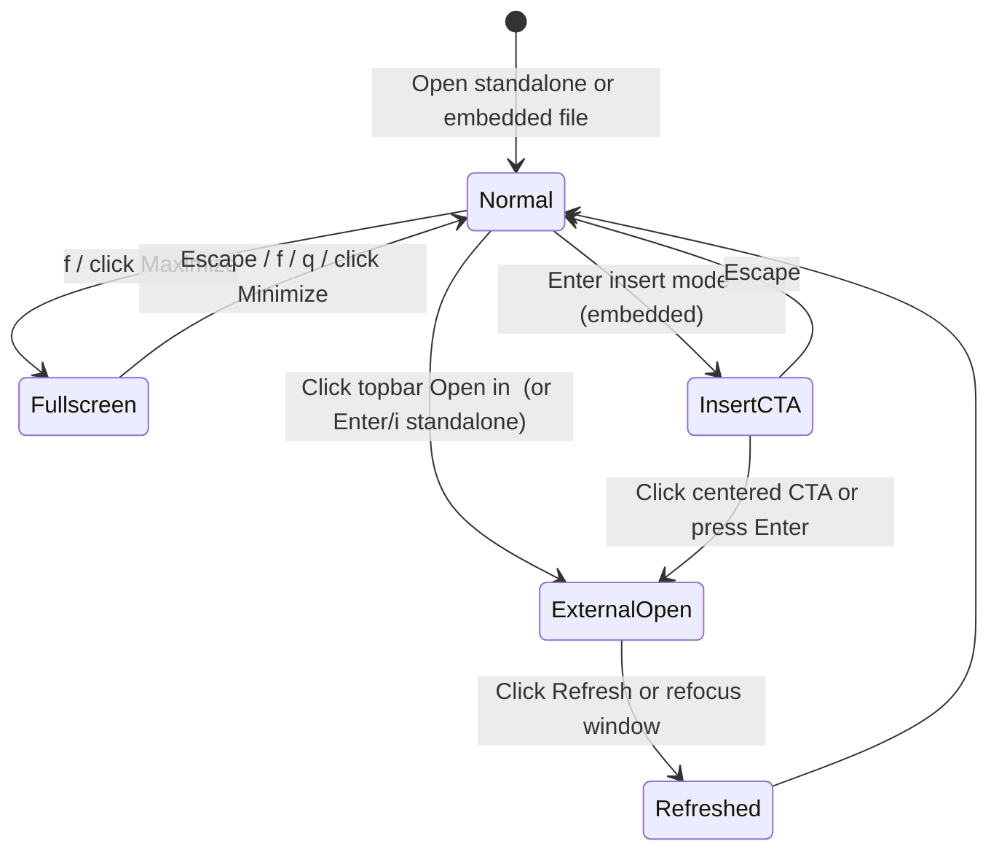

# File viewer (`FileViewer`)

## Overview

`FileViewer` (`libs/ui/src/file-viewer/FileViewer.svelte`) is the unified interactive preview shell for non-text workspace files (images, `.drawio.svg`, `.drawio.png`, plain `.drawio` XML, and future PDFs). It composes [`WindowInplace`](window-inplace.md), `FileViewerToolbar`, and `PanZoomViewport` with pluggable format renderers.

## Design

### Public API

| Prop | Type | Default | Purpose |
| --- | --- | --- | --- |
| `kind` | `'image' \| 'drawio-image' \| 'drawio-xml'` | — | Selects `ImageRenderer` or `DrawioXmlRenderer`. |
| `title` | `string` | — | Filename or label displayed in the topbar. |
| `src` | `string` | `''` | Display URL for image / `.drawio.svg` / `.drawio.png` assets. |
| `xml` | `string` | `''` | Raw `<mxfile>` XML for plain `.drawio` diagrams. |
| `standalone` | `boolean` | `false` | Renders full-pane inside `ContentPane` without inline margins. |
| `mode` | `EditorMode` | `'normal'` | Shows centered `Open in <App>` CTA overlay when `'insert'` and not standalone. |
| `fullscreen` | `boolean` (`$bindable`) | `false` | Toggles editor/pane fullscreen mode. |
| `scale` / `panX` / `panY` | `number` (`$bindable`) | `1` / `0` / `0` | Shared pan/zoom viewport state. |
| `onopenexternal` | `() => void` | `undefined` | Launches the file in its preferred external app (or OS default). |
| `onrefresh` | `() => void` | `undefined` | Reloads the file from disk after external edits. |
| `onreplace` / `onremove` | `() => void` | `undefined` | Optional insert-mode Replace and Remove controls for embedded blocks. |

### State and Data Flow

