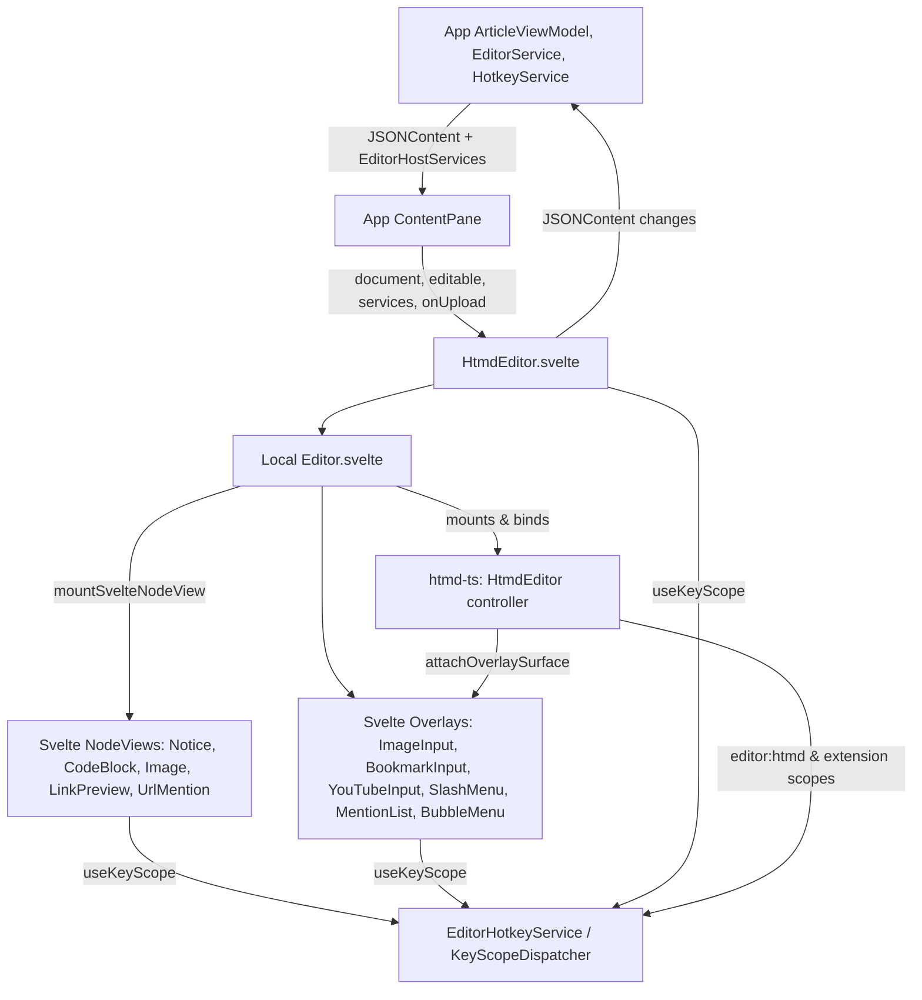
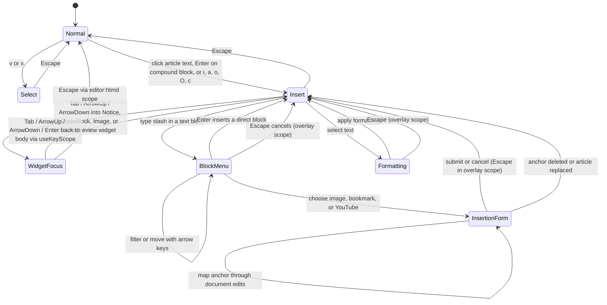

# HTMD editor (`HtmdEditor`)

## Overview

`HtmdEditor` (`libs/ui/src/editor/HtmdEditor.svelte`) is the Svelte UI component that mounts the concrete `HtmdEditor` controller from `htmd-ts` with Svelte 5 NodeViews, floating overlays, and `useKeyScope` integration. The host application supplies parsed `JSONContent`, `editable`, and `EditorHostServices` (`hotkeys`, `notifications`, `embedRegistry`) and receives `JSONContent` changes without any `@tiptap/*` or ProseMirror types crossing the UI boundary.

## Design

### Public API

`HtmdEditorProps` in `libs/ui/src/editor/types.ts` accepts `document: JSONContent`, optional `editable`, optional `clickToEdit`, optional `services: EditorHostServices`, and `onchange(document: JSONContent)`. The optional `onUpload(file)` callback returns an image display `src` and optional `srcset`. The optional `oneditablechange(editable)` callback requests an editability change and returns the accepted boolean. The component handle exposes `focus()` and `enterCompoundBlock()`. `class` styles the scroll region, and `contentClass` styles the inner document.

```svelte
<HtmdEditor
  document={article.content}
  editable={editor.editable && !workspace.blocked}
  clickToEdit={workspace.settings.clickToInsert}
  services={workspace.editorServices}
  oneditablechange={(editable) => editor.setEditable(editable && !workspace.blocked)}
  class="article-scroll"
  contentClass="article-editor"
  onchange={(document) => editor.change(document)}
  onUpload={(file) => editor.upload(file)}
/>
```

### Component Diagram



`HtmdEditor.svelte` owns the focusable article scroll region (`role="region"`, `aria-label="Article content"`), registers viewport scroll commands (`view.center`, `view.top`, `view.bottom`, `view.scrollDown`, `view.scrollUp`) with `services.hotkeys`, and delegates document state, `editor:htmd` keybindings (`Enter` compound block entry, `Escape` exit to normal mode), and extension execution to the `HtmdEditor` controller in `htmd-ts`.

### Layout

Editable document, including an inserted notice:

```text
+------------------------------------------------------------------+
|                                                                  |
|  A saved article                                                 |
|                                                                  |
|                                                                  |
|  Start writing your article here.                                |
|                                                                  |
|  +------------------------------------------------------------+  |
|  | [i] Note                                                   |  |
|  |     Add the notice body here.                              |  |
|  +------------------------------------------------------------+  |
|                                                                  |
|                                                                  |
+------------------------------------------------------------------+
```

The wrapper fills the host content area without a toolbar or footer of its own. Normal and select modes hide editing controls and the formatting toolbar while keeping video playback and code copying available. `HtmdEditor.svelte` focuses the scroll region while editing is disabled so arrow and page keys scroll the article. Node views render blocks with published Helical and Ark UI controls.

### State and Data Flow

```mermaid
stateDiagram-v2
    [*] --> Normal: host supplies document (editable = false)
    [*] --> Insert: host creates new document (editable = true)
    Normal --> Select: v or x
    Select --> Normal: Escape, ;, y, d, p, P
    Normal --> Insert: click article text, press Enter on compound block, call focus(), or press i, a, I, A, o, O, c
    Select --> Insert: press c, i, a
    Insert --> Insert: emit JSONContent change to app
    Insert --> Normal: Escape (via editor:htmd scope after overlays/widgets)
    Normal --> [*]: host replaces document
    Select --> [*]: host replaces document
    Insert --> [*]: host replaces document
```



The `HtmdEditor` controller in `htmd-ts` owns selection, transactions, `editor:htmd` and extension key scopes, and node-view instances. `EditorService` owns the current `editable` flag and resets it when the selected article changes. Replacing the article destroys the previous `HtmdEditor` instance, node views, key scopes, and overlay bindings.

### Behavior



- **Widget and overlay key scopes (`useKeyScope`)**: `NoticeNodeView.svelte`, `CodeBlockComponent.svelte`, `ImageNodeView.svelte`, and `LinkPreviewCard.svelte` register `widget`-priority keymaps (`Tab`, `Shift+Tab`, `ArrowUp`, `ArrowDown`, `Enter`) with `useKeyScope`. Floating dialogs (`ImageInput`, `BookmarkInput`, `YouTubeInput`, `LinkEditPopover`) register `overlay`-priority keymaps (`Escape`, `Enter`). No Svelte component uses raw `window.addEventListener('keydown')` or `onkeydowncapture`.
- **Svelte 5 NodeView adapter (`svelte-node-view.ts`)**: Mounts Svelte 5 NodeView components using `mount()` / `unmount()` from `'svelte'` against `HtmdNodeViewFactory` from `htmd-ts`, without `svelte-tiptap` or `@tiptap/*` imports.

## Implementation

- Keep `libs/ui` completely free of `@tiptap/*`, `lowlight`, and `svelte-tiptap` dependencies; import `HtmdEditor` and Tiptap-free editor contracts from `htmd-ts` and `core-ts`.
- Compose published Helical prose variants for editor typography. Keep app CSS to layout so heading sizes and spacing have one owner.
- Render editable code without whitespace around its node-view content. Place the language selector at the left of the shared code-block header.
- Cover standalone `HtmdEditor` API boundaries in `e2e/htmd-ts/htmd-editor.spec.ts` and integrated desktop workflows in `e2e/hypertextual-desktop/{modal-editing,editor}.spec.ts`.
- See [editor source ownership](editor-source.md) for provenance, package split across `core-ts`, `htmd-ts`, and `libs/ui`, and the upstream transplant procedure.
