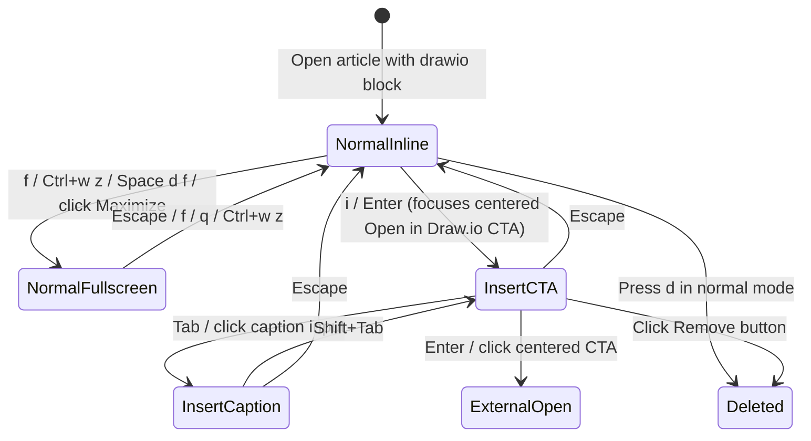

# Draw.io diagram block (`DrawioNodeView`)

## Overview

`DrawioNodeView` (`libs/ui/src/editor/components/drawio-block/DrawioNodeView.svelte`) is the Svelte 5 `NodeView` for `drawio` blocks (`libs/htmd-ts/src/editor/extensions/drawio-viewer.ts` and `libs/htmd-ts/src/nodes.ts`). It wraps [`FileViewer`](../file-viewer.md) with an editable `<figcaption>` matching `ImageNodeView.svelte`.

## Design

### Public API

`DrawioNodeViewProps` extends `SvelteNodeViewProps<HtmdEditor>`. Markdown images targeting `.drawio`, `.drawio.svg`, or `.drawio.png` (``) parse into `drawio` block nodes and resolve through `EditorMediaService`.

### State and Data Flow

