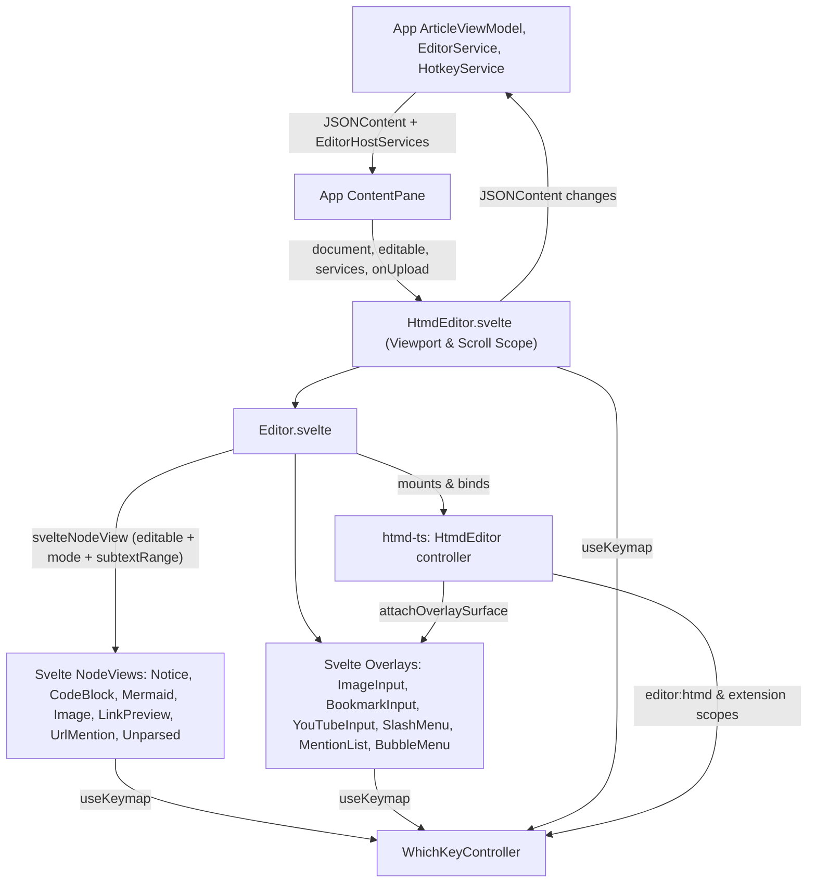
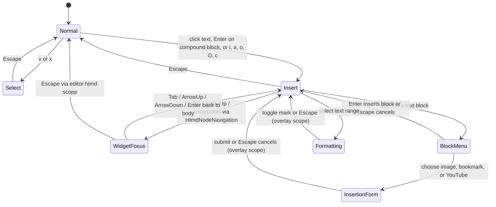

# HTMD editor (`HtmdEditor`)

## Overview

`HtmdEditor` (`libs/ui/src/editor/HtmdEditor.svelte`) is the Svelte UI component that mounts the `HtmdEditor` controller from `htmd-ts` with Svelte 5 `NodeView`s, floating overlays, and `useKeymap` integration. The host supplies parsed `JSONContent`, `editable`, and `EditorHostServices` (`notifications`, `media`, `embedRegistry`) and receives `JSONContent` changes without any `@tiptap/*` or ProseMirror types crossing the UI boundary.

## Design

### Public API

| Prop / Method | Type | Purpose |
| --- | --- | --- |
| `document` | `JSONContent` | Parsed HTMD document tree to render. |
| `editable` | `boolean` | Enables insert-mode editing and interactive `NodeView` controls. |
| `clickToEdit` | `boolean` | Enters insert mode when clicking article text in normal mode. |
| `services` | `EditorHostServices` | Host keyboard (`hotkeys`), notification, media, and embedded-editor services. |
| `onchange` | `(document: JSONContent) => void` | Emits updated `JSONContent` after ProseMirror transactions. |
| `onUpload` | `(file: File) => Promise<{ src: string; srcset?: string }>` | Uploads or imports an image file and returns its display URL. |
| `oneditablechange` | `(editable: boolean) => boolean` | Requests an editability transition (`Normal` <-> `Insert`) and returns the accepted state. |
| `focus()` / `enterCompoundBlock()` | Component methods | Focuses the active block or enters the selected compound block. |

```svelte
<HtmdEditor
  document={article.content}
  editable={editor.editable && !workspace.blocked}
  clickToEdit={workspace.settings.clickToInsert}
  services={workspace.editorServices}
  oneditablechange={(editable) => editor.setEditable(editable && !workspace.blocked)}
  class="article-scroll"
  contentClass="article-editor"
  onchange={(document) => editor.change(document)}
  onUpload={(file) => editor.upload(file)}
/>
```

### Component Diagram



### Layout

Editable document with a callout notice block:

```text
+------------------------------------------------------------------+
|  # Article Title                                                 |
|                                                                  |
|  Start writing your article here.                                |
|                                                                  |
|  +------------------------------------------------------------+  |
|  | [i] [ Note title               ] [ Info                 v ]|  |
|  |     Add the notice body here.                              |  |
|  +------------------------------------------------------------+  |
+------------------------------------------------------------------+
```

### State and Data Flow

```mermaid
stateDiagram-v2
    [*] --> Normal: host supplies document (editable = false)
    [*] --> Insert: host creates new document (editable = true)
    Normal --> Select: v or x
    Select --> Normal: Escape, ;, y, d, p, P
    Normal --> Insert: click text, press Enter on compound block, call focus(), or press i, a, I, A, o, O, c
    Select --> Insert: press c, i, a
    Insert --> Insert: emit JSONContent change to app
    Insert --> Normal: Escape (via editor:htmd scope after overlays/widgets)
    Normal --> [*]: host replaces document
    Select --> [*]: host replaces document
    Insert --> [*]: host replaces document
```



### Behavior



| Layer | Responsibility |
| --- | --- |
| `svelte-node-view.svelte.ts` (`svelteNodeView`) | Mounts Svelte 5 `NodeView` components (`mount` / `unmount`), subscribes once per node view to `editor.subscribe()`, and passes reactive `node`, `editable`, `mode`, and `subtextRange` props to `NoticeNodeView.svelte`, `CodeBlockComponent.svelte`, [`MermaidEditor.svelte`](mermaid.md), `ImageNodeView.svelte`, and `LinkPreviewCard.svelte`. |
| Extension `keymap` & `navigation` (`htmd-ts`) | Compound-block extensions (`NoticeNode`, `CodeBlock`, `MermaidEditor`, `ImageNode`, `LinkPreview`) own their `Tab`, `Shift+Tab`, `ArrowUp`, `ArrowDown`, and `Enter` navigation via `HtmdNodeNavigation`. |
| Overlay `useKeymap` (`libs/ui`) | Floating menus (`SlashMenu`, `MentionList`, `ImageInput`, `BookmarkInput`, `YouTubeInput`, `LinkEditPopover`, and fullscreen `MermaidEditor`) register `overlay`-priority keymaps (`Escape`, `Enter`, `ArrowUp`, `ArrowDown`, pan/zoom). |

## Editor Subcomponents

| Component | Responsibility |
| --- | --- |
| [Mermaid editor (`MermaidEditor`)](mermaid.md) | Modal diagram viewer (`normal`), line-selectable source view (`select`), live code + `PipWindow` preview (`insert`), and fullscreen `WindowInplace` viewer / split-pane editor with keyboard pan and zoom |

## Implementation

- Keep `libs/ui` free of `@tiptap/*`, `lowlight`, and `svelte-tiptap`; import `HtmdEditor` and engine-neutral contracts from `htmd-ts` and `core-ts`.
- Centralize reactive `editable`, `mode`, and `subtextRange` derivation in `libs/ui/src/editor/components/svelte-node-view.svelte.ts` so individual Svelte `NodeView` components remain purely presentational.
- Cover `HtmdEditor` library integration in `libs/htmd-ts/src/editor/htmd-editor.test.ts` and Svelte desktop workflows in `e2e/hypertextual-desktop/{modal-editing,editor}.spec.ts`.
- See [HTMD editor, ProseMirror, Tiptap, and Svelte UI architecture](../../htmd-ts/editor-extensions.md) and [editor source ownership](../editor-source.md).
