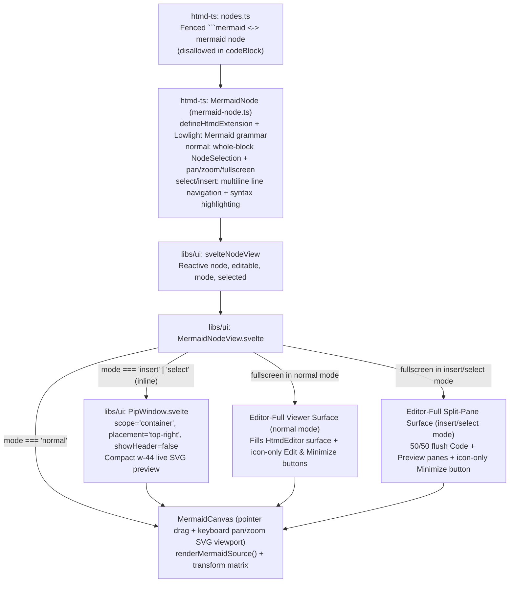

# Mermaid diagram editor and viewer (`MermaidNodeView`)

## Overview

`MermaidNodeView` (`libs/ui/src/editor/components/MermaidNodeView.svelte`) is the dedicated Svelte 5 `NodeView` component for `mermaid` blocks (`libs/htmd-ts/src/editor/extensions/mermaid-node.ts` and `libs/htmd-ts/src/nodes.ts`) inside `HtmdEditor`. It is separate from `CodeBlockComponent.svelte`; fenced ```` ```mermaid ```` blocks parse into `mermaid` nodes rather than `codeBlock` nodes, and `codeBlock` rejects `mermaid` as a selectable or valid language.

The component adapts its presentation and keybindings across all three modal states (`normal`, `select`, `insert`) and provides both inline and fullscreen pan/zoom diagram inspection.

## Design

### Public API

`MermaidNodeViewProps` in `libs/ui/src/editor/components/types.ts` extends `SvelteNodeViewProps<HtmdEditor>` with reactive `mode` (`'normal' | 'select' | 'insert'`), `editable`, and `selected` state supplied by `svelteNodeView`.

| Prop | Type | Purpose |
| --- | --- | --- |
| `editor` | `HtmdEditor` | Host editor instance for command dispatch, mode checks, and focus restoration. |
| `node` | `HtmdNodeViewNode` | ProseMirror `mermaid` node whose `textContent` holds the raw Mermaid source. |
| `editable` | `boolean` | `true` when the editor is editable and in `insert` mode. |
| `mode` | `EditorMode` | Active modal state (`'normal'`, `'select'`, or `'insert'`). |
| `selected` | `boolean` | `true` when the `mermaid` block is covered by the active `NodeSelection` or range. |
| `getPos` | `() => number \| undefined` | Returns the current flat document position of the `mermaid` block. |
| `deleteNode` | `() => void` | Deletes the `mermaid` block from the document. |

```ts
// Registered in libs/ui/src/editor/components/Editor.svelte
const nodeViews = {
  image: createSvelteNodeView(ImageNodeView),
  urlMention: createSvelteNodeView(UrlMentionPill, { as: 'span' }),
  linkPreview: createSvelteNodeView(LinkPreviewCard),
  codeBlock: createSvelteNodeView(CodeBlockComponent),
  mermaid: createSvelteNodeView(MermaidNodeView),
  notice: createSvelteNodeView(NoticeNodeView),
}
```

### Component Diagram



### Layout

#### 1. Normal Mode (Inline Highlighted Diagram Viewer)

When `mode === 'normal'`, the `mermaid` block renders the diagram SVG inside a pointer-draggable and keyboard-navigable pan/zoom viewport. Stepping onto the block (`j`, `k`, `{`, `}`) highlights the entire block (`[data-pm-modal-node-selection="normal"]`) and displays the top bar with icon-only **Edit** (`Pencil`) and **Fullscreen** (`Maximize2`) buttons:

```text
+-----------------------------------------------------------------------+
| .node-mermaid [data-pm-modal-node-selection="normal"]                 |
| +-------------------------------------------------------------------+ |
| | Mermaid                                                [✎]  [⛶]  | |
| +-------------------------------------------------------------------+ |
| |                                                                   | |
| |                     +---------+     +---------+                   | |
| |                     | Client  | --> | Server  |                   | |
| |                     +---------+     +---------+                   | |
| |                                                                   | |
+-----------------------------------------------------------------------+
```

#### 2. Insert Mode & Select Mode (Inline Syntax-Highlighted Code + Top-Right Compact PiP Preview)

When `mode === 'insert'` or `mode === 'select'` inline, the component displays the syntax-highlighted Mermaid source code (`[data-node-view-content]` with Lowlight `.hljs-*` tokens, flush with the component boundaries and `min-h-64`) and a compact, headerless Picture-in-Picture (`PipWindow`) preview anchored at the **top-right** corner (`placement="top-right"`, `showHeader={false}`, `w-44`). All action icons (`Copy`, `Fullscreen`) remain exclusively in the top bar:

```text
+-----------------------------------------------------------------------+
| .node-mermaid (mode === 'insert' | 'select', min-h-64)                |
| +-------------------------------------------------------------------+ |
| | Mermaid                                                [⧉]  [⛶]  | |
| +-------------------------------------------------------------------+ |
| | 1  flowchart LR                           +---------------------+ | |
| | 2    Client["Client"] --> Server          | [Client]-->[Server] | | |
| | 3    Server --> DB[("Database")]|         |               |     | | |
| | 4                                         |             [(DB)]  | | |
| | 5                                         +---------------------+ | |
| | 6                                                                 | |
| |                                                                   | |
+-----------------------------------------------------------------------+
```

#### 3. Fullscreen Viewer (Normal Mode — Fills Full Editor Space)

Pressing `Ctrl+w z` (or `Space w z` / `f` / `Space m f`) or clicking the Fullscreen icon button (`[⛶]`) in `normal` mode expands the viewer to fill the **entire `HtmdEditor` pane space** (`[role="region"]` / `.article-scroll`). In fullscreen mode, the Fullscreen icon is replaced by an icon-only **Minimize** (`Minimize2`) button, with an icon-only **Edit** (`Pencil`) button beside it that enters `insert` mode and transitions directly into the Fullscreen 50/50 Split-Pane Editor:

```text
+=======================================================================+
| Mermaid                                                    [✎]  [⤡]  |
+=======================================================================+
|                                                                       |
|                                                                       |
|                +----------+          +----------+                     |
|                |  Client  | -------> |  Server  |                     |
|                +----------+          +----------+                     |
|                                            |                          |
|                                            v                          |
|                                      +----------+                     |
|                                      | Database |                     |
|                                      +----------+                     |
|                                                                       |
+=======================================================================+
```

#### 4. Fullscreen Split-Pane Editor (Insert Mode — Fills Full Editor Space)

Entering `insert` mode while in Fullscreen (or opening Fullscreen while in `insert` mode via `Ctrl+w z`, `Mod+Enter`, `Ctrl+Shift+f`, or clicking the Fullscreen icon `[⛶]`) **is the toggle** into the Fullscreen 50/50 Split-Pane Editor. Both panes are completely flush with the Mermaid component's boundaries: the left 50% pane hosts the live syntax-highlighted `[data-node-view-content]` code editor, and the right 50% pane hosts the pointer-draggable and keyboard-navigable diagram preview canvas:

```text
+=======================================================================+
| Mermaid                                              [⧉]  [✎]  [⤡]  |
+===================================+===================================+
| 1  flowchart LR                   |                                   |
| 2    Client --> Server            |      +--------+     +--------+    |
| 3    Server --> DB|               |      | Client | --> | Server |    |
| 4                                 |      +--------+     +--------+    |
|                                   |                         |         |
|                                   |                         v         |
|                                   |                     +--------+    |
|                                   |                     |   DB   |    |
|                                   |                     +--------+    |
|                                   |                                   |
+===================================+===================================+
```

### State and Data Flow

```mermaid
stateDiagram-v2
    [*] --> NormalInline: Open article (mode = normal)
    NormalInline --> NormalFullscreen: Press f / Space m f / click Fullscreen
    NormalFullscreen --> NormalInline: Press Escape / f / q / click Minimize
    NormalFullscreen --> InsertSplitCode: Click Edit or press Enter / i
    NormalInline --> SelectInline: Press v or x on mermaid block
    SelectInline --> NormalInline: Press Escape / ; / y / d
    SelectInline --> InsertInline: Press c / i / a
    NormalInline --> InsertInline: Press Enter / i / a / click Edit or block
    InsertInline --> NormalInline: Press Escape
    InsertInline --> InsertSplitCode: Press Mod+Enter / Ctrl+Shift+f / click Fullscreen
    InsertSplitCode --> InsertSplitPreview: Press Ctrl+w l / Ctrl+w w / Tab
    InsertSplitPreview --> InsertSplitCode: Press Ctrl+w h / Ctrl+w w / i / Tab
    InsertSplitPreview --> InsertInline: Press Escape / click Minimize
    InsertSplitCode --> InsertInline: Press Escape / click Minimize
```



- **Document State & Syntax Highlighting (`ProseMirror` + `lowlight`)**: `node.textContent` is the single source of truth for the diagram source. `<code data-node-view-content>` remains mounted in place across inline and fullscreen modes (visually hidden with `sr-only` in `normal` mode, full-width in inline `insert`/`select` mode, and the left 50% `Code` pane in Fullscreen Split View), with `MermaidNode` registering a custom `mermaid` grammar on `lowlight` to decorate keywords, arrows, node titles, strings, directives, and comments with `.hljs-*` classes.
- **SVG Rendering (`@cloudvoyant/helical-ui`)**: `MermaidNodeView` debounces `renderMermaidSource(node.textContent)` (120 ms in `insert` mode, immediate on mount in `normal` mode) and caches the last valid SVG string alongside any syntax error state so typing incomplete tokens in `insert` mode keeps the last valid diagram visible in the PiP/split preview while rendering a full-width flush error footer (`[data-mermaid-footer][data-mermaid-error]`) as the third row (`Header` -> `Viewer (1 or 2 cols)` -> `Footer`).
- **Viewport Pan & Zoom State (Mouse Drag + Pinch Zoom + Keyboard)**: Each `MermaidNodeView` instance holds reactive `{ scale, panX, panY }` state (`scale` clamped to `0.25 .. 4.0`, default `1.0`, `panX = 0`, `panY = 0`) shared across its inline viewer, top-right `PipWindow` (auto-fitted via `mermaidPipSvgFit`), and fullscreen surfaces. All preview surfaces support pointer drag panning, trackpad/touch pinch zooming (`onwheel` with `ctrlKey`/`metaKey` and two-pointer touch pinch), and keyboard pan/zoom shortcuts; no zoom or reset toolbar buttons are rendered.

### Behavior

- **Default (`normal` mode):** Renders the diagram SVG centered in its block container. Moving the cursor onto the block highlights the whole block (`NodeSelection`).
- **Pointer Drag & Keyboard Pan, Zoom, and Fullscreen Across Modes:**
  Dragging with the mouse/pointer on any Mermaid preview surface pans the diagram directly. `Ctrl+h` / `Ctrl+j` / `Ctrl+k` / `Ctrl+l` (pan) and `Ctrl+=` / `Ctrl+-` / `Ctrl+0` (zoom in / zoom out / reset) work uniformly across **all** modes (`normal`, `select`, and `insert`, both inline and fullscreen) when the cursor or selection is inside a `mermaid` block. Non-insert diagram views (`normal` mode inline/fullscreen and the focused `Preview` pane in fullscreen split view) also accept single-key `h`/`j`/`k`/`l` or `H`/`J`/`K`/`L` pan and `+`/`=`/`-`/`0` zoom/reset shortcuts, while `f` / `Space m f` (`normal` mode) and `Mod+Enter` / `Ctrl+Shift+f` (`insert` mode) toggle fullscreen and `Ctrl+w l` / `Ctrl+w h` / `Ctrl+w w` / `Tab` switch between the split-pane `Code` and `Preview` panes. See the [Mermaid block keybinding table](../../../keybindings/index.md#mermaid-diagram-editor--viewer-shortcuts-mermaidnode--mermaidnodeview) for the complete per-mode shortcut matrix.

- **Loading, empty, and error:**
  - Empty `mermaid` blocks show an empty-state placeholder in `normal` mode (`Empty Mermaid diagram — press Enter to edit`) and a starter hint in `insert` mode.
  - Syntax errors during `insert` mode preserve the last valid rendered SVG in the PiP / split preview and display a compact `Syntax error` badge; if no valid SVG has been rendered yet in `normal` mode, a styled diagnostic card displays the source and error summary.
- **Accessibility:**
  - Diagram viewports expose `role="region"` with `aria-label="Mermaid diagram preview"` and live zoom percentage attributes (`data-zoom-percent`).
  - Fullscreen dialogs register with `useKeymap` at `overlay` priority and restore DOM focus to the inline block or active code position when closed with `Escape`.

## Implementation

### Styling and Responsiveness

- Define CVA variants and base classes in `libs/ui/src/editor/components/styles.ts` (`mermaidRootVariants`, `mermaidToolbar`, `mermaidViewerCanvas`, `mermaidFullscreenOverlay`) using semantic theme tokens (`bg-card`, `border-border`, `text-foreground`, `text-muted-foreground`, `ring-ring`) and Helical's `renderMermaidSource` / `resolveMermaidThemeVariables` so diagrams automatically adapt to light/dark mode and all 54 Helical themes. Set `data-code-block=""` on the root wrapper so `.ProseMirror [data-code-block] .editor-code-content` resets `.prose pre` rounded corners/margins and applies `.hljs-*` syntax highlighting colors flush to the pane boundaries.
- Compose [`PipWindow`](../pip-window.md) (`libs/ui/src/pip-window/PipWindow.svelte`) with `scope="container"`, `placement="top-right"`, and `showHeader={false}` in inline `insert` and `select` modes so a compact (`w-44`), headerless diagram preview floats at the top-right corner while all icon controls remain in the top bar.

### Maintainer Notes

- **Never merge `mermaid` into `codeBlock`**: `libs/htmd-ts/src/nodes.ts` parses ```` ```mermaid ```` fences into `mermaid` nodes, and `codeBlock` validation rejects `language === 'mermaid'`. `CodeBlockComponent.svelte` excludes `mermaid` from its `languages` list.
- **Keep `[data-node-view-content]` mounted**: ProseMirror requires the `contentDOM` element to stay in the DOM across mode transitions. Hide the code container with `sr-only` when `mode === 'normal'` rather than unmounting it with `{#if}`.
- **Mode-aware `collectLeafBlocks`**: In `libs/htmd-ts/src/editor/extensions/modal-editing.ts`, `collectLeafBlocks` treats `mermaid` as a single whole-block `NodeSelection` stop in `normal` mode (so `j`/`k` highlight the diagram block as a unit) and expands `mermaid` into per-line text descriptors in `select` mode (so `x` and `v` select individual lines of Mermaid code).
- **References**:
  - [Picture-in-Picture window (`PipWindow`)](../pip-window.md)
  - [HTMD editor (`HtmdEditor`)](index.md)
  - [HTMD editor extensions architecture](../../htmd-ts/editor-extensions.md)
  - [Keybindings](../../../keybindings/index.md)
