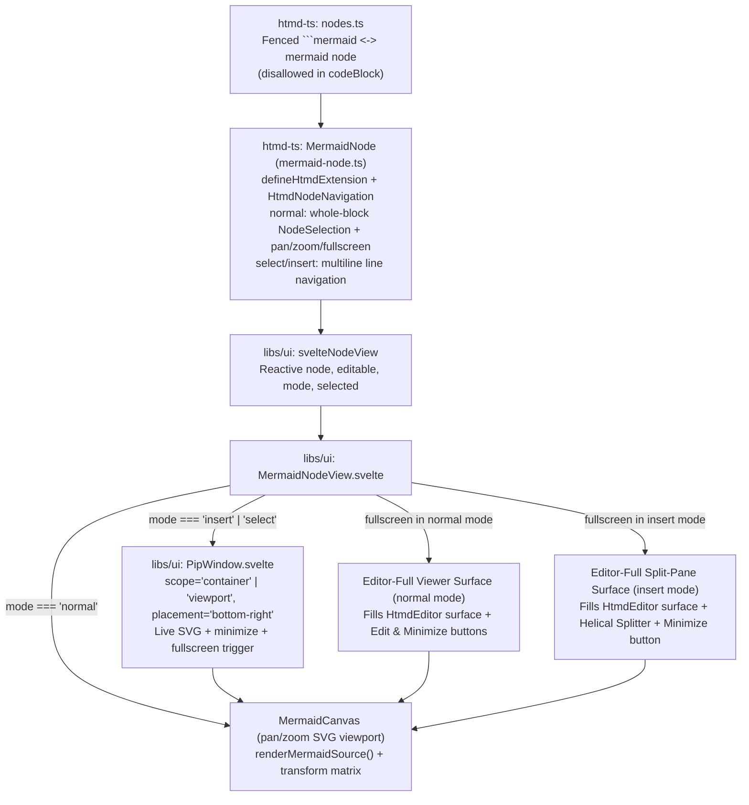

# Mermaid diagram editor and viewer (`MermaidNodeView`)

## Overview

`MermaidNodeView` (`libs/ui/src/editor/components/MermaidNodeView.svelte`) is the dedicated Svelte 5 `NodeView` component for `mermaid` blocks (`libs/htmd-ts/src/editor/extensions/mermaid-node.ts` and `libs/htmd-ts/src/nodes.ts`) inside `HtmdEditor`. It is separate from `CodeBlockComponent.svelte`; fenced ```` ```mermaid ```` blocks parse into `mermaid` nodes rather than `codeBlock` nodes, and `codeBlock` rejects `mermaid` as a selectable or valid language.

The component adapts its presentation and keybindings across all three modal states (`normal`, `select`, `insert`) and provides both inline and fullscreen pan/zoom diagram inspection.

## Design

### Public API

`MermaidNodeViewProps` in `libs/ui/src/editor/components/types.ts` extends `SvelteNodeViewProps<HtmdEditor>` with reactive `mode` (`'normal' | 'select' | 'insert'`), `editable`, and `selected` state supplied by `svelteNodeView`.

| Prop | Type | Purpose |
| --- | --- | --- |
| `editor` | `HtmdEditor` | Host editor instance for command dispatch, mode checks, and focus restoration. |
| `node` | `HtmdNodeViewNode` | ProseMirror `mermaid` node whose `textContent` holds the raw Mermaid source. |
| `editable` | `boolean` | `true` when the editor is editable and in `insert` mode. |
| `mode` | `EditorMode` | Active modal state (`'normal'`, `'select'`, or `'insert'`). |
| `selected` | `boolean` | `true` when the `mermaid` block is covered by the active `NodeSelection` or range. |
| `getPos` | `() => number \| undefined` | Returns the current flat document position of the `mermaid` block. |
| `deleteNode` | `() => void` | Deletes the `mermaid` block from the document. |

```ts
// Registered in libs/ui/src/editor/components/Editor.svelte
const nodeViews = {
  image: createSvelteNodeView(ImageNodeView),
  urlMention: createSvelteNodeView(UrlMentionPill, { as: 'span' }),
  linkPreview: createSvelteNodeView(LinkPreviewCard),
  codeBlock: createSvelteNodeView(CodeBlockComponent),
  mermaid: createSvelteNodeView(MermaidNodeView),
  notice: createSvelteNodeView(NoticeNodeView),
}
```

### Component Diagram



### Layout

#### 1. Normal Mode (Inline Highlighted Diagram Viewer)

When `mode === 'normal'`, the `mermaid` block renders the diagram SVG inside a pan/zoom viewport. Stepping onto the block (`j`, `k`, `{`, `}`) highlights the entire block (`[data-pm-modal-node-selection="normal"]`) and reveals the zoom/pan readout, **Edit** button, and **Fullscreen** button:

```text
+-----------------------------------------------------------------------+
| .node-mermaid [data-pm-modal-node-selection="normal"]                 |
| +-------------------------------------------------------------------+ |
| | Mermaid                          [-] [100%] [+] [Reset] [Edit] [Full] |
| +-------------------------------------------------------------------+ |
| |                                                                   | |
| |                     +---------+     +---------+                   | |
| |                     | Client  | --> | Server  |                   | |
| |                     +---------+     +---------+                   | |
| |                                                                   | |
| +-------------------------------------------------------------------+ |
+-----------------------------------------------------------------------+
```

#### 2. Insert Mode & Select Mode (Inline Code + Bottom-Right PiP Preview)

When `mode === 'insert'` or `mode === 'select'`, the component displays the Mermaid source code (`[data-node-view-content]`) with a floating Picture-in-Picture (PiP) preview anchored at the bottom-right corner. In `select` mode (`v` or `x`), line selections (`[data-pm-modal-selection="select"]`) highlight individual lines of Mermaid code while keeping the live PiP diagram visible:

```text
+-----------------------------------------------------------------------+
| .node-mermaid (mode === 'insert' | 'select')                          |
| +-------------------------------------------------------------------+ |
| | Mermaid                                           [Copy]   [Full] | |
| +-------------------------------------------------------------------+ |
| | 1  flowchart LR                                                   | |
| | 2    Client["Client"] --> Server["Server"]                        | |
| | 3    Server --> DB[("Database")]|                                 | |
| | 4                                 +-----------------------------+ | |
| | 5                                 | Preview     [-] [+] [_] [F] | | |
| | 6                                 | +-------------------------+ | | |
| |                                   | | [Client]-->[Server]     | | | |
| |                                   | |               |         | | | |
| |                                   | |             [(DB)]      | | | |
| |                                   | +-------------------------+ | | |
| |                                   +-----------------------------+ | |
+-----------------------------------------------------------------------+
```

#### 3. Fullscreen Viewer (Normal Mode — Fills Full Editor Space)

Pressing `f` (or `Space m f`) or clicking `[Full]` in `normal` mode expands the viewer to fill the **entire `HtmdEditor` pane space** (`[role="region"]` / `.article-scroll`). In fullscreen mode, the `[Full]` button is replaced by a **Minimize** (`[Min]`) button, with an **Edit** (`[Edit]`) button beside it that switches directly into the Fullscreen Split-Pane Editor:

```text
+=======================================================================+
| Mermaid Diagram                  [-] [125%] [+] [Reset] [Edit] [Min]  |
+=======================================================================+
|                                                                       |
|                                                                       |
|                +----------+          +----------+                     |
|                |  Client  | -------> |  Server  |                     |
|                +----------+          +----------+                     |
|                                            |                          |
|                                            v                          |
|                                      +----------+                     |
|                                      | Database |                     |
|                                      +----------+                     |
|                                                                       |
|  h/j/k/l or Ctrl+h/j/k/l: pan · +/-: zoom · 0: reset · Esc: minimize  |
+=======================================================================+
```

#### 4. Fullscreen Split-Pane Editor (Insert Mode — Fills Full Editor Space)

Opening fullscreen in `insert` mode (`Mod+Enter`, `Ctrl+Shift+f`, clicking `[Full]`, or clicking `[Edit]` from the Fullscreen Viewer) fills the **entire `HtmdEditor` pane space** with a split-pane surface (`Splitter` from `@cloudvoyant/helical-svelte`) containing the editable Mermaid code on the left, the interactive pan/zoom preview canvas on the right, and a **Minimize** (`[Min]`) button in place of Fullscreen:

```text
+=======================================================================+
| Mermaid Split Editor          [Pane: Code | Preview]  [-] [100%] [+] [Min] |
+===================================+===================================+
| 1  flowchart LR                   |                                   |
| 2    Client --> Server            |      +--------+     +--------+    |
| 3    Server --> DB|               |      | Client | --> | Server |    |
| 4                                 |      +--------+     +--------+    |
|                                   |                         |         |
|                                   |                         v         |
|                                   |                     +--------+    |
|                                   |                     |   DB   |    |
|                                   |                     +--------+    |
|                                   |                                   |
| Ctrl+h/j/k/l: pan · Ctrl+=/Ctrl+-/Ctrl+0: zoom · Esc: minimize        |
+===================================+===================================+
```

### State and Data Flow

```mermaid
stateDiagram-v2
    [*] --> NormalInline: Open article (mode = normal)
    NormalInline --> NormalFullscreen: Press f / Space m f / click Fullscreen
    NormalFullscreen --> NormalInline: Press Escape / f / q / click Minimize
    NormalFullscreen --> InsertSplitCode: Click Edit or press Enter / i
    NormalInline --> SelectInline: Press v or x on mermaid block
    SelectInline --> NormalInline: Press Escape / ; / y / d
    SelectInline --> InsertInline: Press c / i / a
    NormalInline --> InsertInline: Press Enter / i / a / click Edit or block
    InsertInline --> NormalInline: Press Escape
    InsertInline --> InsertSplitCode: Press Mod+Enter / Ctrl+Shift+f / click Fullscreen
    InsertSplitCode --> InsertSplitPreview: Press Ctrl+w l / Ctrl+w w / Tab
    InsertSplitPreview --> InsertSplitCode: Press Ctrl+w h / Ctrl+w w / i / Tab
    InsertSplitPreview --> InsertInline: Press Escape / click Minimize
    InsertSplitCode --> InsertInline: Press Escape / click Minimize
```



- **Document State (`ProseMirror`)**: `node.textContent` is the single source of truth for the diagram source. `<code data-node-view-content>` remains mounted at all times (visually hidden with `sr-only` in `normal` mode) so ProseMirror owns text transactions, undo/redo history, and inline selection decorations in `select` and `insert` modes.
- **SVG Rendering (`@cloudvoyant/helical-ui`)**: `MermaidNodeView` debounces `renderMermaidSource(node.textContent)` (120 ms in `insert` mode, immediate on mount in `normal` mode) and caches the last valid SVG string alongside any syntax error state so typing incomplete tokens in `insert` mode keeps the last valid diagram visible in the PiP/split preview with a compact syntax indicator.
- **Viewport Pan & Zoom State**: Each `MermaidNodeView` instance holds reactive `{ scale, panX, panY }` state (`scale` clamped to `0.25 .. 4.0`, default `1.0`, `panX = 0`, `panY = 0`) shared between its inline canvas and fullscreen view.

### Behavior

- **Default (`normal` mode):** Renders the diagram SVG centered in its block container. Moving the cursor onto the block highlights the whole block (`NodeSelection`).
- **Keyboard Pan, Zoom, and Fullscreen Across Modes:**
  `Ctrl+h` / `Ctrl+j` / `Ctrl+k` / `Ctrl+l` (pan) and `Ctrl+=` / `Ctrl+-` / `Ctrl+0` (zoom in / zoom out / reset) work uniformly across **all** modes (`normal`, `select`, and `insert`, both inline and fullscreen) when the cursor or selection is inside a `mermaid` block. Non-insert diagram views also accept single-key shortcuts:

| Context | Pan Shortcuts | Zoom & Reset Shortcuts | Mode / Pane Transitions |
| --- | --- | --- | --- |
| **Inline `normal` mode** (when `mermaid` block is selected) | `Ctrl+h` / `Ctrl+j` / `Ctrl+k` / `Ctrl+l` or `H` / `J` / `K` / `L` (leaves `j`/`k` free for article block motion) | `Ctrl+=` / `Ctrl+-` / `Ctrl+0` or `+` / `=` / `-` / `0` | `f` or `Space m f`: open Fullscreen Viewer; `Enter` / `i`: enter `insert` mode; `v` / `x`: enter `select` mode |
| **Fullscreen Viewer (`normal` mode)** (`overlay` priority) | `Ctrl+h` / `Ctrl+j` / `Ctrl+k` / `Ctrl+l`, `h` / `j` / `k` / `l`, `H` / `J` / `K` / `L`, or Arrow keys | `Ctrl+=` / `Ctrl+-` / `Ctrl+0` or `+` / `=` / `-` / `0` | `Escape`, `f`, or `q`: close fullscreen and restore inline `NodeSelection` |
| **Inline `select` mode** (`v` or `x`) | `Ctrl+h` / `Ctrl+j` / `Ctrl+k` / `Ctrl+l` | `Ctrl+=` / `Ctrl+-` / `Ctrl+0` | `j` / `k` / `x` select lines of Mermaid code; `y` / `d` / `c` operate on selected lines; `Escape` returns to `normal` mode |
| **Inline `insert` mode** | `Ctrl+h` / `Ctrl+j` / `Ctrl+k` / `Ctrl+l` | `Ctrl+=` (zoom in), `Ctrl+-` (zoom out), `Ctrl+0` (reset) | `Mod+Enter` or `Ctrl+Shift+f`: open Fullscreen Split-Pane; `Tab` / `Shift+Tab`: cycle header/PiP controls; `Escape`: return to `normal` mode |
| **Fullscreen Split-Pane — Code Pane focused (`insert` mode)** | `Ctrl+h` / `Ctrl+j` / `Ctrl+k` / `Ctrl+l` without interrupting typing | `Ctrl+=` (zoom in), `Ctrl+-` (zoom out), `Ctrl+0` (reset) | `Ctrl+w l`, `Ctrl+w w`, or `Tab`: focus Preview Pane; `Escape` or `Mod+Enter`: exit fullscreen |
| **Fullscreen Split-Pane — Preview Pane focused (`insert` mode)** | `Ctrl+h` / `Ctrl+j` / `Ctrl+k` / `Ctrl+l`, `h` / `j` / `k` / `l`, `H` / `J` / `K` / `L`, or Arrow keys | `Ctrl+=` / `Ctrl+-` / `Ctrl+0` or `+` / `=` / `-` / `0` | `Ctrl+w h`, `Ctrl+w w`, `i`, or `Tab`: focus Code Pane; `Escape`: exit fullscreen |

- **Loading, empty, and error:**
  - Empty `mermaid` blocks show an empty-state placeholder in `normal` mode (`Empty Mermaid diagram — press Enter to edit`) and a starter hint in `insert` mode.
  - Syntax errors during `insert` mode preserve the last valid rendered SVG in the PiP / split preview and display a compact `Syntax error` badge; if no valid SVG has been rendered yet in `normal` mode, a styled diagnostic card displays the source and error summary.
- **Accessibility:**
  - Diagram viewports expose `role="region"` with `aria-label="Mermaid diagram preview"` and live zoom percentage attributes (`data-zoom-percent`).
  - Fullscreen dialogs register with `useKeymap` at `overlay` priority and restore DOM focus to the inline block or active code position when closed with `Escape`.

## Implementation

### Styling and Responsiveness

- Define CVA variants and base classes in `libs/ui/src/editor/components/styles.ts` (`mermaidBlockSurface`, `mermaidToolbar`, `mermaidViewport`, `mermaidFullscreenSplit`) using semantic theme tokens (`bg-card`, `border-border`, `text-foreground`, `text-muted-foreground`, `ring-ring`) and Helical's `renderMermaidSource` / `resolveMermaidThemeVariables` so diagrams automatically adapt to light/dark mode and all 54 Helical themes.
- Compose [`PipWindow`](../pip-window.md) (`libs/ui/src/pip-window/PipWindow.svelte`) with `scope="container"` (confined to the `.node-mermaid` relative wrapper by default, or switchable to `scope="viewport"`) and `placement="bottom-right"` so the preview floats over the bottom-right corner and can be minimized to a compact header pill (`Preview [-] [100%] [+] [+] [Full]`).

### Maintainer Notes

- **Never merge `mermaid` into `codeBlock`**: `libs/htmd-ts/src/nodes.ts` parses ```` ```mermaid ```` fences into `mermaid` nodes, and `codeBlock` validation rejects `language === 'mermaid'`. `CodeBlockComponent.svelte` excludes `mermaid` from its `languages` list.
- **Keep `[data-node-view-content]` mounted**: ProseMirror requires the `contentDOM` element to stay in the DOM across mode transitions. Hide the code container with `sr-only` when `mode === 'normal'` rather than unmounting it with `{#if}`.
- **Mode-aware `collectLeafBlocks`**: In `libs/htmd-ts/src/editor/extensions/modal-editing.ts`, `collectLeafBlocks` treats `mermaid` as a single whole-block `NodeSelection` stop in `normal` mode (so `j`/`k` highlight the diagram block as a unit) and expands `mermaid` into per-line text descriptors in `select` mode (so `x` and `v` select individual lines of Mermaid code).
- **References**:
  - [Picture-in-Picture window (`PipWindow`)](../pip-window.md)
  - [HTMD editor (`HtmdEditor`)](index.md)
  - [HTMD editor extensions architecture](../../htmd-ts/editor-extensions.md)
  - [Keybindings](../../../keybindings/index.md)
