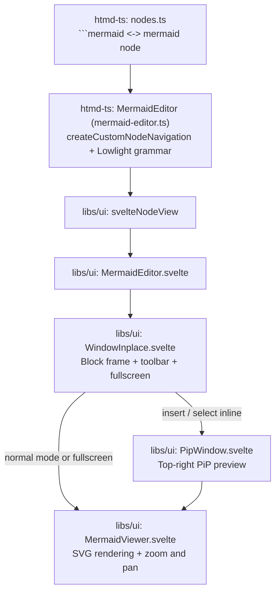

# Mermaid diagram editor (`MermaidEditor`)

## Overview

`MermaidEditor` (`libs/ui/src/editor/components/MermaidEditor.svelte`) is the Svelte 5 `NodeView` for `mermaid` blocks (`libs/htmd-ts/src/editor/extensions/mermaid-editor.ts` and `libs/htmd-ts/src/nodes.ts`). It composes [`WindowInplace`](../window-inplace.md), [`PipWindow`](../pip-window.md), and [`MermaidViewer`](../mermaid-viewer.md) across `normal`, `select`, and `insert` modes.

## Design

### Public API

`MermaidEditorProps` in `libs/ui/src/editor/components/types.ts` extends `SvelteNodeViewProps<HtmdEditor>`:

| Prop | Type | Purpose |
| --- | --- | --- |
| `editor` | `HtmdEditor` | Host editor for commands, mode state, and focus control. |
| `node` | `HtmdNodeViewNode` | ProseMirror `mermaid` node whose `textContent` holds the Mermaid source. |
| `editable` | `boolean` | `true` when the editor is editable. |
| `mode` | `EditorMode` | Active modal state (`'normal'`, `'select'`, or `'insert'`). |
| `selected` | `boolean` | `true` when the block is selected. |
| `getPos` | `() => number \| undefined` | Returns the current document position of the block. |
| `deleteNode` | `() => void` | Deletes the block from the document. |

```ts
const nodeViews = {
  image: createSvelteNodeView(ImageNodeView),
  urlMention: createSvelteNodeView(UrlMentionPill, { as: 'span' }),
  linkPreview: createSvelteNodeView(LinkPreviewCard),
  codeBlock: createSvelteNodeView(CodeBlockComponent),
  mermaid: createSvelteNodeView(MermaidEditor),
  notice: createSvelteNodeView(NoticeNodeView),
}
```

### Component Diagram



### Layout

#### 1. Normal Mode (Inline Diagram Viewer)

```text
+-----------------------------------------------------------------------+
| .node-mermaid [data-pm-modal-node-selection="normal"]                 |
| +-------------------------------------------------------------------+ |
| | Mermaid                                                [✎]  [⛶]  | |
| +-------------------------------------------------------------------+ |
| |                     +---------+     +---------+                   | |
| |                     | Client  | --> | Server  |                   | |
| |                     +---------+     +---------+                   | |
+-----------------------------------------------------------------------+
```

#### 2. Insert & Select Mode (Inline Code + Top-Right `PipWindow` Preview)

```text
+-----------------------------------------------------------------------+
| .node-mermaid (mode === 'insert' | 'select', min-h-64)                |
| +-------------------------------------------------------------------+ |
| | Mermaid                                                [⧉]  [⛶]  | |
| +-------------------------------------------------------------------+ |
| | 1  flowchart LR                           +---------------------+ | |
| | 2    Client["Client"] --> Server          | [Client]-->[Server] | | |
| | 3    Server --> DB[("Database")]|         |               |     | | |
| | 4                                         |             [(DB)]  | | |
| | 5                                         +---------------------+ | |
+-----------------------------------------------------------------------+
```

#### 3. Fullscreen Viewer (Normal Mode)

```text
+=======================================================================+
| Mermaid                                                    [✎]  [⤡]  |
+=======================================================================+
|                +----------+          +----------+                     |
|                |  Client  | -------> |  Server  |                     |
|                +----------+          +----------+                     |
+=======================================================================+
```

#### 4. Fullscreen Split-Pane Editor (Insert & Select Mode)

```text
+=======================================================================+
| Mermaid                                                    [⧉]  [⤡]  |
+===================================+===================================+
| 1  flowchart LR                   |      +--------+     +--------+    |
| 2    Client --> Server            |      | Client | --> | Server |    |
| 3    Server --> DB|               |      +--------+     +--------+    |
+===================================+===================================+
```

### State and Data Flow

```mermaid
stateDiagram-v2
    [*] --> NormalInline: Open article (mode = normal)
    NormalInline --> NormalFullscreen: Press f / Space m f / Ctrl+w z / click Fullscreen
    NormalFullscreen --> NormalInline: Press Escape / f / q / Ctrl+w z / click Minimize
    NormalFullscreen --> InsertSplitCode: Click Edit or press Enter / i
    NormalInline --> SelectInline: Press v or x
    SelectInline --> NormalInline: Press Escape / ; / y / d
    SelectInline --> InsertInline: Press c / i / a
    NormalInline --> InsertInline: Press Enter / i / a / click Edit
    InsertInline --> NormalInline: Press Escape
    InsertInline --> InsertSplitCode: Press Ctrl+w z / Mod+Enter / click Fullscreen
    InsertSplitCode --> InsertSplitPreview: Press Ctrl+w l / Ctrl+w w / Tab
    InsertSplitPreview --> InsertSplitCode: Press Ctrl+w h / Ctrl+w w / i / Tab
    InsertSplitPreview --> NormalFullscreen: Press Escape
    InsertSplitCode --> NormalFullscreen: Press Escape
```



- **Document State**: `node.textContent` holds the Mermaid source. `<code data-node-view-content>` stays mounted in the DOM and uses `.sr-only` in `normal` mode so ProseMirror preserves its `contentDOM`.
- **Rendering & Viewport**: [`MermaidViewer`](../mermaid-viewer.md) debounces `renderMermaidSource(code)`, retains the last valid SVG during syntax errors, and manages `{ scale, panX, panY }` across inline, `PipWindow`, and fullscreen views.

### Behavior

- **Normal mode**:
  - When the user moves onto the block (`j`, `k`), the editor selects the whole diagram (`NodeSelection`) and hides the raw code.
  - When the user drags the diagram or presses `+`, `-`, `0`, or `Ctrl+h/j/k/l`, the viewer pans and zooms.
- **Insert mode**:
  - When the user presses `Enter`, `i`, or clicks `Edit`, the editor shows syntax-highlighted code and the top-right `PipWindow` preview.
  - When the user presses `ArrowUp` on line 1, focus moves to the toolbar `Copy` button; `Tab` moves to `Fullscreen`, and `ArrowUp` moves to the block above.
  - When the user types invalid Mermaid syntax, `MermaidViewer` keeps the last valid diagram and `WindowInplace` shows a bottom error bar.
- **Select mode**:
  - When the user presses `x` or `v`, the editor reveals the code and `PipWindow` preview and selects individual source lines.
- **Fullscreen**:
  - When the user presses `Ctrl+w z` (or `Space w z` / `Space m f` / `f`), `WindowInplace` expands to fill the editor pane (`viewer` in `normal` mode, 50/50 `split` in `insert`/`select` mode).
  - When the user presses `Escape` in split screen, the editor exits to `normal` mode and switches to fullscreen preview; a second `Escape` minimizes fullscreen back to the inline block.

## Implementation

### Design Decisions

- **Separate `mermaid` node from `codeBlock`**: `libs/htmd-ts/src/nodes.ts` parses ```` ```mermaid ```` fences into `mermaid` nodes and disallows `language === 'mermaid'` on `codeBlock` so diagrams use `createCustomNodeNavigation` (`kind: 'custom'`) instead of plain code-block navigation.
- **Keep `[data-node-view-content]` mounted**: ProseMirror requires `contentDOM` to remain in the DOM across mode changes, so `MermaidEditor` hides the code container with `sr-only` in `normal` mode rather than unmounting it.
- **References**:
  - [In-place window (`WindowInplace`)](../window-inplace.md)
  - [Picture-in-Picture window (`PipWindow`)](../pip-window.md)
  - [Mermaid viewer (`MermaidViewer`)](../mermaid-viewer.md)
  - [HTMD editor (`HtmdEditor`)](index.md)
  - [Keybindings](../../../keybindings/index.md)
