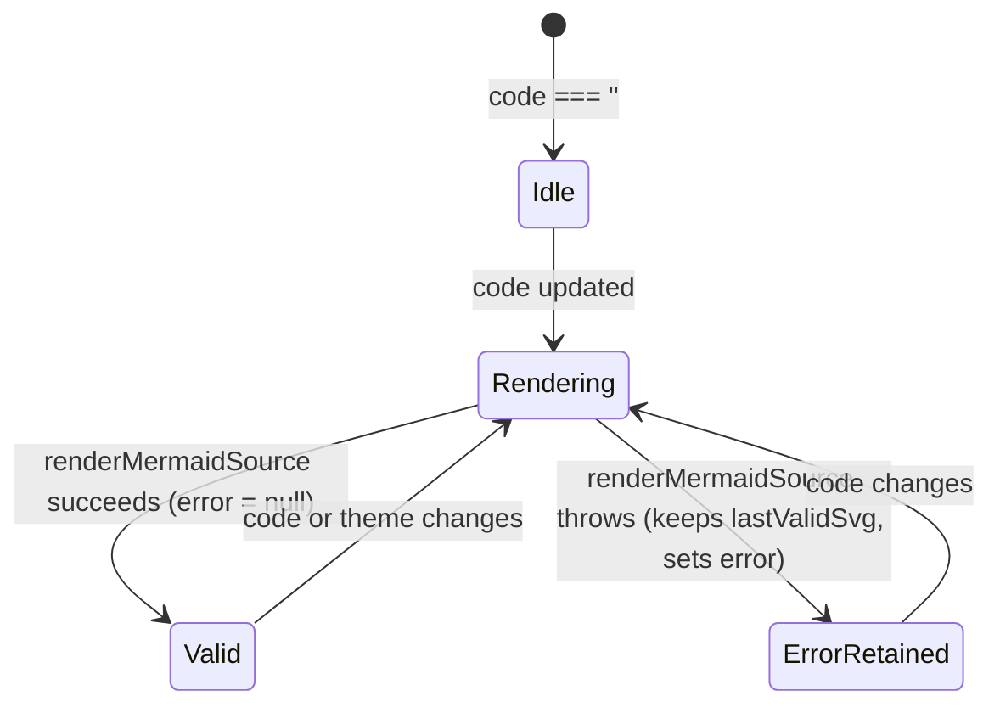

# Mermaid viewer (`MermaidViewer`)

## Overview

`MermaidViewer` (`libs/ui/src/mermaid-viewer/MermaidViewer.svelte`) renders Mermaid source code into an interactive SVG viewport with pointer drag panning, wheel/pinch zooming, theme synchronization, and last-valid SVG retention during syntax errors.

## Design

### Public API

| Prop | Type | Default | Purpose |
| --- | --- | --- | --- |
| `code` | `string` | — | Mermaid diagram source code. |
| `debounceMs` | `number` | `0` | Debounce delay in milliseconds when `code` changes while a valid SVG is already shown. |
| `fit` | `'auto' \| 'contain'` | `'auto'` | `'auto'` for full viewports; `'contain'` scales the SVG to fit compact `WindowInplace` containers. |
| `scale` | `number` (`$bindable`) | `1` | Current zoom scale (`0.25` to `4.0`). |
| `panX` | `number` (`$bindable`) | `0` | Horizontal pan offset in pixels. |
| `panY` | `number` (`$bindable`) | `0` | Vertical pan offset in pixels. |
| `error` | `string \| null` (`$bindable`) | `null` | Latest Mermaid syntax error, or `null` when valid. |
| `onviewportchange` | `(state) => void` | `undefined` | Called when pointer or wheel gestures change `scale`, `panX`, or `panY`. |

### State and Data Flow

### Behavior

- **Live rendering**: Calls `renderMermaidSource(code)` and re-renders automatically when `document.documentElement` changes `class` or `data-theme`.
- **Fault tolerance**: Retains the last valid SVG when `renderMermaidSource` throws and binds the error message to `error`.
- **Zoom and pan**: Supports pointer drag panning, `Ctrl`/`Cmd` + wheel zooming, two-finger touch pinch zooming, and imperative `zoomBy`, `panBy`, and `resetViewport` methods.
