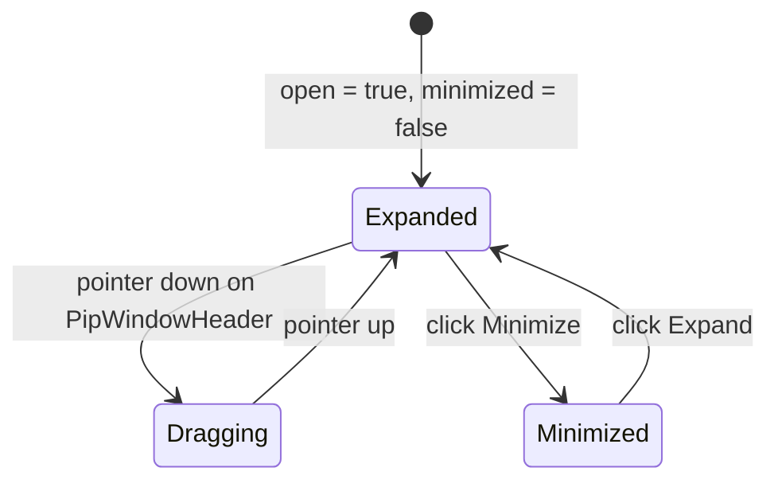

# Picture-in-Picture window (`PipWindow`)

## Overview

`PipWindow` (`libs/ui/src/pip-window/`) is a compound Picture-in-Picture preview window family (`PipWindow`, `PipWindowHeader`, `PipWindowTitle`, `PipWindowControls`, `PipWindowBody`) that anchors inside a parent container (`scope="container"`) or portals to the viewport (`scope="viewport"`). [`MermaidEditor`](htmd-editor/mermaid.md) composes `PipWindow` and `PipWindowBody` to display a live diagram preview at the top-right corner of the code block in `insert` and `select` modes.

## Design

### Public API

| Component / Prop | Type | Default | Purpose |
| --- | --- | --- | --- |
| `PipWindow` (`title`) | `string` | `'Preview'` | Accessible `aria-label` for the group and default `PipWindowTitle` text. |
| `PipWindow` (`open`) | `boolean` | `true` | Controls whether the window is rendered. |
| `PipWindow` (`scope`) | `'container' \| 'viewport'` | `'container'` | `'container'` positions absolutely inside the parent; `'viewport'` portals to `document.body`. |
| `PipWindow` (`boundaryEl`) | `HTMLElement \| null` | `null` | Boundary element for drag clamping when `draggable` is enabled. |
| `PipWindow` (`placement`) | `'bottom-right' \| 'top-right' \| 'bottom-left' \| 'top-left'` | `'top-right'` | Corner anchor inside the container or viewport. |
| `PipWindow` (`minimized`) | `boolean` (`$bindable`) | `false` | Collapses `PipWindowBody` to a header pill. |
| `PipWindow` (`draggable`) | `boolean` | `false` | Enables pointer dragging on `PipWindowHeader`. |
| `PipWindow` (`resizable`) | `boolean` | `false` | Enables CSS resize handles on the window. |
| `PipWindowHeader` | `class?: string`, `children?: Snippet` | — | Optional header bar with pointer drag listeners. |
| `PipWindowTitle` | `class?: string`, `children?: Snippet` | — | Header title text (defaults to context `title`). |
| `PipWindowControls` | `class?: string`, `children?: Snippet` | — | Header action buttons plus Minimize and Fullscreen triggers. |
| `PipWindowBody` | `class?: string`, `children?: Snippet` | — | Window body rendered when `minimized` is `false`. |

### Layout

```text
+-------------------------------------------------------------------+
| Parent Container (position: relative, min-h-64)                   |
|                                         +-----------------------+ |
|                                         | PipWindowBody         | |
|                                         | [Client] ---> [Server]| |
|                                         +-----------------------+ |
+-------------------------------------------------------------------+
```

### State and Data Flow



### Behavior

- **Container scope**: Renders inside the parent container (`position: absolute`) anchored `12px` from the chosen corner (`w-44`).
- **Headerless composition**: Omitting `PipWindowHeader` renders a body-only preview card (`<PipWindow><PipWindowBody>...</PipWindowBody></PipWindow>`) so all action buttons stay in the parent block's toolbar.
- **Accessibility**: Uses `role="group"` with `aria-label={title}` so parent `.closest('[role="region"]')` lookups always resolve the outer article scroll region.
