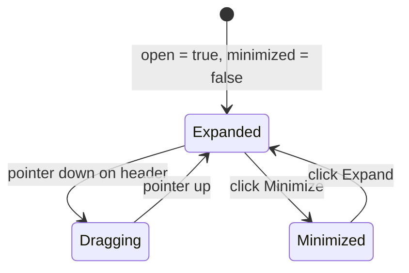

# Picture-in-Picture window (`PipWindow`)

## Overview

`PipWindow` (`libs/ui/src/pip-window/PipWindow.svelte`) is a floating Picture-in-Picture preview window that anchors inside a parent container (`scope="container"`) or portals to the viewport (`scope="viewport"`). [`MermaidEditor`](htmd-editor/mermaid.md) uses `PipWindow` to display a live diagram preview at the top-right corner of the code block in `insert` and `select` modes.

## Design

### Public API

| Prop | Type | Default | Purpose |
| --- | --- | --- | --- |
| `title` | `string` | `'Preview'` | Header title or `aria-label` when `showHeader={false}`. |
| `open` | `boolean` | `true` | Controls whether the window is rendered. |
| `scope` | `'container' \| 'viewport'` | `'container'` | `'container'` positions absolutely inside the parent; `'viewport'` portals to `document.body`. |
| `boundaryEl` | `HTMLElement \| null` | `null` | Boundary element for drag clamping when `draggable` is enabled. |
| `placement` | `'bottom-right' \| 'top-right' \| 'bottom-left' \| 'top-left'` | `'top-right'` | Corner anchor inside the container or viewport. |
| `showHeader` | `boolean` | `true` | Shows the header bar and window controls. |
| `minimized` | `boolean` (`$bindable`) | `false` | Collapses the body to a header pill. |
| `draggable` | `boolean` | `false` | Enables pointer dragging on the header bar. |
| `resizable` | `boolean` | `false` | Enables CSS resize handles on the window body. |
| `onminimizechange` | `(minimized: boolean) => void` | `undefined` | Called when the minimize button is toggled. |
| `onfullscreen` | `() => void` | `undefined` | Called when the fullscreen button is clicked. |
| `actions` | `Snippet` | `undefined` | Extra header buttons rendered before minimize and fullscreen. |
| `children` | `Snippet` | — | Window body content. |
| `class` | `string` | `undefined` | Caller class overrides merged via `cn`. |

### Layout

```text
+-------------------------------------------------------------------+
| Parent Container (position: relative, min-h-64)                   |
|                                         +-----------------------+ |
|                                         | [Client] ---> [Server]| |
|                                         |                  |    | |
|                                         |                [(DB)] | |
|                                         +-----------------------+ |
+-------------------------------------------------------------------+
```

### State and Data Flow



### Behavior

- **Container scope**: Renders inside the parent container (`position: absolute`) anchored `12px` from the chosen corner (`w-44`).
- **Headerless mode**: When `showHeader={false}`, omits the title bar so all action buttons stay in the parent block's toolbar.
- **Accessibility**: Uses `role="group"` with `aria-label={title}` so parent `.closest('[role="region"]')` lookups always resolve the outer article scroll region.
