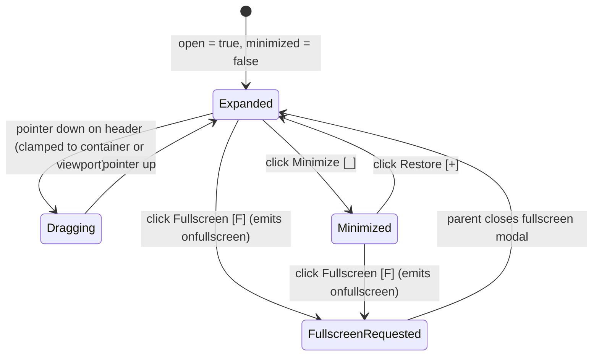

# Picture-in-Picture window (`PipWindow`)

## Overview

`PipWindow` (`libs/ui/src/pip-window/PipWindow.svelte`) is a reusable Picture-in-Picture floating preview window built on Ark UI FloatingPanel (`@ark-ui/svelte/floating-panel`) and `@cloudvoyant/helical-ui` window tokens (`windowContentBase`, `windowHeaderBase`, `windowTitleBase`, `windowControlBase`, `windowStageTriggerBase`, `windowBodyBase`).

Unlike `@cloudvoyant/helical-svelte`'s top-level `Window` (which always portals to `document.body`), `PipWindow` can be **scoped either to a parent `div` container** (`scope="container"`, `strategy="absolute"`) or **to the browser viewport** (`scope="viewport"`, `strategy="fixed"` via `<Portal>`). [`MermaidNodeView`](htmd-editor/mermaid.md) uses `PipWindow` for its live diagram preview in `insert` and `select` modes, and future embedded editors (Manim, Chart, LaTeX) can reuse the same primitive.

## Design

### Public API

`PipWindowProps` in `libs/ui/src/pip-window/types.ts` controls scoping, corner placement, dimensions, stage (`default` vs `minimized`), and fullscreen escalation:

| Prop | Type | Default | Purpose |
| --- | --- | --- | --- |
| `title` | `string` | `'Preview'` | Header label displayed in the PiP title bar (or `aria-label` when `showHeader={false}`). |
| `open` | `boolean` | `true` | Controls whether the PiP window is visible. |
| `scope` | `'container' \| 'viewport'` | `'container'` | `'container'` confines and positions the PiP inside its bounding `div`; `'viewport'` portals it to `document.body`. |
| `boundaryEl` | `HTMLElement \| null` | `undefined` | Optional explicit boundary element for drag/resize clamping when `scope="container"`. |
| `placement` | `'bottom-right' \| 'top-right' \| 'bottom-left' \| 'top-left'` | `'top-right'` | Initial corner anchor within the container or viewport. |
| `showHeader` | `boolean` | `true` | Renders the header bar (`[data-pip-header]`). Set to `false` for a compact, headerless preview window (`MermaidNodeView`). |
| `minimized` | `boolean` | `false` | Collapses the body so only the compact header bar remains visible (when `showHeader={true}`). |
| `draggable` | `boolean` | `true` | Allows dragging the header within the active scope boundary. |
| `resizable` | `boolean` | `false` | Enables Ark `FloatingPanelResizeTrigger` handles. |
| `onminimizechange` | `(minimized: boolean) => void` | `undefined` | Called when the user toggles the minimize/restore stage button. |
| `onfullscreen` | `() => void` | `undefined` | Called when the user clicks the Fullscreen button (`Maximize2`). |
| `actions` | `Snippet` | `undefined` | Optional header control slot rendered before the minimize and fullscreen buttons. |
| `children` | `Snippet` | — | Preview body content. |
| `class` | `string` | `undefined` | Additional classes merged onto the window surface via `cn`. |

```svelte
<div bind:this={containerEl} class="relative min-h-64">
  <!-- Main editor content -->
  <PipWindow
    title="Mermaid diagram preview"
    scope="container"
    boundaryEl={containerEl}
    placement="top-right"
    showHeader={false}
    draggable={false}
  >
    <div class="mermaid-pip-canvas">{@html svg}</div>
  </PipWindow>
</div>
```

### Layout

Compact headerless (`showHeader = false`) anchored at `top-right` of a container `div` (`scope="container"`):

```text
+-------------------------------------------------------------------+
| Parent Container (position: relative, min-h-64)                   |
|                                         +-----------------------+ |
|                                         | [Client] ---> [Server]| |
|                                         |                  |    | |
|                                         |                [(DB)] | |
|                                         +-----------------------+ |
|                                                                   |
+-------------------------------------------------------------------+
```

With header (`showHeader = true`, `minimized = false`):

```text
+-------------------------------------------------------------------+
| Parent Container (position: relative)                             |
|                                         +-----------------------+ |
|                                         | Preview        [_][F] | |
|                                         +-----------------------+ |
|                                         | [Client] ---> [Server]| |
|                                         +-----------------------+ |
+-------------------------------------------------------------------+
```

### State and Data Flow



### Behavior

- **Default (`scope="container"`, `placement="top-right"`):** Renders inside the nearest `position: relative` container without a `<Portal>`, anchored `12px` (`top-3 right-3`) from the chosen corner at compact `w-44` width. When `showHeader={false}`, the title bar and window stage controls are omitted so all toolbar icons stay in the parent component's top bar.
- **Viewport Scope (`scope="viewport"`):** Wraps `FloatingPanelPositioner` in Ark `<Portal>` with `strategy="fixed"` and `getBoundaryEl={() => document.documentElement}` so the PiP floats above the application viewport when the user pins a preview across page scroll.
- **Loading, empty, and error:** `PipWindow` is content-agnostic; callers render loading spinners, last-valid previews, or syntax badges inside `children` or `actions`.
- **Accessibility:** Exposes `role="region"` with `aria-label={title}`, keyboard-focusable stage buttons (`Minimize preview` / `Restore preview`, `Enter fullscreen`), and `data-editor-controls` so clicking or tabbing into PiP controls inside `HtmdEditor` never triggers an unintended mode exit.

## Implementation

- Compose `@ark-ui/svelte/floating-panel` (`FloatingPanelRoot`, `FloatingPanelPositioner`, `FloatingPanelContent`, `FloatingPanelDragTrigger`, `FloatingPanelHeader`, `FloatingPanelBody`, `FloatingPanelResizeTrigger`) with `@cloudvoyant/helical-ui`'s `window*Base` tokens and CVA placement/scope variants in `libs/ui/src/pip-window/styles.ts`.
- Export `PipWindow` and `PipWindowProps` from `libs/ui/src/pip-window/index.ts` and `libs/ui/src/index.ts`.
- See [Mermaid diagram editor and viewer (`MermaidNodeView`)](htmd-editor/mermaid.md).
