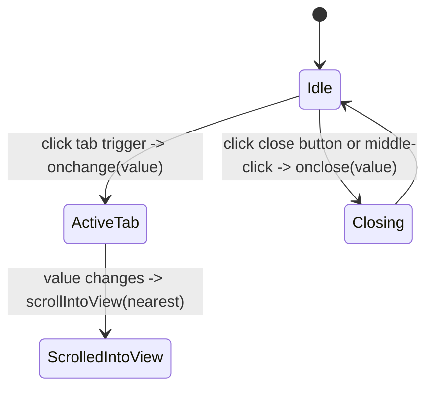

# Tabs

## Overview

`Tabs` is a reusable Ark UI tab strip in `libs/ui/src/tabs/` styled with a Linear-like minimal visual language (quiet hairline bottom border, compact flat pill triggers with subtle active surface contrast, dirty dot indicator, and hover/active close buttons) using semantic Helical theme tokens.

## Design

### Public API

`TabsProps` accepts `items: TabItem[]`, `value: string | null`, `ariaLabel`, `size` (`'sm' | 'md'`), `class`, `onchange(value)`, and optional `onclose(value)`.

```svelte
<Tabs items={workspace.tabItems} value={workspace.activeTab} onchange={handleTabChange} onclose={handleTabClose} />
```

### Layout

```text
+----------------------------------------------------------------------------+
| [ Markdown  x ]   [ HTMD •  x ]                                            |
+----------------------------------------------------------------------------+
```

### State and Data Flow



- Tab triggers prevent default `mousedown` focus transfer so clicking tabs does not steal editor focus.
- Middle-clicking a tab invokes `onclose(value)` when provided.

## Implementation

- Built on `@ark-ui/svelte/tabs` with CVA variants in `libs/ui/src/tabs/styles.ts` and types in `libs/ui/src/tabs/types.ts`.
