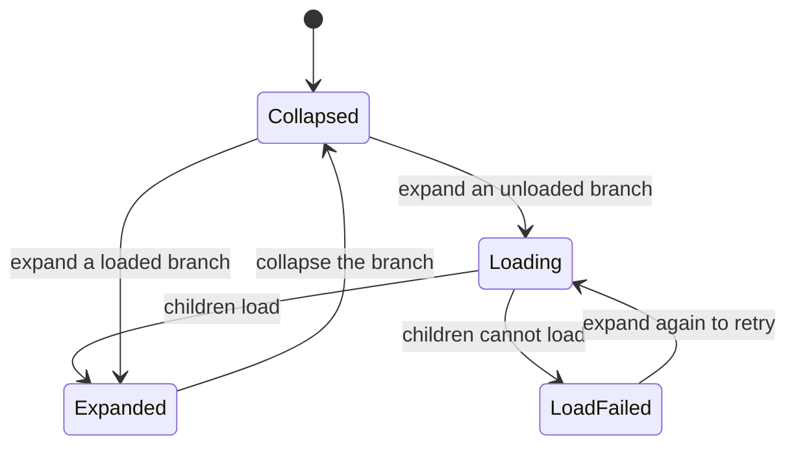
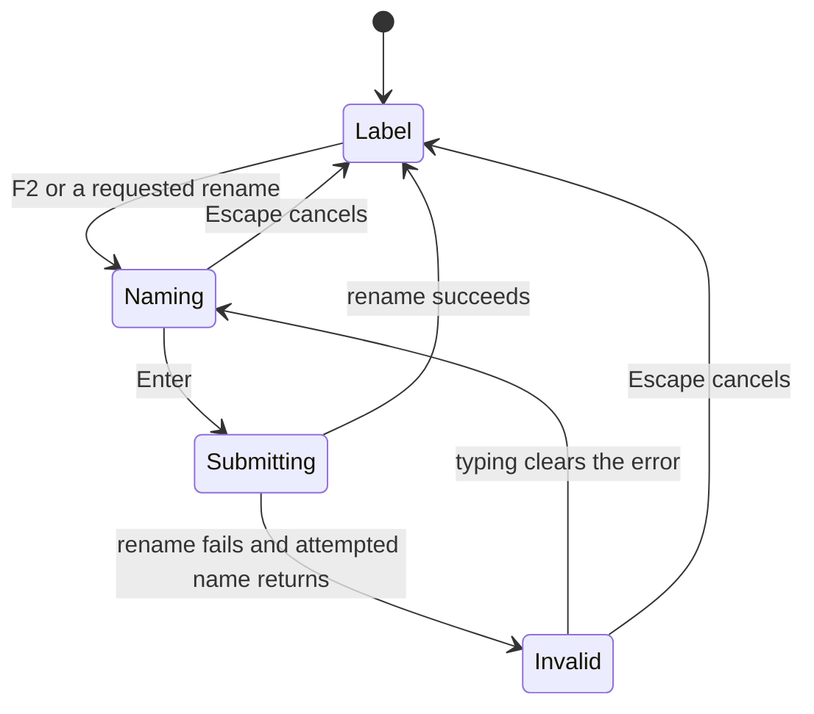

# Tree view

## Overview

TreeView is a reusable Ark UI tree wrapper with Helical styling. The workspace file tree is its current consumer.

## Design

### Public API

`TreeViewProps` in `libs/ui/src/tree-view/types.ts` defines nodes, selection, loading, renaming, label/icon rendering, context actions, and refresh requests. Stable node values identify entries. Callers keep storage behavior outside the component.

```svelte
<TreeView {nodes} {selected} onselect={selectNode} {loadChildren} />
```

### Layout

Expanded and collapsed branches:

```text
Drafts/
|-- First article
`-- Research/
    `-- Source notes
Archive/
```

Conflicting inline rename:

```text
Drafts/
|-- First article
`-- [ Existing name          ]
    A file or folder with this
    name already exists.
Archive/
```

Rows are 24 px tall. Each nesting level adds 16 px of indentation, with a 14 px icon box and a truncated label. During renaming, a 22 px input replaces the label. Its error appears below that row.

### State and Data Flow

Branch expansion:



Inline naming:



- Arrow keys move focus through the hierarchy. Selecting a leaf reports its value to the caller.

## Implementation

- Keep selection controlled by `selected`. A failed draft save must leave the original leaf selected.
- Replace the `loaded` cache object when children change. It uses `$state.raw`, so nested mutation does not refresh the collection.
- Keep the attempted rename label separate from `displayLabel`, which supplies the normal row label.
- Defer menu actions until menu focus restoration finishes. Starting a rename earlier can steal focus from its input.
