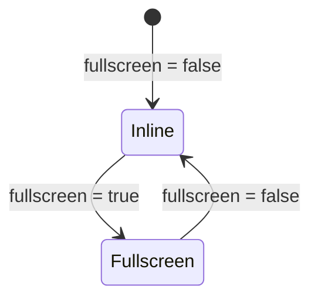

# In-place window (`WindowInplace`)

## Overview

`WindowInplace` (`libs/ui/src/window-inplace/`) is a compound in-place block window family (`WindowInplace`, `WindowInplaceHeader`, `WindowInplaceTitle`, `WindowInplaceToolbar`, `WindowInplaceBody`, `WindowInplaceFooter`) with an editor-scoped fullscreen overlay mode (`fullscreen={true}`). [`MermaidEditor`](htmd-editor/mermaid.md) composes these subcomponents as its outer block frame across inline and fullscreen views.

## Design

### Public API

| Component | Key Props | Purpose |
| --- | --- | --- |
| `WindowInplace` | `fullscreen?: boolean` (`$bindable`), `class?: string`, `children?: Snippet` | Root container; expands to fill the enclosing `[role="region"]` or `.editor-container` when `fullscreen` is `true`. |
| `WindowInplaceHeader` | `class?: string`, `children?: Snippet` | Non-editable (`contenteditable="false"`) header bar marked with `data-editor-controls`. |
| `WindowInplaceTitle` | `class?: string`, `children?: Snippet` | Left-aligned header icon and title container. |
| `WindowInplaceToolbar` | `class?: string`, `children?: Snippet` | Right-aligned header action buttons container. |
| `WindowInplaceBody` | `class?: string`, `children?: Snippet` | Main content region (`flex-col` inline, `flex-row` in split-screen). |
| `WindowInplaceFooter` | `class?: string`, `children?: Snippet` | Bottom status or error banner (`contenteditable="false"`). |

### Layout

```text
+-------------------------------------------------------------------+
| WindowInplaceHeader                                               |
|   WindowInplaceTitle                       WindowInplaceToolbar   |
+-------------------------------------------------------------------+
| WindowInplaceBody                                                 |
+-------------------------------------------------------------------+
| WindowInplaceFooter (optional)                                    |
+-------------------------------------------------------------------+
```

### State and Data Flow



### Behavior

- **Inline mode**: Renders as a full-width bordered block (`rounded-lg border border-border bg-background`) inside the document flow.
- **Fullscreen mode**: When `fullscreen={true}`, measures the enclosing `[role="region"]` or `.editor-container` via `ResizeObserver` and locks its scroll overflow while fixed over the editor pane.
