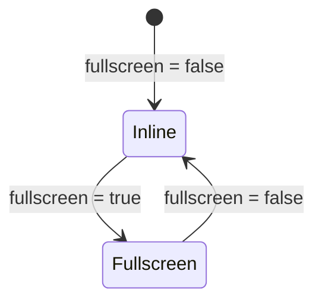

# In-place window (`WindowInplace`)

## Overview

`WindowInplace` (`libs/ui/src/window-inplace/WindowInplace.svelte`) is a reusable in-place block window frame with a header bar (icon, title, right-aligned toolbar controls), a body region, an optional footer slot, and an editor-scoped fullscreen overlay mode (`fullscreen={true}`). [`MermaidEditor`](htmd-editor/mermaid.md) uses `WindowInplace` as its outer block frame across inline and fullscreen views.

## Design

### Public API

| Prop | Type | Default | Purpose |
| --- | --- | --- | --- |
| `title` | `string \| Snippet` | `undefined` | Header title text or snippet. |
| `icon` | `Snippet` | `undefined` | Icon rendered before the title. |
| `fullscreen` | `boolean` (`$bindable`) | `false` | Expands the window to fill the enclosing `[role="region"]` or `.editor-container`. |
| `toolbar` | `Snippet` | `undefined` | Toolbar controls rendered on the right side of the header. |
| `footer` | `Snippet` | `undefined` | Optional footer rendered below the body (e.g. error bar). |
| `children` | `Snippet` | — | Main window body content. |
| `class` | `string` | `undefined` | Caller class overrides merged onto the root container. |
| `bodyClass` | `string` | `undefined` | Caller class overrides merged onto the body container. |

### Layout

```text
+-------------------------------------------------------------------+
| [icon] Title                                         [Toolbar...] |
+-------------------------------------------------------------------+
| Body content                                                      |
+-------------------------------------------------------------------+
| Optional footer                                                   |
+-------------------------------------------------------------------+
```

### State and Data Flow



### Behavior

- **Inline mode**: Renders as a bordered block card (`rounded-lg border border-border bg-card`) inside the document flow.
- **Fullscreen mode**: When `fullscreen={true}`, measures the enclosing `[role="region"]` or `.editor-container` via `ResizeObserver` and locks its scroll overflow while fixed over the editor pane.
