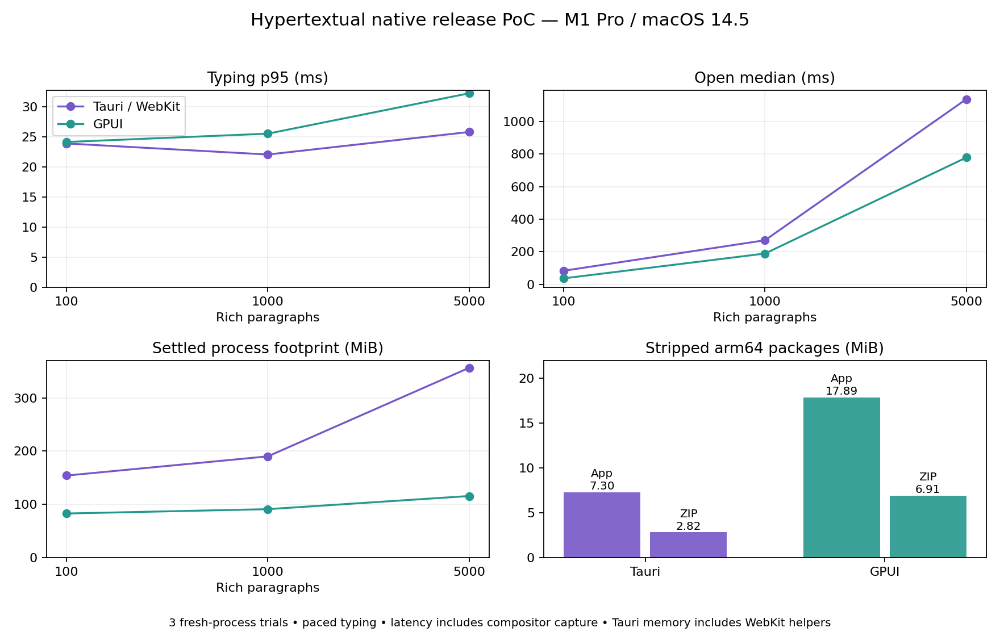

# Framework evaluation for Hypertextual

This evaluation separates measurements of this PoC from a judgment about building the product. The target is one file-based application with rich HTMD notes, NBMD notebooks, DBMD tables/databases, downloadable plugins, and desktop, browser and mobile distribution. A renderer alone does not provide kernels, a formula engine, synchronization or a plugin sandbox.

## Measurements

Native release results, app package sizes and reproducible commands are recorded below. The raw data is in `artifacts/performance/`. Earlier per-block editor numbers are obsolete. Browser Chromium/WebKit numbers are useful diagnostic evidence but are not measurements of the shipped desktop apps.

The release comparison uses the same MacBookPro18,1 / M1 Pro, 16 GiB, macOS 14.5, the same display and 1240×840 content windows, and identical temporary vaults. Each trial starts a fresh process, opens 100 / 1,000 / 5,000 rich paragraphs, types 33 characters, moves the caret 24 times, scrolls 12 times, then opens a custom chart. Three trials alternate framework order. Open timings start at mouse-up dispatch, after the driver positions the pointer and presses the mouse button. File caches and system frameworks are warm; this is not a cold-disk benchmark. The computer is a working development machine rather than an isolated lab. The two editors retain their PoC layouts and typography; they render the same content but are not pixel-identical implementations. Switching files includes saving the previously edited note, so the chart switch also exposes long-note serialization/save costs.

An opt-in 16×16 marker changes in the same view update as document changes. An external Swift driver posts macOS input and polls the marker using compositor window capture. This includes input delivery, application work, scheduling and capture overhead. It is an **observed input-to-visible-update** measurement, not physical key-to-photon latency and not a sustained FPS measurement. The capture cost is retained. Marker creation/painting is extra benchmark work; it is disabled during ordinary runs. Navigation and scrolling change the marker after their update; open waits for the new editor marker. Startup includes process launch to the first captured note frame. Typing is paced with a 60 ms pause after each update at the beginning of a note; this is not maximum throughput, random-position editing, large paste, undo or IME testing. CPU percentages convert Mach absolute-time counters using the machine timebase; 100% represents one fully occupied core.

Memory uses macOS `proc_pid_rusage` physical footprint. Tauri totals its Rust process and freshly launched WebKit content/GPU/network helpers; using only its Rust process would be misleading. Raw per-process footprints and RSS are retained. Helper attribution uses newly created WebKit PIDs at launch, not parent PID, because XPC helpers have launchd as their parent. The files list those PIDs. This is process-attributed memory, not a guarantee about total system RAM saved. The sampled peak is not a guaranteed instantaneous peak. The chart is opened after the long-note workloads, so its memory includes retained caches.

Bundle sizes are measured on stripped arm64 release executables, standard macOS `.app` layouts, and ZIP archives. Tauri is packaged by its CLI; GPUI is assembled as a minimal `.app` with embedded Kit assets and an Info.plist. Both comparison copies are ad-hoc signed. They are not Developer-ID signed/notarized installers or universal binaries. macOS WebKit and other system frameworks are excluded from downloads. Neither package contains the vault, a Python environment, notebook packages, database engines or third-party plugins.

### Native release responsiveness and memory

| Rich paragraphs | Tauri open median | GPUI open median | Tauri typing p95 | GPUI typing p95 | Tauri footprint | GPUI footprint |
| --- | ---: | ---: | ---: | ---: | ---: | ---: |
| 100 | 83 ms | 37 ms | 23.9 ms | 24.1 ms | 154.1 MiB | 82.8 MiB |
| 1,000 | 271 ms | 189 ms | 22.1 ms | 25.5 ms | 190.1 MiB | 91.0 MiB |
| 5,000 | 1137 ms | 778 ms | 25.8 ms | 32.2 ms | 356.4 MiB | 115.6 MiB |

There are 99 typing, 72 navigation and 36 scroll samples per size/framework, with three opens per case. Warm startup median was 462 ms for Tauri and 329 ms for GPUI (only three launches each). The capture itself typically cost 2.7–2.9 ms, with p95 around 5–6 ms; do not treat small latency differences as a universal renderer advantage.

| 5,000-paragraph workload | Tauri | GPUI |
| --- | ---: | ---: |
| Caret navigation p95 | 23.8 ms | 23.5 ms |
| Scroll p95 | 29.5 ms | 25.9 ms |
| Sampled peak footprint | 381.3 MiB | 127.4 MiB |
| Typing CPU at driver cadence | 24.8 % | 16.5 % |
| CPU during 2-second post-open pause | 7.4 % | 0.9 % |

Switching from the edited 5,000-paragraph note to the chart took 1105 ms in Tauri versus 46 ms in GPUI. The chart's retained footprint was 317 versus 110 MiB; this includes preceding workloads. GPUI's memory and file-switch advantage is substantial in this implementation. Both editors have responsive paced typing; the data does not establish a blanket GPUI typing advantage.

The two-second pause includes deferred post-open work and is not a long-term quiescent idle/battery test. No GPU utilization, energy consumption or sustained FPS measurement was made. The native result does not erase the slower headless WebKit test: that test uses a development server, faster/burst input and both document ends, and measures beforeinput-to-rAF rather than compositor-visible presentation. Those are different workloads. Large paste, edits throughout the document and device-specific IME remain acceptance tests.



### Release package sizes

| Package metric | Tauri | GPUI |
| --- | ---: | ---: |
| Release executable before stripping | 10.24 MiB | 22.92 MiB |
| Stripped executable | 7.28 MiB | 17.88 MiB |
| Installed `.app` file bytes | 7.30 MiB | 17.89 MiB |
| ZIP download | 2.82 MiB | 6.91 MiB |

The production web assets total 1.56 MiB uncompressed and 492 KiB with gzip, including HTML, JavaScript and CSS. This is a potential website asset transfer, not a complete browser runtime download. No GPUI WASM package was built. ZIP sizes include package metadata. Runtime timing uses the original release executables; stripping is applied only to the package comparison copies and removes symbols rather than changing application behavior.

Reproduce the release measurements with:

```sh
mise run build:release
mise run bench:sizes
mise run bench:desktop
```

The optional chart is regenerated by `python3 scripts/performance-chart.py` with matplotlib installed. Native automation requires existing macOS event-posting and screen-capture permissions and uses temporary vaults. Functional validation passed 15 Rust tests and 22 browser tests; six native benchmark trials also verified persisted input.

## Product implementation effort

| Area | Tauri + web UI | GPUI + gpui-kit | Assessment |
| --- | --- | --- | --- |
| HTMD rich editing | Tiptap supplies selection, history, input handling and extensible node views; Helical supplies typography and chart presentation. | Kit supplies controls and code editors, but this continuous rich Markdown editor owns projection, source mapping, shaping, caret movement, selection and IME handling. | Web UI is less work for the intended editor. |
| HTMD custom nodes | A renderer can use an existing React component inside a Tiptap node view. | Each custom view needs native layout/painting or a matching Kit component, plus integration with document input. | Web UI has a faster path for diverse components. |
| NBMD notebook UI | Existing web code editors, charts, tables and rich MIME outputs fit naturally; cells can use ordinary web components. | Code editing is available, but notebook cell coordination and arbitrary rich output viewers need native implementations. | Web UI is likely quicker; GPUI may suit a tightly limited set of output types. |
| NBMD execution | Desktop Rust can manage a separate kernel; browser/mobile need a compatible local runtime or a remote execution service. | The same choices apply. A native renderer does not make local Python available in a browser or phone. | Neither framework solves kernel semantics or dependency management. |
| DBMD table/database views | Existing grids provide row/column virtualization, selection and editing; separate formula and query engines still need integration. | Kit has table and data-table components, so basic tables are practical. Spreadsheet selection, formulas, paste/fill, multiple views and rich cell editors remain product work. | Web UI likely wins on feature breadth and speed of implementation. |
| DBMD very large data | Virtualization and worker/server computation are necessary. | Virtualized native tables and Rust computation can offer a strong path. | Requires a real DBMD workload; paragraph benchmarks cannot settle this. |

The present native rich editor has roughly 1,930 lines across its editor modules, excluding tests. The corresponding web editor integration, custom chart, slash menu and Markdown adapters have roughly 330 lines, excluding dependencies and styles. These are evidence of code we own, **not** a measure of total framework size or proof of developer productivity. Both prototypes reuse the same Rust vault code.

Tiptap explicitly supports custom extensions and interactive nodes ([custom extensions](https://tiptap.dev/docs/editor/extensions/custom-extensions)). AG Grid documents virtualization of rows and columns ([DOM virtualization](https://www.ag-grid.com/javascript-data-grid/dom-virtualisation/)); this establishes an available implementation option, not a measured DBMD result. JupyterLab exposes notebook and kernel extension interfaces ([extension points](https://jupyterlab.readthedocs.io/en/4.4.x/extension/extension_points.html)). Pyodide is a browser Python runtime with its own deployed runtime and packages ([deployment guide](https://pyodide.org/en/stable/usage/downloading-and-deploying.html)). Their sizes and performance are not included in this PoC.

## Desktop, browser and mobile distribution

**The web UI has the lower-risk path across all three targets.** Tauri packages the frontend for desktop and iOS/Android, and the same React frontend can be served separately as a website. A browser deployment still needs a different vault/storage adapter: Tauri IPC and unrestricted desktop file paths do not work there. An IndexedDB/OPFS or server-backed vault, import/export and synchronization need explicit design. Mobile needs touch navigation, safe areas, keyboard handling and sandbox/document-provider integration. The current PoC has not implemented or tested those adaptations.

Tauri documents desktop and mobile distribution ([distribution](https://v2.tauri.app/distribute/)) and uses platform WebViews rather than bundling a browser ([project](https://github.com/tauri-apps/tauri)). This helps package size, but also means behavior/performance differ across WebKit, Android System WebView, WebView2 and WebKitGTK. macOS results cannot predict Android, Windows or Linux results.

**GPUI-kit can target web and mobile, but that is not equivalent to shipping this editor on them.** Its WebAssembly guide says the supported use is primarily trying components in a browser and that full application distribution has not been validated as mature. It requires a WASM entry point, JavaScript loader, browser GPU/font handling and browser-specific storage ([WebAssembly guide](https://github.com/longbridge/gpui-kit/blob/main/website/docs/webassembly.md)). The mobile guide identifies desktop as its primary target and describes experimental native-host integration with limited validated scenarios, rather than a complete mobile application framework ([mobile guide](https://github.com/longbridge/gpui-kit/blob/main/website/docs/mobile.md)). Our custom rich input surface is outside that validated chat/component scenario. Touch selection, soft keyboards, accessibility, lifecycle and font coverage would need direct validation.

No GPUI WASM bundle, iOS package, Android package or physical-device performance measurement was produced for this evaluation. Those targets remain unmeasured, and no size or mobile latency number should be inferred from the Mac binaries.

## Plugin system

For an Obsidian-style ecosystem where users install plugins that add commands, panels and custom document components, **the web UI is easier**. JavaScript/TypeScript plugins can register commands and React/Tiptap renderers, reuse web libraries, and share most UI code between desktop and browser. Mobile plugins can share that API, subject to platform packaging and execution constraints. This is a product plugin architecture to build; Tauri's native plugin mechanism is not automatically an Obsidian plugin loader.

Tauri's plugins expose Rust and platform-native functionality and have mobile implementations ([plugin development](https://v2.tauri.app/develop/plugins/)). Its permissions are enforced at window/WebView boundaries ([runtime authority](https://v2.tauri.app/security/runtime-authority/)). Loading multiple plugins into the same page does **not** give them separate isolation. Trusted UI plugins may run in-process; untrusted code needs a separate worker/iframe/process or WASM boundary, plus a restricted host API. A worker cannot directly render a React node view, so arbitrary UI and sandboxed computation need distinct integration paths. The present CSP also needs a deliberate plugin loading policy.

GPUI is straightforward for built-in Rust extensions compiled with the app. Downloadable plugins are a larger job: define a runtime, host API, stable interfaces, error isolation and rendering contract. A WASM plugin can supply transformations, commands or notebook/data computations; adding arbitrary new GPUI widgets requires host-supported declarative views or a rendering interface rather than just loading a native Rust component. JavaScript plugins would similarly need an embedded JS runtime and bindings. This makes broad third-party UI extensibility harder than using the web platform directly.

WASM is a plausible common **compute** plugin layer for either choice. Wasmtime provides a host/component plugin model ([plugin example](https://docs.wasmtime.dev/wasip2-plugins.html)); browser execution uses a browser-compatible loading path rather than embedding the desktop Wasmtime runtime. This is an architectural option, not an implemented or measured plugin system here.

A practical first SDK would expose `registerCommand`, `registerNodeRenderer`, `registerSlashItem` and `registerPanel`, schema/version validation and narrowly scoped document operations. Separate the document model (content, transactions and serialization), UI registrations (panels and renderers), and platform services (vault access and execution). Keep a versioned manifest with explicit capabilities and compatible SDK versions, and make disabling a plugin restore the fallback/source presentation rather than delete its data. Keep HTMD/NBMD/DBMD schemas independent of React and GPUI. Persist opaque unknown custom nodes losslessly, keep execution opt-in through an execution service, and define how plugins migrate older data. That preserves the option of another renderer without making every plugin depend on renderer internals.

## Decision

For broad HTMD components, notebooks, databases, downloadable UI plugins and browser/mobile distribution, start with the web UI and keep a shared Rust core behind a platform storage/execution adapter. Native speed can justify GPUI for a desktop-first product with a deliberately bounded plugin/output model, but should be weighed against the cost of owning rich editing and the unvalidated additional targets.

Neither framework is a substitute for a renderer-independent document specification, a correct incremental editor model, virtualized large data views, execution isolation or an explicit plugin API. The release measurements show comparable paced typing and a clear native memory/file-switch advantage. For the recommended web implementation, prioritize incremental serialization/save and large-document rendering, then validate burst input, paste, IME and mobile devices. Keep the earlier headless WebKit slowdown as a separate regression workload.
