# Keybindings

## Overview

Hypertextual uses a modal, keyboard-first interaction model powered by `WhichKey` and `ModalKeymap`. You can navigate between the Workspace Explorer sidebar and the Article editor, move across text and rich blocks, select text objects, yank/delete/paste notices and images, and trigger commands without leaving the keyboard.

The status bar at the bottom right of the Article pane displays the active preset and modal state (`helix · normal`, `helix · select`, `helix · insert`, or `helix · jump`). Pressing a prefix key (`Space`, `g`, `z`, `m`, `Ctrl-w`, `[`, `]`) in `normal` or `select` mode opens the `WhichKey` popup at the bottom right of the window; pressing `<leader>?` (`Space ?`) or `?` opens the searchable **Keybinding Explorer**.

---

## Modal States

```mermaid
stateDiagram-v2
  [*] --> Normal: Open existing article
  [*] --> Insert: Create new article ("New article" / Space n)
  Normal --> Insert: Click editable text or press i, a, I, A, o, O, c
  Normal --> Select: Press v or x
  Normal --> Jump: Press gw, Space j, or s (Vim)
  Select --> Normal: Press Escape, ;, y, d, p, P
  Select --> Insert: Press c, i, a
  Insert --> Insert: Escape closes active menu, overlay, or widget control first
  Insert --> Normal: Press Escape
  Jump --> Normal: Type jump badge or press Escape
```



| Mode | Badge | Entry | Behavior |
| --- | --- | --- | --- |
| **Normal** | `NORMAL` | Default when opening an existing article; press `Escape` from `insert` or `select` mode | Single-key motions, operators, and prefix menus are active. Unbound printable keys are blocked from mutating the document. `.ProseMirror` renders a block cursor (`[data-pm-modal-cursor]`). Node views (notices, images, link previews, code blocks, Mermaid diagrams) render clean reading chrome without form inputs or remove buttons. |
| **Select** | `SELECT` | Press `v` or `x` (`V` in Vim) in `normal` mode | Motions extend the active selection from its anchor across text and non-text blocks (`notice`, `imageNode`, `linkPreview`, `codeBlock`, `mermaid`, `urlMention`, `internalMention`). On a `mermaid` block, `select` mode reveals the Mermaid source lines alongside the bottom-right `PipWindow` preview so `x` and `j`/`k` select individual lines of Mermaid code. Selected text renders `[data-pm-modal-selection="select"]` and selected non-text nodes render `[data-pm-modal-node-selection="select"]`. |
| **Insert** | `INSERT` | Press `i`, `a`, `I`, `A`, `o`, `O`, `c`, click editable article text, or create a `New article` | Standard text typing, slash commands (`/`), internal mentions (`@`), the selection `BubbleMenu` toolbar, and node-view editing controls (`Notice title` input, `Notice type` select, `Code language` select, Mermaid source editor + bottom-right `PipWindow` preview, image `caption` input, and `Remove` buttons) are active. |
| **Jump** | `JUMP` | Press `gw`, `<leader>j` (`Space j`), or `s` (in Vim preset) | Overlays 2D home-row jump badges (`[data-which-key-jump-overlay]`) over visible interactive targets in both the Workspace Explorer tree and the Article pane. Typing a badge's characters focuses or activates that target and returns to `normal` mode. |

---

## Presets

Hypertextual defaults to the **Helix** preset (`storageKey="hypertextual"`) and supports switching live to **Vim** or **Kakoune** via `<leader>k`:

| Chord | Command ID | Preset | Grammar Summary |
| --- | --- | --- | --- |
| `Space k h` | `preset.helix` | **Helix** (Default) | Selection-first (`motion` selects -> `operator` acts). `x` selects and extends full lines/blocks, `;` collapses selection, `U` redoes, `gw` starts Jump Mode, `z` opens View menu. |
| `Space k v` | `preset.vim` | **Vim** | Operator-motion and Visual mode (`v` charwise visual, `V` linewise visual, `G` document end, `s` Flash/Sneak jump, `Ctrl-r` redo, `z` View menu). |
| `Space k k` | `preset.kakoune` | **Kakoune** | Selection-first object-verb (`x` selects line/block, `;` reduces selection to cursor, `v` opens View menu, `V` locks View menu, `gk`/`gj` buffer top/bottom, `ga` previous location, `U` redoes). |

---

## Leader Menu (`Space`) & Workspace Commands

`WhichKey` does **not** hardcode numbered pane slots (`Focus Pane 1..9`) into the `<leader>` menu. Instead, `<leader>` (`Space`) exposes semantic workspace, explorer, window, goto, view, and preset actions:

| Key Sequence | Command ID | Label | Description |
| --- | --- | --- | --- |
| `Space ?` / `?` | `whichKey.openExplorer` | Explore Keybindings | Open the fuzzy-searchable Keybinding Explorer modal |
| `Space e` / `Ctrl-e` | `workspace.toggleExplorer` | Toggle Explorer | Toggle the Workspace Explorer sidebar open or closed (focusing the Workspace Explorer tree when opened, and returning focus to the Article editor when closed) |
| `Space n` | `workspace.newArticle` | New Article | Create a new untitled article and open it in `insert` mode |
| `Space N` | `workspace.newFolder` | New Folder | Create a new folder and start inline naming in the Workspace Explorer |
| `Space t o` | `settings.togglePaneOutline` | Toggle Pane Outline | Toggle the purple focus outline around the active Workspace or Article pane (persisted in `localStorage`, enabled by default) |
| `Space t c` | `settings.toggleClickToInsert` | Toggle Click to Insert | Toggle whether clicking in the Article editor enters `insert` mode or moves the `normal` mode cursor (persisted in `localStorage`, enabled by default) |
| `Space t d` | `settings.cycleThemeMode` | Cycle Theme Mode | Cycle between `system`, `light`, and `dark` theme modes (persisted in `localStorage`, defaults to `system`) |
| `Space w` | `+window` | Window / Pane | Open the spatial window/pane menu (proxies `Ctrl-w`) |
| `Space j` | `jump.start` | Jump to Element | Overlay 2D jump labels across visible workspace and article targets |
| `Space g` | `+goto` | Goto | Open the Goto menu (proxies `g`) |
| `Space v` | `+view` | View / Scroll | Open the View / Scroll menu (proxies `z` in Helix/Vim, `v` in Kakoune) |
| `Space k` | `+preset` | Keybinding Preset | Open the preset switcher (`h` Helix, `v` Vim, `k` Kakoune) |
| `Space m f` | — | Toggle Mermaid Fullscreen | When a `mermaid` block is highlighted in `normal` mode, open or close the editor-scoped Mermaid Fullscreen Viewer |

---

## Pane Switching & Workspace Explorer Navigation

Hypertextual registers two spatial panes:

- **Workspace** (`paneId="workspace"`): The left sidebar containing the Workspace Explorer file tree.
- **Article** (`paneId="article"`): The main content pane containing the `HtmdEditor`.

### Cross-Pane Navigation

| Key Sequence | Command ID | Behavior |
| --- | --- | --- |
| `Space e` / `Ctrl-e` | `workspace.toggleExplorer` | Toggle the Workspace Explorer sidebar open or closed. When opening, focuses the selected or first `[role="treeitem"]` in the Workspace Explorer (or `New article` if the workspace is empty). When closing, returns focus to the Article editor. |
| `Ctrl-w h` / `Space w h` / `Ctrl-w ←` | `pane.left` | Move focus to the pane on the left (`Workspace` sidebar when expanded) |
| `Ctrl-w l` / `Space w l` / `Ctrl-w →` | `pane.right` | Move focus to the pane on the right (`Article` editor) |
| `Ctrl-w w` / `Space w w` | `pane.next` | Cycle focus to the next open pane (`Workspace` <-> `Article`) |
| `Ctrl-w W` / `Space w W` | `pane.prev` | Cycle focus to the previous open pane |
| `Ctrl-w s` / `Space w s` | `+sticky window` | Lock the Window menu open (`·lock`) for repeated pane commands until `Escape` |
| `Ctrl-o` | `jumplist.back` | Jump backward in the cross-pane Jumplist history |
| `Ctrl-i` | `jumplist.forward` | Jump forward in the cross-pane Jumplist history |

### Workspace Explorer Tree Keys (when `Workspace` pane is focused in `normal` mode)

| Key | Behavior |
| --- | --- |
| `j` / `↓` | Move focus to the next visible file or folder (`[role="treeitem"]`) |
| `k` / `↑` | Move focus to the previous visible file or folder (`[role="treeitem"]`) |
| `l` / `→` | Expand a collapsed folder, or move focus to its first child item |
| `h` / `←` | Collapse an expanded folder, or move focus to its parent folder |
| `gg` / `Home` | Jump to the first item in the file tree |
| `ge` / `G` / `End` | Jump to the last visible item in the file tree |
| `Enter` | Open the focused article in the Article pane (in `normal` mode) or toggle a folder |
| `a` | Create a new article inside the focused folder (or workspace root) |
| `A` | Create a new folder inside the focused folder (or workspace root) and begin inline naming |
| `r` / `F2` | Begin inline rename on the focused file or folder |
| `d` / `Delete` | Open the Delete confirmation dialog for the focused file or folder |
| `Escape` (while renaming) | Cancel inline file/folder rename and restore `normal` mode focus on the tree item |

---

## Article Editor Motions (`normal` & `select` modes)

Numeric counts (`2j`, `3w`, `5x`) prefix any motion or operator.

| Key Sequence | Command ID | Motion | Behavior on Text & Non-Text Nodes |
| --- | --- | --- | --- |
| `h` / `←` | `motion.left` | Move Left | Moves one character left. Stepping onto an inline atom (`urlMention`, `internalMention`) selects it in `normal` mode or extends the selection across it in `select` mode. |
| `l` / `→` | `motion.right` | Move Right | Moves one character right. Stepping onto an inline atom selects it in `normal` mode or extends the selection across it in `select` mode. |
| `j` / `↓` | `motion.down` | Move Down | Moves to the same column on the next line or block. Stepping onto a compound or atom block (`notice`, `codeBlock`, `imageNode`, `linkPreview`, `horizontalRule`, `unparsedBlock`) highlights the whole block (`NodeSelection`) in `normal` mode or extends the range selection across the block in `select` mode. |
| `k` / `↑` | `motion.up` | Move Up | Moves to the same column on the previous line or block, highlighting compound/atom blocks as a whole in `normal` mode and preserving selection anchors in `select` mode. |
| `Enter` | — | Enter Compound Block | When a compound block (`notice`, `codeBlock`, `image`, `linkPreview`) is highlighted as a whole block in `normal` mode, enters the block's interior (`insert` mode) and focuses its primary control (`Notice title` input, `Code language` selector, `Image caption` input, or preview action). Inside the block, `Tab` / `Shift+Tab` (and `ArrowDown` / `ArrowUp`) cycles through header controls and body text, and `Escape` returns to the whole-block highlight in `normal` mode. |
| `w` | `motion.wordForward` | Next Word | Moves to the start of the next word (in Helix `normal` mode, selects the word moved over; in `select` mode, extends selection). |
| `b` | `motion.wordBackward` | Previous Word | Moves to the start of the previous word. |
| `e` | `motion.wordEnd` | Word End | Moves to the end of the current/next word. |
| `0` / `gh` | `motion.lineStart` | Start of Line | Moves to the first character of the current line or start of the current block. |
| `$` / `gl` | `motion.lineEnd` | End of Line | Moves to the last character of the current line or end of the current block. |
| `{` / `[p` | `motion.paragraphBackward` | Previous Block | Jumps to the previous top-level block (paragraph, heading, notice, code block, image, or link preview). |
| `}` / `]p` | `motion.paragraphForward` | Next Block | Jumps to the next top-level block. |
| `gg` / `gk` (Kakoune) | `motion.docStart` | Document Top | Moves to the start of the first block in the article. |
| `ge` / `gb` / `G` (Vim) / `gj` (Kakoune) | `motion.docEnd` | Document End | Moves to the end of the last block in the article. |
| `gw` / `Space j` / `s` (Vim) | `jump.start` | 2D Jump Labels | Enters `jump` mode and overlays 2D home-row labels on visible blocks and controls. |

---

## Selection & Text Objects (`v`, `x`, `m`)

### Selection Commands

| Key Sequence | Command ID | Behavior |
| --- | --- | --- |
| `v` | `mode.toggleSelect` | Toggle between `normal` mode and `select` (visual) mode |
| `x` / `V` (Vim) | `motion.lineSelect` | Select the current text line or non-text block (`imageNode`, `linkPreview`, `horizontalRule`); pressing `x` again extends the selection to include the next line or block |
| `;` | `selection.collapse` | Collapse the active selection to a single cursor head and return to `normal` mode |
| `Alt-;` / `mm` (Helix) | `selection.flip` | Swap the selection `anchor` and `head` |
| `C` | `selection.addCursorBelow` | Add a secondary cursor/selection on the next line or block |
| `,` | `selection.keepPrimary` | Clear all secondary cursors and keep only the primary selection |

### Text Objects (`m i <obj>` & `m a <obj>`)

| Key Sequence | Command ID | Target | Behavior |
| --- | --- | --- | --- |
| `m i w` | `textObject.iw` | Inner Word | Selects the word under the cursor without surrounding whitespace |
| `m a w` | `textObject.aw` | Around Word | Selects the word under the cursor including trailing (or leading) whitespace |
| `m i p` | `textObject.ip` | Inner Paragraph | Selects the text inside the current paragraph or heading |
| `m a p` | `textObject.ap` | Around Paragraph | Selects the entire paragraph/heading block node |
| `m i c` | `textObject.ic` | Inner Code Block | Selects the code text inside the enclosing `codeBlock` |
| `m a c` | `textObject.ac` | Around Code Block | Selects the entire `codeBlock` node `[pos, pos + nodeSize]` including its language attribute and decorates it with `[data-pm-modal-node-selection]` |
| `m i m` | `textObject.im` | Inner Mermaid Block | Selects the Mermaid source text inside the enclosing `mermaid` block |
| `m a m` | `textObject.am` | Around Mermaid Block | Selects the entire `mermaid` block node `[pos, pos + nodeSize]` and decorates it with `[data-pm-modal-node-selection]` |
| `m i n` | `textObject.in` | Inner Notice | Selects the body text inside the enclosing `notice` while preserving the notice container, variant, and title |
| `m a n` | `textObject.an` | Around Notice | Selects the entire outer `notice` block node `[pos, pos + nodeSize]` (including its `variant` and `title` attributes) and decorates `.editor-notice-node` with `[data-pm-modal-node-selection]` |
| `m i l` | `textObject.il` | Inner List Item | Selects the text content of the current list item |
| `m a l` | `textObject.al` | Around List Item | Selects the entire list item node |

---

## Operators & Non-Text Node Support (`y`, `d`, `c`, `p`, `P`, `u`, `U`)

All operators work uniformly on inline text selections, textblocks, and non-text nodes (`notice`, `imageNode`, `linkPreview` bookmark/YouTube embeds, `codeBlock`, `urlMention`, `internalMention`):

| Key | Command ID | Operator | Text Selection Behavior | Non-Text Node Behavior (`notice`, `imageNode`, `linkPreview`, `codeBlock`, mentions) |
| --- | --- | --- | --- | --- |
| `y` | `operator.yank` | **Yank** | Copies the selected text `Slice` into the modal register, writes plain text to the system clipboard, emits `helical:yank`, and collapses to `normal` mode. | Copies the full block/atom `Slice` (preserving `notice` `variant`/`title`, `imageNode` `src`/`alt`/`title`, `linkPreview` metadata) into the modal register, serializes a non-empty Markdown fallback (`> [!VARIANT] Title`, ``, URL) to the clipboard so `onYank` fires, and returns to `normal` mode. |
| `d` | `operator.delete` | **Delete** | Deletes the selected text range, stores its `Slice` in the modal register, and triggers autosave. | Deletes the entire selected block/atom node (`imageNode`, `linkPreview`, or `notice` when selected via `m a n` or visual block selection) **without leaving an empty notice or block shell behind**, stores the full node `Slice` in the register, and positions the cursor on the adjacent block. |
| `c` | `operator.change` | **Change** | Deletes the selected text range, stores it in the register, and enters `insert` mode at the deletion point. | Replaces the selected block/atom node with an empty paragraph, stores the removed node in the register, and enters `insert` mode inside the new paragraph. |
| `p` | `operator.pasteAfter` | **Paste After** | Inserts inline register content after the cursor/selection. | When the register holds a closed block slice (`notice`, `imageNode`, `linkPreview`, `codeBlock`, or full line/paragraph), inserts the block **after the current top-level block** instead of splitting the current paragraph mid-line. |
| `P` | `operator.pasteBefore` | **Paste Before** | Inserts inline register content before the cursor/selection. | When the register holds a closed block slice, inserts the block **before the current top-level block**. |
| `u` | `operator.undo` | **Undo** | Undoes the last editor transaction and persists via autosave. | Restores deleted/changed notices, images, link previews, and attributes intact. |
| `U` / `Ctrl-r` (Vim) | `operator.redo` | **Redo** | Redoes the last undone editor transaction. | Reapplies undone block insertions, deletions, or attribute edits. |
| `i` | `operator.insertStart` | **Insert before** | Collapses selection to its start and enters `insert` mode. | On an atom block (`imageNode`, `linkPreview`), enters `insert` mode at the nearest valid position before the node. |
| `a` | `operator.appendEnd` | **Append after** | Collapses selection to its end (or moves one char right) and enters `insert` mode. | On an atom block, enters `insert` mode after the node. |
| `o` | `operator.openBelow` | **Open line below** | Inserts a new empty paragraph below the current block (or after the enclosing `notice` / `imageNode` / `linkPreview`) and enters `insert` mode. | Opens a new paragraph directly below the selected `notice`, `imageNode`, or `linkPreview` and enters `insert` mode. |
| `O` | `operator.openAbove` | **Open line above** | Inserts a new empty paragraph above the current block and enters `insert` mode. | Opens a new paragraph directly above the selected `notice`, `imageNode`, or `linkPreview` and enters `insert` mode. |

---

## View / Scroll (`z` / `v`) & Unimpaired (`[` / `]`)

### View Menu (`z` in Helix/Vim, `v` in Kakoune, or `Space v`)

| Key Sequence | Command ID | Description |
| --- | --- | --- |
| `zz` / `zc` / `vv` (Kakoune) / `gc` | `view.center` | Scroll the active pane so the cursor or focused item is vertically centered |
| `zt` / `vt` (Kakoune) | `view.top` | Align the cursor or focused item to the top of the viewport |
| `zb` / `vb` (Kakoune) | `view.bottom` | Align the cursor or focused item to the bottom of the viewport |
| `zj` / `vj` (Kakoune) / `Ctrl-d` | `view.scrollDown` | Scroll the active pane down |
| `zk` / `vk` (Kakoune) / `Ctrl-u` | `view.scrollUp` | Scroll the active pane up |
| `Z` (Helix) / `V` (Kakoune) | `+sticky view` | Lock the View menu open (`·lock`) for repeated scrolling until `Escape` |

### Unimpaired Navigation (`[` & `]`)

| Key Sequence | Command ID | Description |
| --- | --- | --- |
| `[p` / `]p` | `motion.paragraphBackward` / `Forward` | Jump to previous / next block or paragraph |
| `[s` / `]s` | `section.prev` / `next` | Jump to previous / next heading section |
| `[f` / `]f` | `focus.prevBlock` / `nextBlock` | Move DOM focus to previous / next interactive control in the active pane |
| `[ Space` / `] Space` | `operator.openAbove` / `openBelow` | Insert a blank paragraph above / below the current block |

---

## Mermaid Diagram Editor & Viewer Shortcuts (`MermaidNode` & `MermaidNodeView`)

Fenced ```` ```mermaid ```` blocks use a dedicated `mermaid` block node (`MermaidNodeView.svelte`) separate from `codeBlock` (`mermaid` is disallowed as a `codeBlock` language).

| Context | Key Sequence | Behavior |
| --- | --- | --- |
| **All Modes (`normal`, `select`, `insert` — inline & fullscreen)** | `Ctrl-h` / `Ctrl-j` / `Ctrl-k` / `Ctrl-l` | Pan the active Mermaid diagram canvas left, down, up, or right (works even while typing in the Mermaid source editor or Fullscreen Split-Pane `Code` pane) |
| **All Modes (`normal`, `select`, `insert` — inline & fullscreen)** | `Ctrl-=` / `Ctrl--` / `Ctrl-0` | Zoom in (`+25%`), zoom out (`-25%`), or reset zoom and pan (`100%`) across all modes |
| **Normal Mode (inline `mermaid` block highlighted)** | `f` / `Space m f` | Open the editor-scoped **Fullscreen Viewer** filling the `HtmdEditor` pane (with `Edit` and `Minimize` header buttons) |
| **Normal Mode (inline `mermaid` block highlighted)** | `+` / `=` / `-` / `0` | Zoom in, zoom out, or reset zoom/pan inline without leaving `normal` mode |
| **Normal Mode (inline `mermaid` block highlighted)** | `H` / `J` / `K` / `L` | Pan the inline Mermaid diagram canvas left, down, up, or right while keeping `j`/`k` free for block navigation |
| **Normal Mode (inline `mermaid` block highlighted)** | `Enter` / `i` | Enter `insert` mode inside the Mermaid source editor (showing the live bottom-right `PipWindow` preview) |
| **Select Mode (`v` or `x` on a `mermaid` block)** | `x` / `j` / `k` | Switches to the Mermaid source + bottom-right `PipWindow` preview layout and selects or extends across individual lines of Mermaid code |
| **Insert Mode (inside a `mermaid` block)** | `Mod-Enter` / `Ctrl-Shift-f` | Open the editor-scoped **Fullscreen Split-Pane Editor** (`Code` pane on the left, interactive `Preview` pane on the right, with a `Minimize` button in place of Fullscreen) |
| **Fullscreen Viewer (`normal` mode)** | `h` / `j` / `k` / `l` / Arrow keys, `+` / `-` / `0` | Pan and zoom the fullscreen diagram canvas |
| **Fullscreen Viewer (`normal` mode)** | `Enter` / `i` | Transition directly into `insert` mode in the Fullscreen Split-Pane Editor |
| **Fullscreen Viewer / Split-Pane Editor** | `Escape` / `f` / `q` (Viewer) or `Escape` (Split-Pane) | Minimize fullscreen and return to the inline `mermaid` block |
| **Fullscreen Split-Pane Editor (`insert` mode)** | `Ctrl-w l` / `Ctrl-w h` / `Ctrl-w w` / `Tab` | Switch focus between the left `Code` pane and the right `Preview` pane (where single-key `h`/`j`/`k`/`l` and `+`/`-`/`0` are active) |

---

## `Escape` Priority Hierarchy

Pressing `Escape` always peels back the innermost temporary layer before changing the modal state:

1. **Keybinding Explorer (`WhichKeyExplorer`)**: Closes the `<leader>?` dialog and restores focus.
2. **Active Prefix Menu (`Space`, `g`, `z`, `m`, `Ctrl-w`) or `Jump` Mode (`gw`)**: Closes the `WhichKey` popup or cancels Jump badges and returns to `normal` mode.
3. **Open Floating Surface / Suggestion / Insertion Overlay**:
   - Closes an open `SlashMenu` (`/`), `MentionMenu` (`@`), `BubbleMenu` formatting toolbar, `CursorOverlay` (`ImageInput`, `BookmarkInput`, `YouTubeInput`), or Ark popup (`Select` dropdown, `ContextMenu`, `AlertDialog`) **while keeping the editor in its current mode**.
4. **Sidebar Inline Rename Input (`ArkTreeView.NodeRenameInput`)**: Cancels the in-progress file or folder rename, switches to `normal` mode, and focuses the tree item.
5. **NodeView Widget Input (`Notice title` or image `caption`)**: Commits the input value, transitions the editor from `insert` to `normal` mode, hides widget form controls, and restores focus to `.ProseMirror`.
6. **Editor `insert` Mode**: Transitions `.ProseMirror` from `insert` mode to `normal` mode (`data-modal-mode="normal"`), hides NodeView editing controls, and renders the modal block cursor (`[data-pm-modal-cursor]`).
7. **Editor `select` Mode**: Collapses the selection to its cursor head and transitions to `normal` mode.
