# Hypertextual app: rich articles that remain portable files

- Status: draft
- Owner: [person or team]
- Date: 2026-10-11
- Related ADRs: None authored yet.
- Design: [Hypertextual v0](../../designs/prototypes/hypertextual-v0/README.md)

## Summary

The initial target is a desktop app for rich Markdown editing with portable `.md` and `.htmd` articles.

Future plans include web-based hosting and shared drives for teams and organizations. Hypertextual also plans to offer documents as a service, so other apps can embed rich text documents with viewing and editing support.

## Problem and Evidence

## Users and Use Cases

## Goals

## Non-Goals

## Proposed Experience

The [interactive design](../../designs/prototypes/hypertextual-v0/index.html) demonstrates the main states. These snapshots show the proposed experience at 1120 × 640.

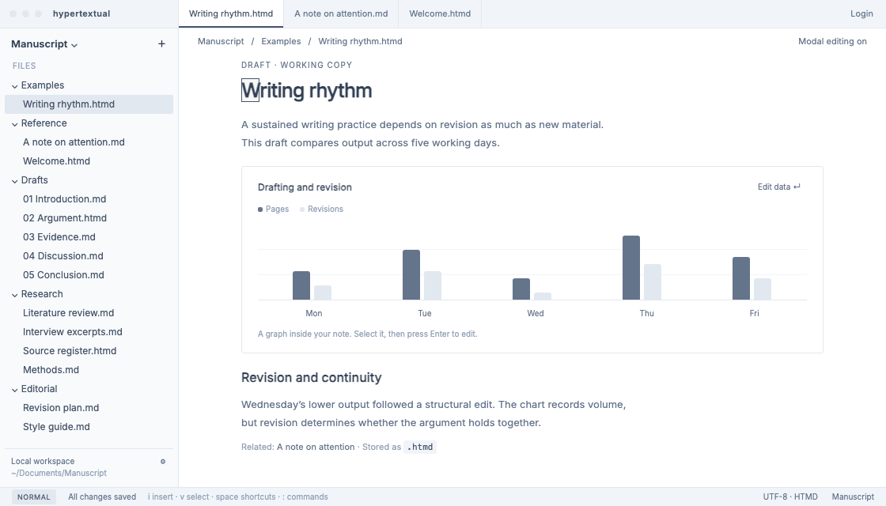

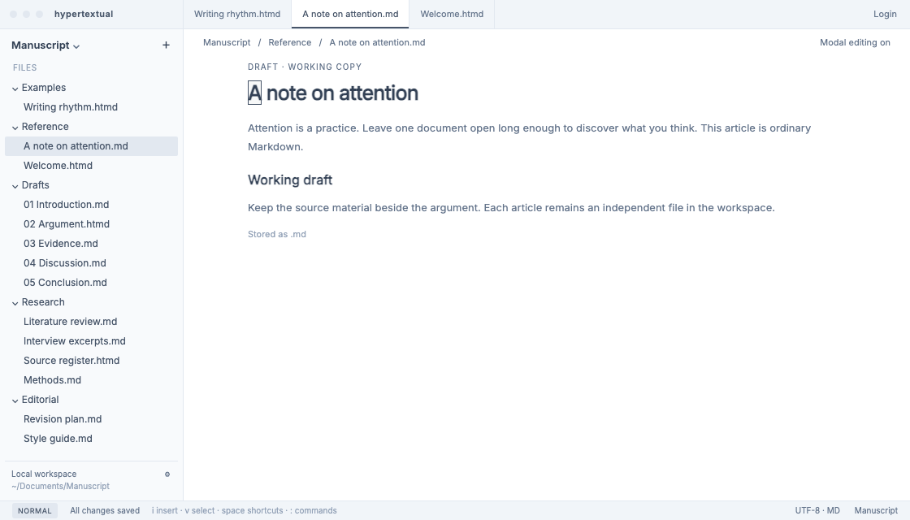

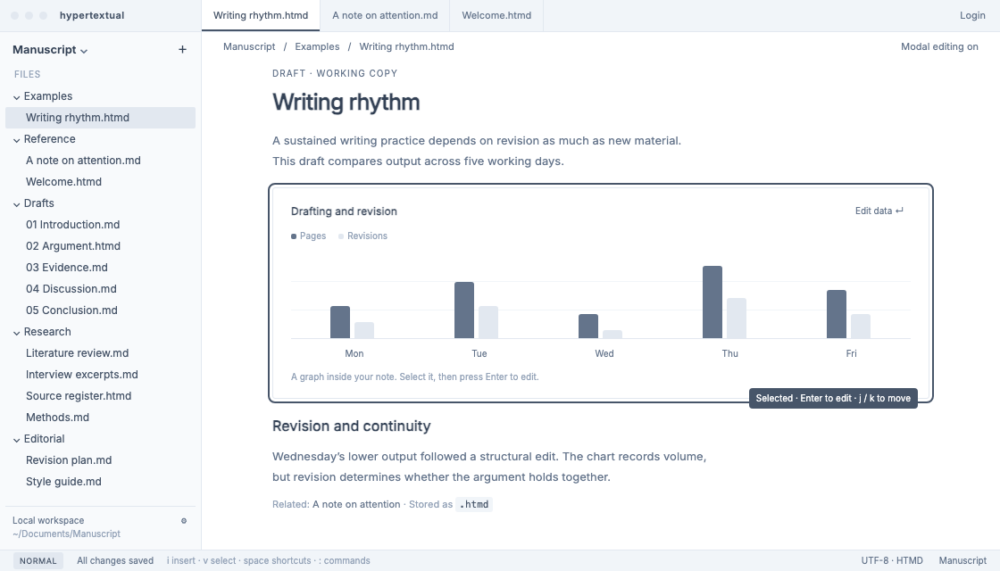

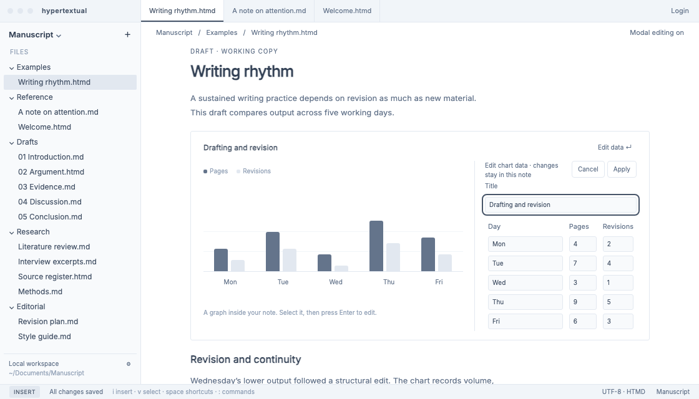

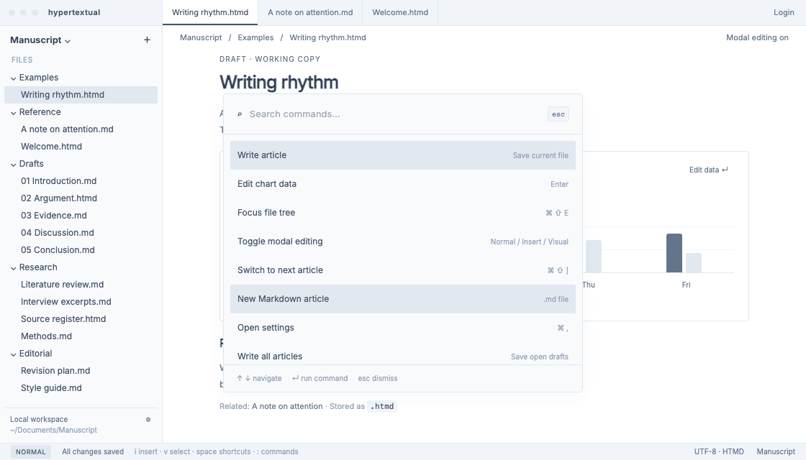

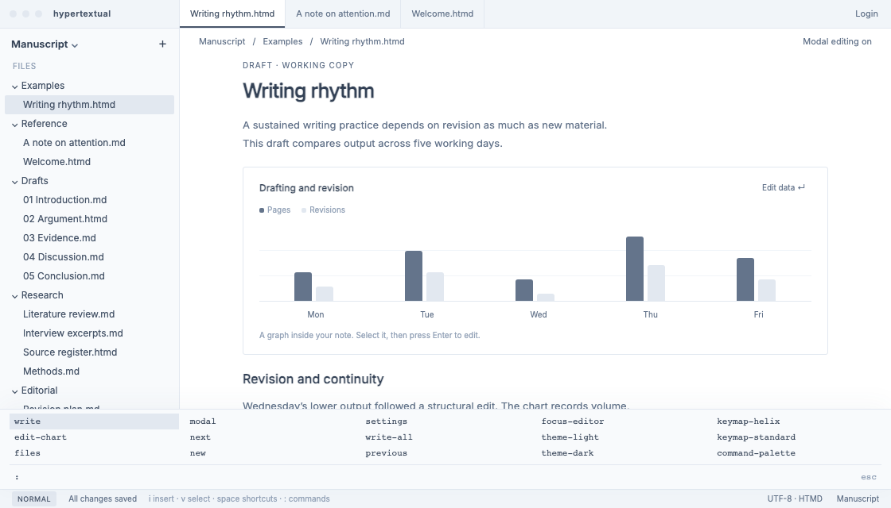

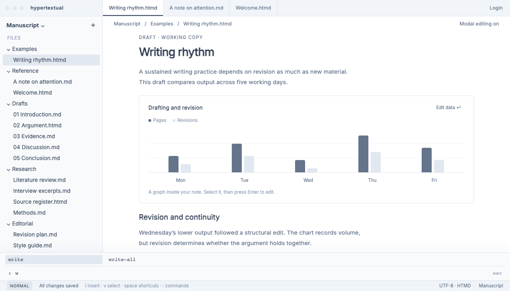

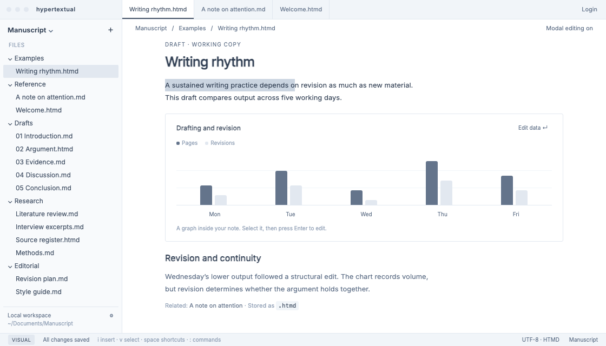

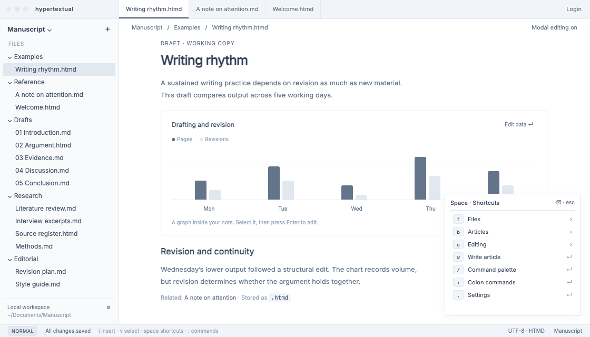

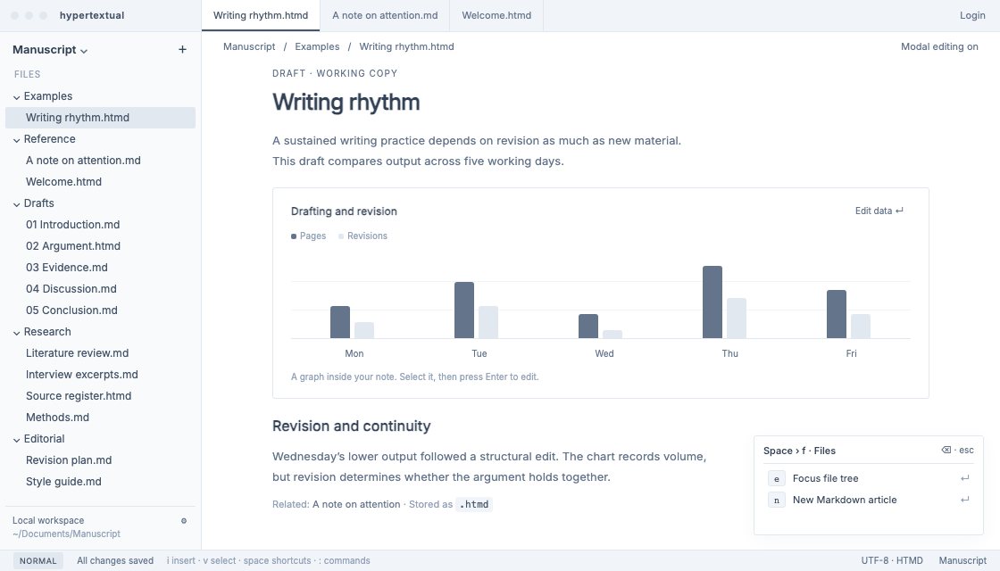

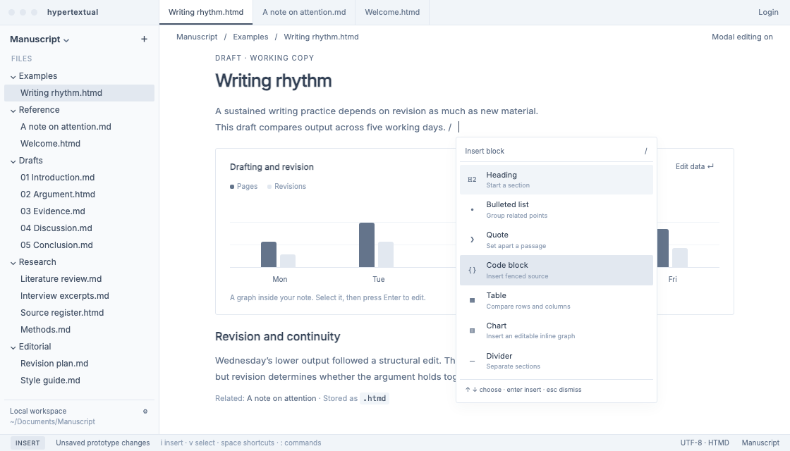

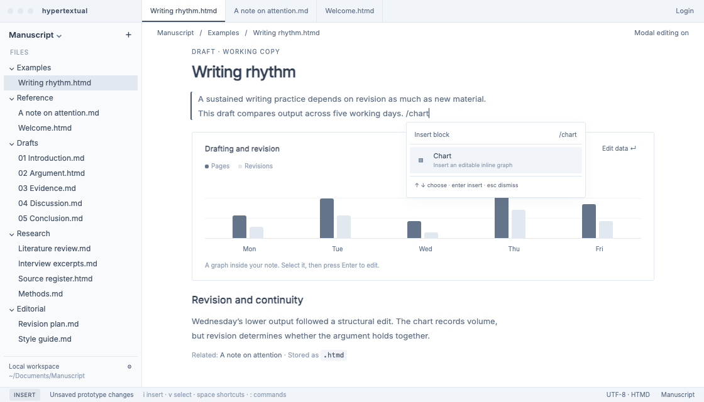

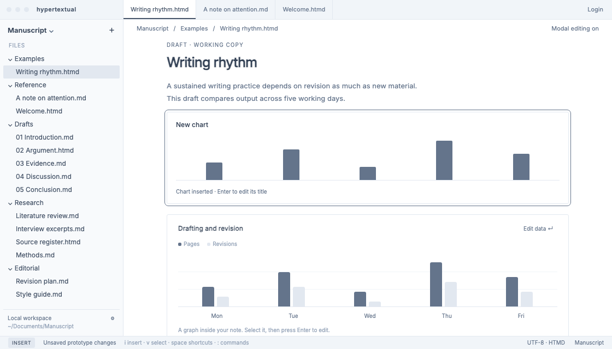

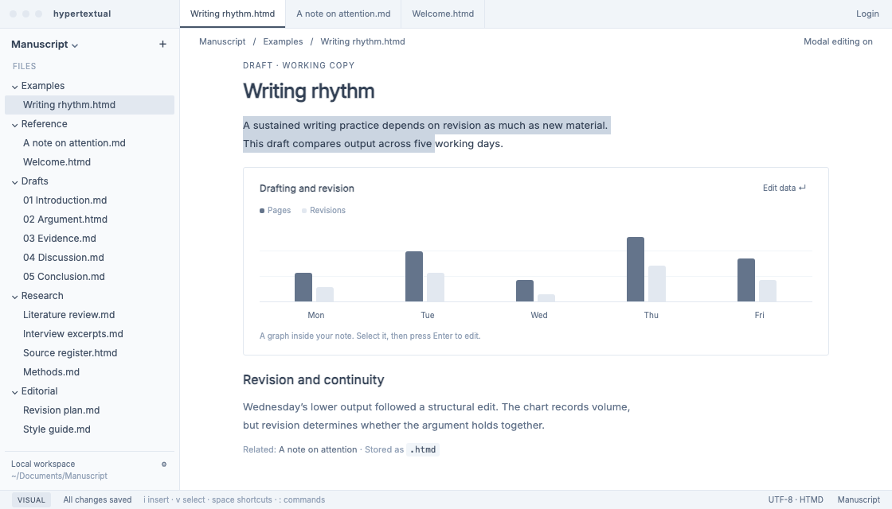

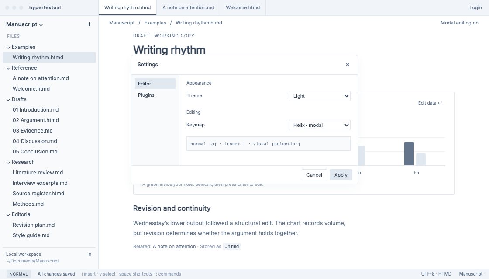

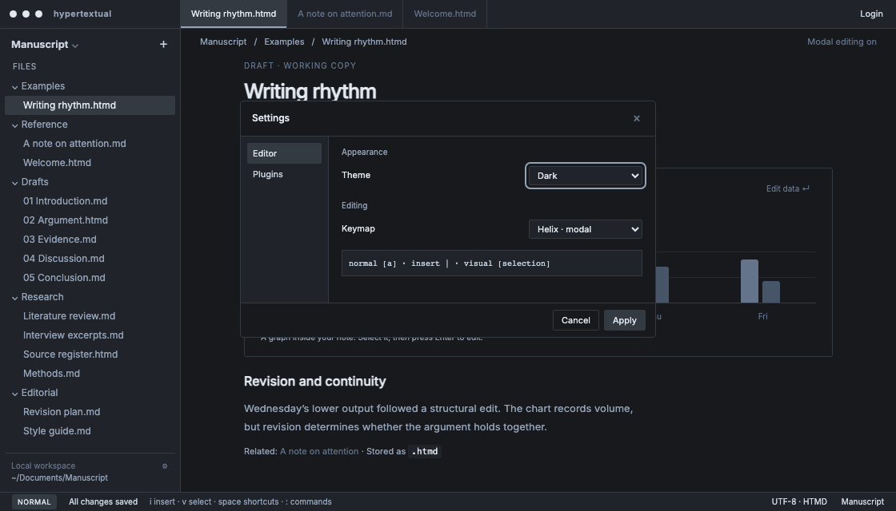

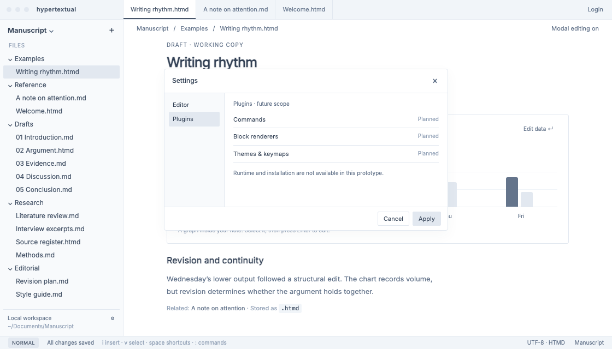

## Requirements

### R1. Rich Markdown first

Priority:

Acceptance:

### R2. File tree and article tabs

Priority:

Acceptance:

### R3. Selectable rich elements and inline editing

Priority:

Acceptance:

### R4. Complete keyboard navigation

Priority:

Acceptance:

### R5. Optional Helix-style modal editing

Priority:

Acceptance:

### R6. Command palette and bottom command menu

Priority:

Acceptance:

### R7. Portable `.md` and `.htmd` articles

Priority:

Acceptance:

### R8. Safe saves and source preservation

Priority:

Acceptance:

### R9. Space leader and which-key-style command discovery

Priority:

Acceptance:

### R10. Inline slash menu for block insertion

Priority:

Acceptance:

### R11. Settings for appearance and editing

Priority:

Acceptance:

### Future plugin scope in Settings

### Future account scope

## Success Measures

## Risks and Dependencies

## Open Questions

## Rollout

NA.
